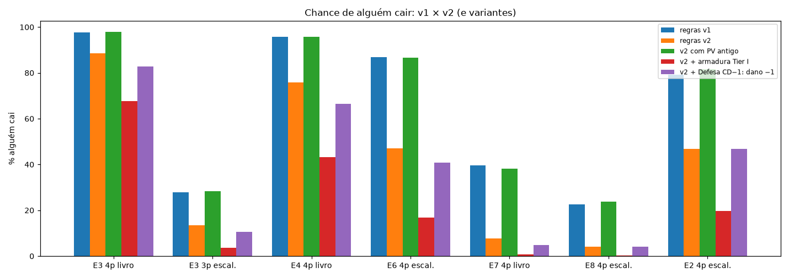
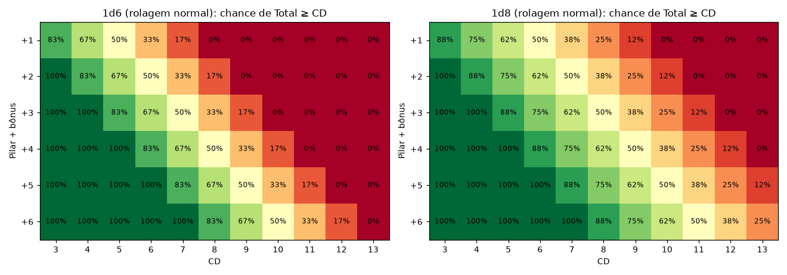
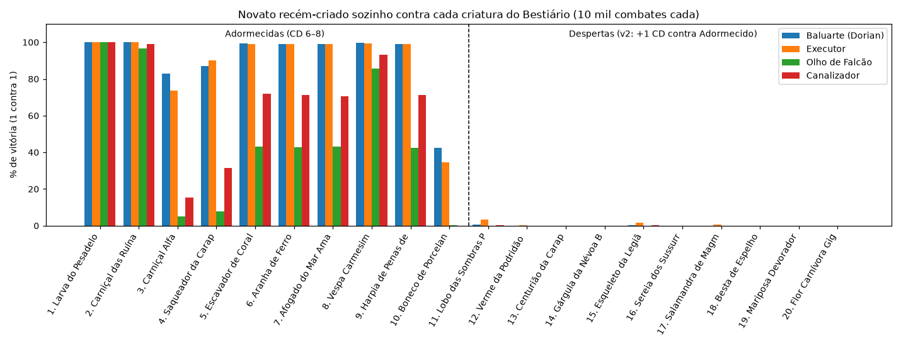

# Relatório de Rolagens e Equilíbrio — Shadow Slave RPG (regras v2)

*Simulador em `sim/ssrpg/` · probabilidades exatas por enumeração · Monte Carlo com 10.000 combates por cenário (976 cenários) · **padrão = regras v2** já aplicadas nos Livros 1–4; a coluna "v1" reproduz as regras antigas para comparação.*

## Resumo em 1 minuto

- **Testes ficaram jogáveis:** a CD Moderada agora é 7. Um novato passa em média em **31%** das 12 Subcategorias na CD 7 (antes, na Moderada 9: **8%**, e impossível em 9 de 12).
- **Combates ficaram menos letais sem ficar triviais:** 4 novatos contra os encontros escalados vencem **99%** (v1: 96%) e alguém cai em **18%** (v1: 38%). Contra os encontros como estão no livro (feitos para 7), vencem **84%** (v1: 64%); por isso o Livro 3 agora tem o **Orçamento de Ameaça**.
- **Rank acima virou rampa, não parede:** 4 novatos contra UMA criatura Desperta vencem em média **47%** (v1: 12%). Demônios e Diabos Despertos continuam quase invencíveis para novatos.
- **Teste extra do Jhonne:** 4 Adormecidos **saturados** (Marco 10, Memórias, 2 Ecos) vencem a ficha comum do Demônio Desperto em **100%**. O **Perfil de Chefe** nos livros agora é **CD 11, 3× PV, +1 de Dano** (desde 18/11/2026). Calibrado em 2× PV com fichas sem Aspecto, ele dava 22% na briga direta e 91–94% com plano. Com 3× PV e Coortes com Aspectos (pacote completo aplicado), a briga direta cai para cerca de **23%** e o plano fica em cerca de **93%** (seção 8.6). Sem Aspectos, o chefe de 3× PV vence 0% na briga direta e 42% com plano. O Derrubar revisado passou de 2% para 55% contra esse chefe (seção 7).

- **Rodada de Aspectos (só Inata + 1ª Habilidade, personagens Adormecidos):** os Aspectos mais fortes são Escravo das Sombras, Besta Lunar, Dançarino da Gravidade, Predador Silencioso, Senhor das Correntes. O Escravo das Sombras Adormecido não é um Aspecto de utilidade: o Manto (+1 em rolagens e +1 de Dano por Sombra, sem custo) leva a briga direta contra o Demônio chefe de 24% para 99%. Com "1 Sombra no Manto e sem +Dano", ele cai para 78% nos cenários duros e mantém o Batedor (seção 8).

## 1. Regras v2 aplicadas (resumo exato para repassar)

### 1.1 Escala de CDs de tarefa (Livro 1 §1.3)

| Dificuldade | CD v2 | CD v1 |
| :--- | :--- | :--- |
| Trivial | **3** | 5 |
| Fácil | **5** | 7 |
| Moderada (padrão) | **7** | 9 |
| Difícil | **9** | 11 |
| Extrema | **11** | 13 |
| Divina | **13** | 15 |

- CDs intermediárias para ajuste fino: **4, 6, 8, 10, 12**. **CD mínima: 3.**
- Toda CD **fixa de teste** dos livros (perícia, sobrevivência, ofício, ambiente) caiu **2 pontos**. Exemplos: primeiros socorros e estabilizar **CD 7** (**9** sem kit); Culinária **CD 5 + 1 por Rank** do ingrediente acima do cozinheiro; Iniciativa/CD de Reação **CD 7 ± 1 por Rank** (**9** contra inimigos muito velozes); Choque de Vontades **CD 7 ± 1 por Rank**; perseguição **CD 7 ± 1 por Rank**.
- **CDs de criatura não mudam** (CD da ficha = CD de combate contra o próprio Rank): Adormecida **6–8**, Desperta **9–10**, Caída **10–11**, Corrompida **12**, Grande **13+**. CDs de efeitos dentro das fichas do Bestiário também ficam como estão.
- **CD Estática de NPC / Percepção da presa / Fintar:** `7 + Pilar (ou Astúcia) relevante ± 1 por Rank`.

### 1.2 Diferença de Rank (Livro 1 §1.3)

- **±1 na CD por Rank de diferença** (antes ±2), sempre com mínimo 3.
| Situação | CD da ficha | CD v2 | CD v1 |
| :--- | :--- | :--- | :--- |
| Adormecido contra criatura Desperta | 9 | **10** | 11 |
| Adormecido contra criatura Caída | 10 | **12** | 14 |
| Adormecido contra criatura Corrompida | 12 | **15** | 18 |
| Desperto contra criatura Adormecida | 7 | **6** | 5 (mínimo) |
| Ascendido contra criatura Adormecida | 7 | **5** | 5 (mínimo) |

### 1.3 Orçamento de Ameaça (Livro 3, antes da Regra dos 5 Segundos)

- **Ameaça de uma criatura** = `nº de jogadores que ela ataca por rodada × Dano por alvo` (Dano normal da ficha; enxames e matilhas: 1 alvo por indivíduo; Dano de Alma conta igual; quem só prende/controla conta 0).
- **Ameaça do encontro** = soma de todas as criaturas que agem na rodada. **Regra: Ameaça ≤ 1 × nº de jogadores.**
| Jogadores | 3 | 4 | 5 | 6 | 7 |
| :--- | :--- | :--- | :--- | :--- | :--- |
| Orçamento | 3 | 4 | 5 | 6 | 7 |

- Acima do Orçamento: retire lacaios, reduza alvos do chefe, divida em ondas ou ofereça gargalo/cobertura/emboscada.
- **Criatura de Rank acima num encontro acima do Orçamento → ⚠️ Fuga/Evitar.** Criatura **2+ Ranks acima → sempre Fuga/Evitar.** Mesmo Rank acima do Orçamento → marcado **⚖️ Acima do Orçamento** (dividir em ondas).
- Matrizes do Livro 3 e as 10 tabelas `1d6` de encontros do Livro 4 foram marcadas com essas tags (Livro 4: Coorte de referência por região, mesa de 7).

### 1.4 PV (Livro 1 §2.1 e §6.1)

- **PV Máximo = (2 × Corpo) + 4** (antes +2), +1 nos Marcos 2 e 6, +1 por Núcleo Divino extra (+2 no 7º).
| Corpo | 1 | 2 | 3 | 4 | 5 |
| :--- | :--- | :--- | :--- | :--- | :--- |
| PV v2 | 6 | 8 | 10 | 12 | 14 |
| PV v1 | 4 | 6 | 8 | 10 | 12 |

### 1.5 Sombras e Ecos (Livro 1 §7.5 G; Livro 2 cap. 8)

- **Sombra Evolutiva sobe de Rank: +2 na CD e +1 de Dano Base** (antes +1 CD). A rolagem continua `1d6 + ⌊CD/2⌋`, então +2 de CD = +1 na rolagem.
- **Eco reforjado** continua **+1 CD e +4 PV** por reforja (teste de reforja `Alma [Canalizar]` **CD 9**, Relógio 4).
- As 12 fichas de Sombra do Livro 2 cap. 8 mostram a trilha como `CD X (Eco Y)`.

### 1.5b Regras da 2ª rodada (aprovadas e aplicadas)

- **Perfil de Chefe** (Livro 3 §5.2): Demônio ou Diabo **Desperto** como chefe contra Coorte **Adormecida**: **CD 11** na ficha (12 na mesa, pelo `+1` por Rank), **PV × 2** (Demônio da Matriz 28, Diabo 36), **Dano +1** por alvo, mesmos alvos e habilidades. Aplicado a 6 fichas do Bestiário do L3 e às matrizes do L4 (Centurião da Carapaça, Troll de Casca Vermelha, Salamandra Ígnea).
- **Relógio de Preparação** (Livro 1 §1.7; guia do Mestre no Livro 3 §5.1): **4 segmentos**, sempre ao lado de um **Relógio de Ameaça** de 4. Completo = **1 Vantagem de Plano**: *Fraqueza Estudada* (−1 na CD da criatura na cena), *Terreno Escolhido* (−1 alvo por rodada, mínimo 1) ou *Emboscada Garantida* (Rodada de Surpresa sem teste). Máximo **1 por criatura de Rank acima**.
- **Derrubar** (Livro 1 §5.3): CD de Defesa (+1 se quadrúpede ou Grande), **dano normal da arma** (+2 no Crítico) e *Derrubado*. A criatura derrubada **gasta a Ação Maior para se levantar** (não ataca nessa rodada) e fica **Firme** até o fim da rodada seguinte. Personagens continuam levantando com metade do Movimento.
- **CDs do L4 alinhadas ao Bestiário do L3:** Centurião da Carapaça 11 → 10; Aranhas de Ferro 10 → 9.

### 1.6 Esclarecimentos aprovados junto

- **CD Exata na Defesa:** você **não sofre dano**, mas paga **1 Infortúnio** (padrão: **I1 Guarda Aberta**: Desvantagem na sua próxima Defesa).
- **Mariposa Devoradora de Sonhos:** **1 Dano de Alma** por alvo (texto alinhado à linha de stats) e cura **1 PV por alvo drenado**.
- **Esqueleto da Legião Imortal:** remonta **uma vez** (com 3 PV no turno seguinte); **fogo, esmagamento ou Crítico** impedem a remontagem.

### 1.7 Antes × depois (números do simulador)

| Encontro | Jog. | Versão | Ameaça / Orçamento | Vitória v1 → v2 | Alguém cai v1 → v2 | Grupo todo cai v1 → v2 | Rodadas (v2, vitórias) |
| :--- | :--- | :--- | :--- | :--- | :--- | :--- | :--- |
| E1 | 4 | livro (7) | 3 / 4 (ok) | 100% → **100%** | 1% → **0%** | 0% → **0%** | 3,0 |
| E1 | 4 | escalado | 3 / 4 (ok) | 100% → **100%** | 1% → **0%** | 0% → **0%** | 3,0 |
| E1 | 3 | livro (7) | 3 / 3 (ok) | 100% → **100%** | 0% → **0%** | 0% → **0%** | 3,9 |
| E1 | 3 | escalado | 2 / 3 (ok) | 100% → **100%** | 0% → **0%** | 0% → **0%** | 3,1 |
| E2 | 4 | livro (7) | 6 / 4 (⚖️ acima) | 54% → **81%** | 94% → **74%** | 46% → **19%** | 5,3 |
| E2 | 4 | escalado | 6 / 4 (⚖️ acima) | 80% → **95%** | 79% → **47%** | 20% → **5%** | 4,3 |
| E2 | 3 | livro (7) | 6 / 3 (⚖️ acima) | 29% → **50%** | 91% → **77%** | 71% → **50%** | 5,6 |
| E2 | 3 | escalado | 6 / 3 (⚖️ acima) | 87% → **95%** | 33% → **16%** | 13% → **5%** | 3,7 |
| E3 | 4 | livro (7) | 8 / 4 (⚖️ acima) | 46% → **84%** | 98% → **89%** | 54% → **16%** | 8,2 |
| E3 | 4 | escalado | 5 / 4 (⚖️ acima) | 99% → **100%** | 62% → **30%** | 1% → **0%** | 4,7 |
| E3 | 3 | livro (7) | 8 / 3 (⚖️ acima) | 19% → **46%** | 98% → **91%** | 81% → **54%** | 9,9 |
| E3 | 3 | escalado | 4 / 3 (⚖️ acima) | 98% → **100%** | 28% → **13%** | 2% → **0%** | 5,0 |
| E4 | 4 | livro (7) | 6 / 4 (⚖️ acima) | 51% → **88%** | 96% → **76%** | 48% → **10%** | 10,5 |
| E4 | 4 | escalado | 3 / 4 (ok) | 100% → **100%** | 11% → **1%** | 0% → **0%** | 5,0 |
| E4 | 3 | livro (7) | 6 / 3 (⚖️ acima) | 15% → **42%** | 97% → **85%** | 85% → **56%** | 12,2 |
| E4 | 3 | escalado | 2 / 3 (ok) | 100% → **100%** | 0% → **0%** | 0% → **0%** | 4,6 |
| E5 | 4 | livro (7) | 16 / 4 (⚠️ Fuga/Evitar) | 0% → **0%** | 100% → **100%** | 100% → **100%** | — |
| E5 | 4 | escalado | 10 / 4 (⚠️ Fuga/Evitar) | 0% → **0%** | 100% → **100%** | 100% → **100%** | 6,4 |
| E5 | 3 | livro (7) | 16 / 3 (⚠️ Fuga/Evitar) | 0% → **0%** | 100% → **100%** | 100% → **100%** | — |
| E5 | 3 | escalado | 8 / 3 (⚠️ Fuga/Evitar) | 0% → **0%** | 100% → **100%** | 100% → **100%** | 5,2 |
| E6 | 4 | livro (7) | 11 / 4 (⚖️ acima) | 7% → **34%** | 100% → **99%** | 93% → **66%** | 9,5 |
| E6 | 4 | escalado | 8 / 4 (⚖️ acima) | 90% → **99%** | 87% → **47%** | 10% → **1%** | 5,4 |
| E6 | 3 | livro (7) | 11 / 3 (⚖️ acima) | 1% → **5%** | 100% → **100%** | 99% → **94%** | 11,2 |
| E6 | 3 | escalado | 7 / 3 (⚖️ acima) | 92% → **99%** | 51% → **20%** | 8% → **1%** | 5,6 |
| E7 | 4 | livro (7) | 6 / 4 (⚖️ acima) | 100% → **100%** | 40% → **8%** | 0% → **0%** | 5,0 |
| E7 | 4 | escalado | 3 / 4 (ok) | 100% → **100%** | 1% → **0%** | 0% → **0%** | 3,0 |
| E7 | 3 | livro (7) | 6 / 3 (⚖️ acima) | 99% → **100%** | 25% → **5%** | 1% → **0%** | 6,5 |
| E7 | 3 | escalado | 2 / 3 (ok) | 100% → **100%** | 0% → **0%** | 0% → **0%** | 3,1 |
| E8 | 4 | livro (7) | 7 / 4 (⚖️ acima) | 89% → **99%** | 86% → **57%** | 11% → **1%** | 6,4 |
| E8 | 4 | escalado | 4 / 4 (ok) | 100% → **100%** | 23% → **4%** | 0% → **0%** | 3,1 |
| E8 | 3 | livro (7) | 7 / 3 (⚖️ acima) | 59% → **87%** | 84% → **60%** | 41% → **13%** | 8,2 |
| E8 | 3 | escalado | 4 / 3 (⚖️ acima) | 100% → **100%** | 4% → **1%** | 0% → **0%** | 3,1 |

Encontros: **E1** Pântano dos Sinos — Ato 1 (L3 §3.5 A (Roteiro Pronto 1)); **E2** Pântano dos Sinos — Ato 4 (Sanguessuga-Sino) (L3 §3.5 A (Roteiro Pronto 1)); **E3** Alcateia das Ruínas (L3 §4.3 Matriz A 8–9); **E4** Emboscada Noturna da Maré (L3 §4.3 Matriz A 3–4); **E5** Patrulha da Carapaça (L3 §4.3 Matriz A 5–6); **E6** Caçadores do Céu (L3 §4.3 Matriz B 3–4); **E7** Encontro Rápido (modelo) (L3 §5.1 Modelo 1); **E8** Encontro Tático (modelo) (L3 §5.1 Modelo 2 + Matriz §5.2).

## 2. Probabilidades exatas dos graus

Tabela completa em `resultados/probabilidades_graus.csv`. O resultado depende só de **Pilar + bônus**.

### 1d6: chance de Total ≥ CD (Normal / Vantagem / Desvantagem)

| Pilar+bônus | CD 3 | CD 5 | CD 7 | CD 9 | CD 11 | CD 13 |
| :--- | :--- | :--- | :--- | :--- | :--- | :--- |
| +1 | 83 / 97 / 69 | 50 / 75 / 25 | 17 / 31 / 3 | 0 / 0 / 0 | 0 / 0 / 0 | 0 / 0 / 0 |
| +2 | 100 / 100 / 100 | 67 / 89 / 44 | 33 / 56 / 11 | 0 / 0 / 0 | 0 / 0 / 0 | 0 / 0 / 0 |
| +3 | 100 / 100 / 100 | 83 / 97 / 69 | 50 / 75 / 25 | 17 / 31 / 3 | 0 / 0 / 0 | 0 / 0 / 0 |
| +4 | 100 / 100 / 100 | 100 / 100 / 100 | 67 / 89 / 44 | 33 / 56 / 11 | 0 / 0 / 0 | 0 / 0 / 0 |
| +5 | 100 / 100 / 100 | 100 / 100 / 100 | 83 / 97 / 69 | 50 / 75 / 25 | 17 / 31 / 3 | 0 / 0 / 0 |
| +6 | 100 / 100 / 100 | 100 / 100 / 100 | 100 / 100 / 100 | 67 / 89 / 44 | 33 / 56 / 11 | 0 / 0 / 0 |

### 1d8: chance de Total ≥ CD (Normal / Vantagem / Desvantagem)

| Pilar+bônus | CD 3 | CD 5 | CD 7 | CD 9 | CD 11 | CD 13 |
| :--- | :--- | :--- | :--- | :--- | :--- | :--- |
| +1 | 88 / 98 / 77 | 62 / 86 / 39 | 38 / 61 / 14 | 12 / 23 / 2 | 0 / 0 / 0 | 0 / 0 / 0 |
| +2 | 100 / 100 / 100 | 75 / 94 / 56 | 50 / 75 / 25 | 25 / 44 / 6 | 0 / 0 / 0 | 0 / 0 / 0 |
| +3 | 100 / 100 / 100 | 88 / 98 / 77 | 62 / 86 / 39 | 38 / 61 / 14 | 12 / 23 / 2 | 0 / 0 / 0 |
| +4 | 100 / 100 / 100 | 100 / 100 / 100 | 75 / 94 / 56 | 50 / 75 / 25 | 25 / 44 / 6 | 0 / 0 / 0 |
| +5 | 100 / 100 / 100 | 100 / 100 / 100 | 88 / 98 / 77 | 62 / 86 / 39 | 38 / 61 / 14 | 12 / 23 / 2 |
| +6 | 100 / 100 / 100 | 100 / 100 / 100 | 100 / 100 / 100 | 75 / 94 / 56 | 50 / 75 / 25 | 25 / 44 / 6 |

### Distribuição dos 6 graus em casos típicos (rolagem normal)

| Caso | Falha c/ Infortúnio | Falha Simples | Falha c/ Dádiva | Sucesso c/ Custo | Sucesso Pleno | Sucesso Crítico | Máx. Natural |
| :--- | :--- | :--- | :--- | :--- | :--- | :--- | :--- |
| 1d8+3 vs CD 5 | 0,0% | 0,0% | 12,5% | 12,5% | 37,5% | 37,5% | 12,5% |
| 1d8+3 vs CD 7 | 0,0% | 25,0% | 12,5% | 12,5% | 37,5% | 12,5% | 12,5% |
| 1d8+3 vs CD 9 | 25,0% | 25,0% | 12,5% | 12,5% | 25,0% | 0,0% | 12,5% |
| 1d8+3 vs CD 10 | 37,5% | 25,0% | 12,5% | 12,5% | 12,5% | 0,0% | 12,5% |
| 1d8+2 vs CD 7 | 12,5% | 25,0% | 12,5% | 12,5% | 37,5% | 0,0% | 12,5% |
| 1d6+3 vs CD 7 | 0,0% | 33,3% | 16,7% | 16,7% | 33,3% | 0,0% | 16,7% |
| 1d6+1 vs CD 5 | 0,0% | 33,3% | 16,7% | 16,7% | 33,3% | 0,0% | 16,7% |
| 1d6+1 vs CD 7 | 33,3% | 33,3% | 16,7% | 16,7% | 0,0% | 0,0% | 16,7% |

### Chance de sucesso de cada ficha de novato nas 12 Subcategorias (escala v2)

| Ficha (Livro 2 §1.1) | CD 3 Trivial | CD 5 Fácil | CD 7 Moderada | CD 9 Difícil | CD 11 Extrema | CD 13 Divina |
| :--- | :--- | :--- | :--- | :--- | :--- | :--- |
| Baluarte (Dorian) | 92% (impossível em 0/12) | 63% (impossível em 0/12) | 31% (impossível em 0/12) | 8% (impossível em 9/12) | 2% (impossível em 10/12) | 0% (impossível em 12/12) |
| Executor | 92% (impossível em 0/12) | 63% (impossível em 0/12) | 30% (impossível em 0/12) | 6% (impossível em 9/12) | 1% (impossível em 11/12) | 0% (impossível em 12/12) |
| Olho de Falcão | 92% (impossível em 0/12) | 64% (impossível em 0/12) | 33% (impossível em 0/12) | 10% (impossível em 8/12) | 2% (impossível em 10/12) | 0% (impossível em 12/12) |
| Canalizador | 92% (impossível em 0/12) | 63% (impossível em 0/12) | 31% (impossível em 0/12) | 8% (impossível em 9/12) | 2% (impossível em 10/12) | 0% (impossível em 12/12) |

- Na v1, a Moderada era a CD 9: a coluna "CD 9" acima é o "antes" do teste padrão.
- CD 13 (Divina) continua impossível no `1d6` sem bônus e exige `1d8 + Pilar 3 + bônus 2` ou mais; é o teto planejado.

## 3. Novato sozinho contra cada criatura

| Criatura | CD contra Adormecido | Baluarte (Dorian) | Executor | Olho de Falcão | Canalizador |
| :--- | :--- | :--- | :--- | :--- | :--- |
| 1. Larva do Pesadelo | Adormecida CD 6 | 100% → **100%** | 100% → **100%** | 100% → **100%** | 100% → **100%** |
| 2. Carniçal das Ruínas | Adormecida CD 7 | 100% → **100%** | 100% → **100%** | 87% → **97%** | 92% → **99%** |
| 3. Carniçal Alfa | Adormecida CD 8 | 68% → **83%** | 57% → **74%** | 2% → **5%** | 4% → **15%** |
| 4. Saqueador da Carapaça | Adormecida CD 8 | 79% → **87%** | 81% → **90%** | 4% → **8%** | 15% → **31%** |
| 5. Escavador de Coral | Adormecida CD 8 | 96% → **99%** | 96% → **99%** | 22% → **43%** | 36% → **72%** |
| 6. Aranha de Ferro | Adormecida CD 8 | 96% → **99%** | 96% → **99%** | 23% → **43%** | 36% → **71%** |
| 7. Afogado do Mar Amaldiçoado | Adormecida CD 8 | 96% → **99%** | 96% → **99%** | 23% → **43%** | 36% → **70%** |
| 8. Vespa Carmesim | Adormecida CD 8 | 99% → **100%** | 97% → **99%** | 72% → **86%** | 77% → **93%** |
| 9. Harpia de Penas de Bronze | Adormecida CD 8 | 96% → **99%** | 96% → **99%** | 22% → **42%** | 37% → **71%** |
| 10. Boneco de Porcelana | Adormecida CD 8 | 26% → **43%** | 18% → **35%** | 0% → **0%** | 0% → **0%** |
| 11. Lobo das Sombras Profundas | Desperta CD 9 → 10 | 0% → **1%** | 1% → **3%** | 0% → **0%** | 0% → **0%** |
| 12. Verme da Podridão Cinzenta | Desperta CD 9 → 10 | 0% → **0%** | 0% → **0%** | 0% → **0%** | 0% → **0%** |
| 13. Centurião da Carapaça | Desperta CD 10 → 11 | 0% → **0%** | 0% → **0%** | 0% → **0%** | 0% → **0%** |
| 14. Gárgula da Névoa Branca | Desperta CD 10 → 11 | 0% → **0%** | 0% → **0%** | 0% → **0%** | 0% → **0%** |
| 15. Esqueleto da Legião Imortal | Desperta CD 9 → 10 | 0% → **0%** | 0% → **2%** | 0% → **0%** | 0% → **0%** |
| 16. Sereia dos Sussurros | Desperta CD 10 → 11 | 0% → **0%** | 0% → **0%** | 0% → **0%** | 0% → **0%** |
| 17. Salamandra de Magma | Desperta CD 9 → 10 | 0% → **0%** | 0% → **1%** | 0% → **0%** | 0% → **0%** |
| 18. Besta de Espelho | Desperta CD 10 → 11 | 0% → **0%** | 0% → **0%** | 0% → **0%** | 0% → **0%** |
| 19. Mariposa Devoradora de Sonhos | Desperta CD 10 → 11 | 0% → **0%** | 0% → **0%** | 0% → **0%** | 0% → **0%** |
| 20. Flor Carnívora Gigante | Desperta CD 9 → 10 | 0% → **0%** | 0% → **0%** | 0% → **0%** | 0% → **0%** |

Vitória 1 contra 1, v1 → v2. Lutar sozinho contra uma criatura Desperta continua uma péssima ideia, como na obra.

## 4. 4 novatos contra UMA criatura Desperta do Bestiário

| Criatura | v1 | v2 se o Rank ainda desse +2 | v2 | alguém cai (v2) |
| :--- | :--- | :--- | :--- | :--- |
| Lobo das Sombras Profundas | 88% | 97% | **100%** | 6% |
| Verme da Podridão Cinzenta | 7% | 19% | **64%** | 77% |
| Centurião da Carapaça | 0% | 0% | **4%** | 100% |
| Gárgula da Névoa Branca | 1% | 4% | **43%** | 85% |
| Esqueleto da Legião Imortal | 0% | 94% | **100%** | 9% |
| Sereia dos Sussurros | 0% | 0% | **3%** | 100% |
| Salamandra de Magma | 23% | 47% | **91%** | 43% |
| Besta de Espelho | 1% | 4% | **43%** | 85% |
| Mariposa Devoradora de Sonhos | 0% | 0% | **0%** | 100% |
| Flor Carnívora Gigante | 0% | 2% | **21%** | 99% |

O Esqueleto passou de 0% para quase 100% por causa da remontagem limitada; a Mariposa continua a 0% (4 alvos de Dano de Alma + cura).

## 5. Orçamento de Ameaça e Sombras

Dentro do Orçamento (Ameaça ≤ nº de jogadores), alguém cai em menos de 5% dos combates escalados. Acima de ~2× o Orçamento, alguém cai na maioria das lutas.

| Regra | Rank da Sombra | CD | Rolagem | CD das criaturas do Rank | Chance de Total ≥ CD |
| :--- | :--- | :--- | :--- | :--- | :--- |
| v1 (+1 CD) | Desperta | 10 | 1d6+5 | 9–10 | 42% |
| v1 (+1 CD) | Ascendida/Caída | 11 | 1d6+5 | 10–11 | 25% |
| v1 (+1 CD) | Transcendente/Corrompida | 12 | 1d6+6 | 12–12 | 17% |
| v1 (+1 CD) | Suprema/Grande | 13 | 1d6+6 | 13–14 | 0% |
| **v2 (+2 CD)** | Desperta | 10 | 1d6+5 | 9–10 | 42% |
| **v2 (+2 CD)** | Ascendida/Caída | 12 | 1d6+6 | 10–11 | 42% |
| **v2 (+2 CD)** | Transcendente/Corrompida | 14 | 1d6+7 | 12–12 | 33% |
| **v2 (+2 CD)** | Suprema/Grande | 16 | 1d6+8 | 13–14 | 25% |

## 6. Teste extra (A): 4 Adormecidos contra 1 Desperto de cada Classe

**Como as fichas foram montadas** (`sim/extra.py`):

- **Novatos:** as 4 fichas recomendadas do Livro 2 §1.1 (Baluarte, Executor, Olho de Falcão, Canalizador), PV v2, sem Memórias nem Ecos.
- **Adormecidos saturados (Marco 10, Aspecto comum):** Pilar principal **4** (Marco 10), PV `2×Corpo + 4 + 2` (Marcos 2 e 6), Essência +5 (Marcos ímpares), 2 Atributos (Marcos 4 e 8). **Suposições:** arma de Memória com runa `+1` e 1 Atributo de `+1` no ataque (Canalizador: só `+1`, porque ataca com o Aspecto), 1 Atributo de `+1` na Defesa (Baluarte soma o escudo), armadura de Memória Tier I (2 níveis). Ecos: o Baluarte tem um **Eco Saqueador da Carapaça** e o Olho de Falcão um **Eco Lobo das Cinzas** (Tabela 7-4: CD 8, `1d6 + 4`, 5–6 PV, Dano 1), agindo com a Ação Menor do dono.
- **Regras de Rank aplicadas:** CD +1 por Rank; Memória Adormecida contra alvo Desperto (Tabela 7-1): arma com −1 na rolagem e armadura gastando 2 níveis por ponto de dano.
- **Criaturas:** faixa Desperta da Matriz Rank × Classe (L3 §5.2): Besta CD 9, 6 PV, Dano 2, 1 alvo; Monstro CD 9, 10 PV, Dano 2, 2 alvos; Demônio CD 10, 14 PV, Dano 2, 3 alvos (foca o mais frágil); Diabo CD 10, 18 PV, Dano 2, 3 alvos (foca o mais frágil). Mais 4 fichas do Bestiário como conferência.

| Criatura Desperta | 4 novatos | 4 saturados sem Ecos | 4 saturados + 2 Ecos |
| :--- | :--- | :--- | :--- |
| Besta Desperta (Matriz) | **100%** · cai 2% | **100%** · cai 0% | **100%** · cai 0% |
| Monstro Desperto (Matriz) | **96%** · cai 35% | **100%** · cai 0% | **100%** · cai 0% |
| Demônio Desperto (Matriz) | **8%** · cai 100% | **100%** · cai 29% | **100%** · cai 0% |
| Diabo Desperto (Matriz) | **1%** · cai 100% | **99%** · cai 65% | **100%** · cai 3% |
| Lobo das Sombras Profundas (nº 11) | **100%** · cai 5% | **100%** · cai 0% | **100%** · cai 0% |
| Gárgula da Névoa Branca (nº 14) | **38%** · cai 98% | **100%** · cai 15% | **100%** · cai 0% |
| Centurião da Carapaça (nº 13) | **4%** · cai 100% | **98%** · cai 60% | **100%** · cai 1% |
| Sereia dos Sussurros (nº 16) | **55%** · cai 88% | **100%** · cai 1% | **100%** · cai 0% |

"cai" = combates em que pelo menos um jogador chegou a 0 PV.

**Leitura:** para novatos, Besta e Monstro Despertos são vencíveis; Demônio e Diabo são paredes (como pede a obra). Para Adormecidos saturados, **qualquer criatura Desperta da Matriz cai em 3–4 rodadas**, quase sem ninguém cair. O salto vem do Pilar 4 + bônus de Memória, que com flanqueamento estoura o Cap +3 e vira **Vantagem em quase todo ataque**, e dos Ecos, que dão mais ataques e mais alvos para a criatura dividir.

## 7. Teste extra (B): saturados contra um Demônio Desperto, briga direta × estratégia

**Regras v2 usadas aqui (todas já nos livros):** Perfil de Chefe (L3 §5.2), Relógio de Preparação (L1 §1.7) e Derrubar revisado (L1 §5.3: dano normal, a criatura gasta a Ação Maior para se levantar e fica Firme 1 rodada; CD `+1` se quadrúpede/Grande — o simulador aplica o `+1`).

**Estratégias modeladas:**

- **Emboscada** (L1 §3.2): Vanguarda contra `7 + Astúcia da presa + 1` (Demônio da Matriz: 10; Perfil de Chefe: 11). "Coletivo" = 3 rolam e a maioria precisa passar; "líder" = o melhor rola com `+2` de Ajuda. Sucesso = Rodada de Surpresa com Vantagem; o Olho de Falcão faz **Ataque Furtivo**.
- **Runas-armadilha** (L1 Runas 6 e 8): Mina Ígnea (2 de Dano + Derrubado) e Dardo de Relâmpago (2 de Dano + Atordoado).
- **Posição Elevada:** +1 nos ataques à distância. **Gargalo:** a criatura alcança 1 alvo a menos por rodada (decisão do Mestre).
- **Mirar em Ponto Fraco** (Executor, CD +2): no Pleno/Crítico, +1/+2 de Dano e destrói uma parte (−1 alvo e fim da carapaça).
- **Derrubar** (Baluarte, regra nova e antiga), **Proteger Aliado**, **Ajuda Tática** dos Ecos.
- **Relógio de Preparação completo:** 1 Vantagem de Plano (*Fraqueza Estudada* −1 CD, *Terreno Escolhido* −1 alvo ou *Emboscada Garantida*).

### Saturados (4 + 2 Ecos)

| Estratégia | Demônio Desperto da Matriz (CD 10 → 11, 14 PV, Dano 2, 3 alvos) | Demônio Desperto em Perfil de Chefe (CD 11 → 12, 28 PV, Dano 3, 3 alvos) | Diabo Desperto em Perfil de Chefe (CD 11 → 12, 36 PV, Dano 3, 3 alvos) |
| :--- | :--- | :--- | :--- |
| briga direta | **100%** · cai 0% · 0,0 | **22%** · cai 100% · 2,2 | **5%** · cai 100% · 2,4 |
| emboscada, teste coletivo da Vanguarda (+ Ataque Furtivo) | **100%** · cai 0% · 0,0 | **22%** · cai 100% · 2,2 | **5%** · cai 100% · 2,4 |
| emboscada, líder + 2 ajudantes (+ Ataque Furtivo) | **100%** · cai 0% · 0,0 | **35%** · cai 100% · 2,0 | **11%** · cai 100% · 2,3 |
| 1 Runa de Mina Ígnea | **100%** · cai 0% · 0,0 | **60%** · cai 99% · 1,8 | **26%** · cai 100% · 2,2 |
| Mina Ígnea + Dardo de Relâmpago | **100%** · cai 0% · 0,0 | **72%** · cai 98% · 1,7 | **37%** · cai 100% · 2,1 |
| Posição Elevada (+1 à distância) | **100%** · cai 0% · 0,0 | **26%** · cai 100% · 2,2 | **9%** · cai 100% · 2,4 |
| gargalo (−1 alvo da criatura) | **100%** · cai 0% · 0,0 | **76%** · cai 100% · 2,2 | **38%** · cai 100% · 2,4 |
| Mirar em Ponto Fraco (Executor) | **100%** · cai 1% · 0,0 | **51%** · cai 100% · 2,2 | **22%** · cai 100% · 2,4 |
| Derrubar (Baluarte), regra antiga | **100%** · cai 2% · 0,0 | **2%** · cai 100% · 2,2 | **0%** · cai 100% · 2,2 |
| Derrubar (Baluarte), regra nova | **100%** · cai 0% · 0,0 | **55%** · cai 99% · 1,6 | **30%** · cai 100% · 1,9 |
| Proteger Aliado (Baluarte) | **100%** · cai 0% · 0,0 | **29%** · cai 93% · 1,6 | **10%** · cai 99% · 2,0 |
| Ecos dão Ajuda +1 em vez de atacar | **100%** · cai 0% · 0,0 | **30%** · cai 100% · 2,2 | **9%** · cai 100% · 2,4 |
| plano tático (emboscada líder + furtivo + Posição Elevada + Proteger) | **100%** · cai 0% · 0,0 | **47%** · cai 80% · 1,1 | **31%** · cai 91% · 1,5 |
| plano tático + Derrubar | **100%** · cai 0% · 0,0 | **73%** · cai 52% · 0,6 | **62%** · cai 64% · 0,8 |
| plano tático + gargalo | **100%** · cai 0% · 0,0 | **91%** · cai 61% · 1,0 | **80%** · cai 79% · 1,4 |
| plano completo (tático + gargalo + 2 runas) | **100%** · cai 0% · 0,0 | **99%** · cai 17% · 0,2 | **97%** · cai 34% · 0,5 |
| Relógio de Preparação: Fraqueza Estudada (−1 CD) | **100%** · cai 0% · 0,0 | **79%** · cai 100% · 1,8 | **56%** · cai 100% · 2,2 |
| Relógio de Preparação: Terreno Escolhido (−1 alvo) | **100%** · cai 0% · 0,0 | **76%** · cai 100% · 2,2 | **37%** · cai 100% · 2,4 |
| Relógio de Preparação: Emboscada Garantida | **100%** · cai 0% · 0,0 | **59%** · cai 99% · 1,8 | **24%** · cai 100% · 2,2 |
| plano tático + Fraqueza Estudada (−1 CD) | **100%** · cai 0% · 0,0 | **94%** · cai 33% · 0,5 | **90%** · cai 47% · 0,7 |
| plano tático + Terreno Escolhido (−1 alvo) | **100%** · cai 0% · 0,0 | **91%** · cai 61% · 1,0 | **81%** · cai 79% · 1,4 |
| plano tático + Emboscada Garantida | **100%** · cai 0% · 0,0 | **73%** · cai 59% · 0,8 | **52%** · cai 81% · 1,3 |
| (fora da regra) −2 na CD | **100%** · cai 0% · 0,0 | **100%** · cai 96% · 1,0 | **100%** · cai 100% · 1,2 |

Cada célula: **vitória** · combates em que alguém cai · média de jogadores caídos nas vitórias.

### Novatos (para comparação; ficha comum, sem Perfil de Chefe)

| Estratégia | Demônio Desperto da Matriz | Centurião da Carapaça |
| :--- | :--- | :--- |
| briga direta | **8%** · cai 100% | **4%** · cai 100% |
| emboscada, teste coletivo da Vanguarda (+ Ataque Furtivo) | **9%** · cai 100% | **4%** · cai 100% |
| emboscada, líder + 2 ajudantes (+ Ataque Furtivo) | **14%** · cai 98% | **9%** · cai 99% |
| 1 Runa de Mina Ígnea | **32%** · cai 93% | **22%** · cai 97% |
| Mina Ígnea + Dardo de Relâmpago | **49%** · cai 84% | **39%** · cai 89% |
| Posição Elevada (+1 à distância) | **18%** · cai 98% | **6%** · cai 100% |
| gargalo (−1 alvo da criatura) | **23%** · cai 100% | **18%** · cai 100% |
| Mirar em Ponto Fraco (Executor) | **0%** · cai 100% | **0%** · cai 100% |
| Derrubar (Baluarte), regra antiga | **2%** · cai 100% | **0%** · cai 100% |
| Derrubar (Baluarte), regra nova | **6%** · cai 99% | **4%** · cai 100% |
| Proteger Aliado (Baluarte) | **11%** · cai 96% | **4%** · cai 98% |
| plano tático (emboscada líder + furtivo + Posição Elevada + Proteger) | **36%** · cai 78% | **17%** · cai 90% |
| plano tático + Derrubar | **36%** · cai 77% | **17%** · cai 89% |
| plano tático + gargalo | **62%** · cai 69% | **38%** · cai 84% |
| plano completo (tático + gargalo + 2 runas) | **92%** · cai 22% | **82%** · cai 39% |
| Relógio de Preparação: Fraqueza Estudada (−1 CD) | **45%** · cai 97% | **23%** · cai 100% |
| Relógio de Preparação: Terreno Escolhido (−1 alvo) | **23%** · cai 100% | **17%** · cai 100% |
| Relógio de Preparação: Emboscada Garantida | **26%** · cai 96% | **17%** · cai 98% |
| plano tático + Fraqueza Estudada (−1 CD) | **79%** · cai 43% | **50%** · cai 68% |
| plano tático + Terreno Escolhido (−1 alvo) | **62%** · cai 69% | **38%** · cai 84% |
| plano tático + Emboscada Garantida | **58%** · cai 60% | **35%** · cai 76% |
| (fora da regra) −2 na CD | **90%** · cai 88% | **67%** · cai 98% |

### O sistema recompensa estratégia? Sim, e quanto

- **Demônio em Perfil de Chefe:** briga direta **22%** (grupo todo cai em 78%); com o Relógio de Preparação sozinho, **79%** (−1 CD); plano tático **47%**; plano tático + Relógio **94%** (−1 CD, alguém cai em 33%) ou **91%** (−1 alvo, alguém cai em 61%); plano completo **99%**.
- **Diabo em Perfil de Chefe:** briga direta **5%**, plano tático + Relógio (−1 CD) **90%**.
- **Derrubar revisado:** 2% → **55%** contra o Demônio chefe (novatos contra o Demônio da Matriz: 2% → 6%). Deixou de atrapalhar e virou uma tática boa, sem travar o monstro, porque ele fica Firme depois de levantar.
- Novatos contra o Demônio da Matriz: **8% → 92%** com o plano completo.
- **Ainda fraca:** *Mirar em Ponto Fraco* nas mãos de novatos (0%): a CD +2 tira o dano principal do Executor por várias rodadas. Sugestão para uma próxima rodada: o `+2` só vale para partes minúsculas; para juntas e olhos, `+1`.
- **Alvo do Jhonne atingido:** o Demônio Desperto em Perfil de Chefe é bizarramente forte na briga direta e vencível por um grupo saturado e preparado, quase sempre a um custo alto.

## 8. Rodada de Aspectos: 4 Adormecidos com os Aspectos do Livro 2

**Regra desta rodada (correção do Jhonne):** os personagens são **Adormecidos** e usam só o que o Livro 2 libera nesse Rank: a **Habilidade Inata** e a **1ª Habilidade (Adormecida)** de cada Aspecto. Nada de Passo das Sombras, Manifestação, Encarnação ou outra Habilidade de Desperto para cima. Só o monstro é Desperto. Aspectos Divinos: novato no Núcleo `[1/7]`; saturado no `[2/7]`, porque o Marco 10 condensa o 2º Núcleo (L2, Parte A, Regras Compartilhadas, item 2), com +3 PE e +1 PV.

**Método:** 2.000 lutas por célula. Fichas de Papel iguais às das seções 6–7 (novatos e saturados). Cada Aspecto foi testado em cada um dos 4 lugares (Baluarte, Executor, Olho de Falcão, Canalizador), com os outros 3 sem Aspecto de combate. Depois, 247 grupos de 4 Aspectos diferentes (metade com o Escravo das Sombras obrigatório) e 7 combinações suspeitas. Condições em inimigos viram −1 na CD (L2 §2.1 item 6), sem empilhar. Demônios e Diabos focam o mais frágil por sorteio ponderado. Por isso a linha de base da briga direta contra o chefe aparece um pouco acima dos 22% da seção 7 (lá o foco é determinístico).

Cenários: novatos contra L3 E3, E4 (a criatura embosca), E6, E7, E8 e uma criatura Desperta de cada Classe; saturados contra os mesmos, mais a Patrulha da Carapaça (Centurião em Perfil de Chefe) e o Demônio em Perfil de Chefe em 3 situações: briga direta, plano + Relógio de Preparação (Fraqueza Estudada) e Ameaça encheu (a criatura ataca primeiro).

### 8.1 Escravo das Sombras enquanto Adormecido

O que o Livro 2 dá de fato nesse Rank:

- **Inata, Vínculo Sombrio:** enxerga no escuro (alcance Perto no `[1/7]`, Distante no `[2/7]`); Sombras Pessoais com +1 em furtividade se ele não tiver Mestre.
- **1ª Habilidade, Controle das Sombras** (Ação Menor para alternar): **Modo Batedor** até 100 m, invisível, com visão compartilhada. Uma Sombra em Batedor impede que ele seja **Surpreendido** e dá **Vantagem em Astúcia** para detectar emboscadas e mapear o terreno. **Modo Manto:** cada Sombra enrolada nele, na arma ou numa Sombra Evolutiva dá **+1 em todas as rolagens e +1 de Dano**.
- **Sombras:** 1 Sombra Pessoal no novato; 2 no saturado (2º Núcleo). Sombra Evolutiva: até 1 por Núcleo, com custo zero de Essência; no saturado modelei 1 Sombra Adormecida (CD 8, 5 PV, Dano 1) no lugar de um Eco.
- **Defeito, Consciência Limpa:** não pode mentir. Não pesa em combate; pesa em cenas sociais (o simulador não mede).
- **Fora do Adormecido (não usado):** Passo das Sombras (2ª, Desperta), Manifestação (3ª), Encarnação (4ª), Legião do Sol Negro (5ª). Manto em **aliados** só a partir da 2ª/3ª Habilidade pela Seção 1.3 A; a linha de custo da 1ª Habilidade fala em "1 PE para projetar Manto em aliados". Os livros se contradizem aqui; testei as duas leituras.

Escravo das Sombras no lugar do Executor, com os outros 3 sem Aspecto (vitória · alguém cai). Novatos não têm Sombra Evolutiva, então "Manto na Sombra Evolutiva" equivale a não usar o Manto:

| Política | Novatos × Demônio Desperto | Novatos × E4 (emboscada) | Saturados × chefe, briga direta | Saturados × chefe, plano | Saturados × chefe, Ameaça encheu |
| :--- | :---: | :---: | :---: | :---: | :---: |
| Grupo sem Aspectos (base) | 9% · cai 100% | 100% · cai 2% | 24% · cai 100% | 92% · cai 35% | 8% · cai 100% |
| Escravo das Sombras: manto em si + Batedor (padrão) | 39% · cai 97% | 100% · cai 0% | 99% · cai 91% | 100% · cai 1% | 99% · cai 90% |
| Escravo das Sombras: Manto na Sombra Evolutiva | 9% · cai 99% | 100% · cai 1% | 95% · cai 98% | 100% · cai 3% | 95% · cai 98% |
| Escravo das Sombras: Manto num aliado (1 PE, leitura ampla) | 42% · cai 98% | 100% · cai 0% | 99% · cai 93% | 100% · cai 0% | 99% · cai 92% |
| Escravo das Sombras: só Batedor (sem Manto) | 9% · cai 99% | 100% · cai 1% | 55% · cai 100% | 99% · cai 18% | 55% · cai 100% |
| Escravo das Sombras: só Manto (sem Batedor) | 39% · cai 97% | 100% · cai 1% | 99% · cai 91% | 100% · cai 4% | 96% · cai 100% |
| Escravo das Sombras: nem Manto nem Batedor | 9% · cai 99% | 100% · cai 3% | 55% · cai 100% | 98% · cai 25% | 30% · cai 100% |

**Utilidade medida à parte (sem o Manto):**

- **Relógio de Preparação** (tarefas CD 8, Ameaça de 4): o grupo completa a Preparação antes da Ameaça em **54%** das vezes (saturados) e 29% (novatos). Com o Escravo das Sombras (Vantagem em Astúcia para rastrear e mapear): **58%** e 37%.
- **Sombra Evolutiva** (saturado, custo zero): sozinha, sem Manto nem Batedor, leva a briga direta de 24% para 55%. Quase todo o ganho vem do 3º combatente corpo a corpo, que fecha o Cerco (+2) para o grupo.
- **Nunca ser surpreendido:** quando a Ameaça enche e o Demônio chefe ataca primeiro, o mesmo grupo vence 30% sem o Batedor e **55%** com ele: a criatura perde a rodada grátis.
- **Valor esperado da caçada ao chefe** (prepara; depois luta com plano ou alertado): grupo base 54%; com o Escravo das Sombras sem Batedor 67%; **com o Batedor 80%**. O Batedor vale cerca de +13 pontos nessa caçada, sem causar 1 ponto de dano.
- Contra a emboscada do E4, novatos sem ele: alguém cai em 2%; com o Batedor: 1%.

**Leitura:** no Adormecido, o Escravo das Sombras **não é** um Aspecto de utilidade com pouco dano. O Manto dá +1/+1 por Sombra em todas as rolagens, sem custo, e no saturado (2 Sombras) leva a briga direta contra o chefe de 13% para 98% (média dos cenários duros, melhor lugar). A utilidade (Batedor, Relógio, nunca surpreendido) existe e é medida acima, mas o ganho vem quase todo do Manto. Isso contraria a ênfase pedida (utilidade acima de poder ofensivo) e a obra (Sunny Adormecido luta sujo porque é fraco).

### 8.2 Contribuição de cada Aspecto (sozinho no grupo)

Linha de base sem Aspectos: novatos 5% de vitória (média de Demônio e Diabo Despertos); saturados 13% (média de chefe direto, Patrulha da Carapaça e Ameaça encheu); novatos nos encontros do L3: alguém cai em 13%.
Δ = pontos percentuais em relação à base. "Melhor lugar" é o Papel em que o Aspecto rende mais; "média" considera os 4 Papéis.

| Aspecto | Melhor lugar | Novatos Δ (melhor) | Novatos Δ (média) | Saturados Δ (melhor) | Saturados Δ (média) | Encontros L3: menos quedas | Relógio de Preparação Δ | Leitura |
| :--- | :--- | :---: | :---: | :---: | :---: | :---: | :---: | :--- |
| Escravo das Sombras | Executor | +22 | +15 | +85 | +71 | +9 | +3 | 🔴 forte demais |
| Besta Lunar | Olho de Falcão | +27 | +25 | +68 | +54 | +6 | 0 | 🔴 forte demais |
| Dançarino da Gravidade | Baluarte | +21 | +10 | +65 | +42 | +11 | 0 | 🔴 forte demais |
| Predador Silencioso | Baluarte | +19 | +11 | +49 | +26 | +8 | 0 | 🔴 forte demais |
| Senhor das Correntes | Baluarte | +8 | +3 | +54 | +40 | +10 | 0 | 🔴 forte demais |
| Devorador Carmesim | Olho de Falcão | +7 | +4 | +49 | +32 | +6 | 0 | 🔴 forte demais |
| Druida de Espinhos | Baluarte | +3 | -1 | +53 | +37 | +8 | 0 | 🔴 forte demais |
| Alquimista da Peste | Baluarte | +14 | +9 | +41 | +29 | +4 | 0 | 🔴 forte demais |
| Eco Ressonante | Baluarte | +3 | 0 | +40 | +23 | +4 | 0 | 🟠 forte |
| Caçadora da Aurora | Executor | +3 | +2 | +38 | +19 | +11 | 0 | 🟠 forte |
| Forjador do Crepúsculo | Executor | +1 | 0 | +38 | +20 | +2 | 0 | 🟠 forte |
| Mestre das Ilusões | Baluarte | +5 | +3 | +25 | +12 | +10 | 0 | 🟠 forte |
| Portadora da Luz | Baluarte | +8 | +5 | +16 | +11 | +10 | 0 | 🟠 forte |
| Arqueiro dos Ventos | Canalizador | +16 | +7 | +8 | -7 | +7 | 0 | 🟠 forte |
| Guarda-Sol de Aço | Baluarte | +3 | +1 | +14 | +3 | +12 | 0 | 🟢 equilibrado |
| Tecelão de Almas | Executor | 0 | 0 | +13 | +9 | 0 | +5 | 🟢 equilibrado |
| Arauto da Tempestade | Olho de Falcão | +1 | 0 | +12 | +5 | +7 | 0 | 🟢 equilibrado |
| Tecelão de Pesadelos | Olho de Falcão | 0 | 0 | +12 | +4 | +3 | 0 | 🟢 equilibrado |
| Artífice de Cristal | Baluarte | +5 | +4 | +7 | +6 | +4 | 0 | 🟢 equilibrado |
| Príncipe do Nada | Canalizador | +1 | 0 | +8 | +4 | +9 | 0 | 🟢 equilibrado |
| Caminhante do Tempo | Executor | 0 | 0 | +6 | +5 | 0 | 0 | 🟢 equilibrado |
| Oráculo Sagrado | Baluarte | 0 | 0 | +6 | +6 | +1 | 0 | 🟢 equilibrado |
| Ceifadora de Almas | Olho de Falcão | 0 | 0 | +4 | +2 | +1 | 0 | 🔵 fraco/sem efeito em combate |
| Cronista das Cinzas | Olho de Falcão | 0 | 0 | +3 | 0 | +2 | 0 | 🔵 fraco/sem efeito em combate |
| Cantor dos Mortos | Baluarte | 0 | 0 | +2 | +1 | +7 | 0 | 🔵 fraco/sem efeito em combate |
| Guardião de Gelo | Olho de Falcão | 0 | 0 | +1 | 0 | 0 | 0 | 🔵 fraco/sem efeito em combate |
| Cavaleiro Astral | Baluarte | 0 | 0 | 0 | 0 | +1 | 0 | 🔵 fraco/sem efeito em combate |
| Monarca da Areia Branca | Baluarte | 0 | 0 | 0 | 0 | +1 | 0 | 🔵 fraco/sem efeito em combate |

Como cada Aspecto foi modelado (só Inata + 1ª Habilidade):

| Aspecto | Inata usada | 1ª Habilidade usada | Ficou de fora |
| :--- | :--- | :--- | :--- |
| Escravo das Sombras | Vínculo Sombrio (visão no escuro) | Controle das Sombras: Batedor (nunca surpreendido; Vantagem em Astúcia para rastrear/mapear) e Manto (+1 em todas as rolagens e +1 de Dano por Sombra). Novato 1 Sombra, saturado 2 + 1 Sombra Evolutiva | Nome Verdadeiro; ponto fraco das Sombras contra Dano de Alma |
| Portadora da Luz | Chama Incorruptível | Chama da Alma: +1 de Dano (1 PE/cena) ou cura 2 PV (2 PE, Ação Maior, CD 5/7) | imunidades (sem alvo nos testes) |
| Príncipe do Nada | Olhos do Espelho | Reflexo Vivo: Reação, 1 PE, Abjurar contra a CD; sucesso = o golpe acerta o reflexo (2 por rodada no [2/7]) | Duelo de Possessão (só contra alvo enfraquecido; não se aplica a chefe) |
| Arauto da Tempestade | Sangue das Profundezas (−1 dano elétrico/frio) | Centelha do Maelstrom: disparo 2 de Dano por 1 PE, +1 com Carga Estática | chuva/condução; o Defeito (predadores o priorizam) foi modelado |
| Forjador do Crepúsculo | Olho da Bigorna: 1d8 com qualquer arma | Sinfonia do Aço (1 PE/cena): +1 Defesa (Reação, 1×/rodada); [2/7] +1 no ataque focado | quebra de escudos |
| Tecelão de Almas | Olhos da Tapeçaria: +1 em análise, imune a surpresa Perto | Fios de Essência: 1 de Dano por 1 PE | teia de alarme, reduzir Movimento |
| Devorador Carmesim | Fome Imortal | Presa do Predador: garras 2 de Dano sem custo; Crítico deixa Sangrando | Banco Genético (mutações não listadas no L2) |
| Oráculo Sagrado | Percepção Espiritual: nunca surpreendido | Vislumbre de 3 Segundos: 2×/cena, Vantagem na Defesa de um aliado | visões fora de combate |
| Caçadora da Aurora | Corpo de Titã: +2 PV | Arremesso Trovejante: dano da arma, empurra; CD+2 = Derrubado | empurrão de 1 Faixa |
| Arqueiro dos Ventos | Olhos do Céu: sem −1 em Longe | Ascensão Celeste: voo grátis, +1 nos disparos e imune a corpo a corpo de quem não voa | — |
| Ceifadora de Almas | Frio do Além-Túmulo | Lâmina Fantasma: ignora armadura/carapaça; Crítico +1 e −1 na CD na rodada seguinte | — |
| Cantor dos Mortos | Sussurro do Ossuário | Ergam-se: ergue 1 criatura abatida como Marionete (CD −1, ½ PV, 1 de Dano) | nada a erguer contra um chefe sozinho |
| Guarda-Sol de Aço | Raízes de Montanha | Intercepção Heroica: Reação, defende no lugar de aliado Perto com +1 | imunidade a Derrubar (monstros não usam) |
| Dançarino da Gravidade | Equilíbrio Zero | Toque da Pluma e da Bigorna: Arma Pesada (2) com 1 mão por Agilidade; CD+3 = Derrubado | — |
| Mestre das Ilusões | Presença Difusa: monstros não táticos o atacam por último | Miragem Tática: ilusão no flanco = +1 ao próximo aliado (Ação Menor) | Fintar (Vantagem a 2 aliados) |
| Artífice de Cristal | Toque do Avaliador | Cristalizar Gume: 1º acerto de 2 armas +1 de Dano | camada temporária em escudo |
| Predador Silencioso | Passos no Vazio: +1 Furtividade | Golpe na Jugular: +1 no ataque e +1 de Dano contra alvo surpreso ou já engajado por aliado | — |
| Druida de Espinhos | Sangue Botânico | Chicote de Roseira Negra: Derrubar/Agarrar até Perto (Alma ou Agilidade), 1 de Dano | puxar aliado |
| Cronista das Cinzas | Pulmões de Fornalha | Chama de Obsidiana: 1 de Dano até Distante; CD+2 = Queimando | — |
| Guardião de Gelo | Mente Glacial: +1 Vontade | Lâmina da Geada: Congelado (sem Movimento) | o efeito é só de posicionamento: o motor por Faixas não o mede |
| Eco Ressonante | Ecolocalização | Impacto de Alta Frequência: 1 de Dano interno (−1 carapaça); CD+3 = Atordoado | — |
| Caminhante do Tempo | Relógio Interno: nunca surpreendido, +1 Iniciativa | Aceleração de Instante: 2 Movimentos ou troca de arma grátis | fuga e reposicionamento |
| Senhor das Correntes | Alma Acorrentada | Correntes da Alma: Derrubar/Agarrar/Desarmar até Perto com +1 | — |
| Monarca da Areia Branca | Filho das Dunas | Lâmina de Areia de Osso: 1 de Dano até Perto; CD+2 = Cego | — |
| Tecelão de Pesadelos | Aura Inquietante | Sussurro do Pavor: 1 de Dano de Alma e Amedrontado (−1 na CD da criatura por 1 rodada) | — |
| Cavaleiro Astral | Bússola das Constelações | Lança de Luz Estelar: 1 de Dano até Distante (2 em CD+3) | âncora de teleporte (só Desperto+) |
| Alquimista da Peste | Corpo Imune | Destilar Toxina: arma revestida, Envenenado (−1 na CD da criatura até ser tratado) | ácido (−1 carapaça) |
| Besta Lunar | Sentidos de Lobo: +1 Astúcia | Garras da Fera: 1 de Dano (2 em CD+3) e Sangrando | — |

### 8.3 Grupos de 4 Aspectos e combinações que quebram o jogo

- Média dos grupos **com** o Escravo das Sombras: saturados 94%, novatos 32%. **Sem** ele: 59% e 21%.
- Grupos saturados que vencem o Demônio chefe na **briga direta** em 80% ou mais: 186 de 247; em 50% ou mais: 218. O Perfil de Chefe foi calibrado para 22% sem Aspectos; com Aspectos fortes, o chefe deixa de ser "bizarramente forte".

**10 grupos mais fortes** (saturados, média dos cenários duros):

| Grupo (Baluarte / Executor / Olho de Falcão / Canalizador) | Saturados | Novatos | Chefe direto |
| :--- | :---: | :---: | :---: |
| Escravo das Sombras / Forjador do Crepúsculo / Besta Lunar / Arauto da Tempestade | 100% | 56% | 100% |
| Escravo das Sombras / Alquimista da Peste / Forjador do Crepúsculo / Portadora da Luz | 100% | 66% | 100% |
| Senhor das Correntes / Escravo das Sombras / Dançarino da Gravidade / Artífice de Cristal | 100% | 88% | 100% |
| Escravo das Sombras / Dançarino da Gravidade / Senhor das Correntes / Tecelão de Pesadelos | 100% | 45% | 100% |
| Príncipe do Nada / Escravo das Sombras / Besta Lunar / Monarca da Areia Branca | 100% | 54% | 100% |
| Besta Lunar / Escravo das Sombras / Monarca da Areia Branca / Dançarino da Gravidade | 100% | 84% | 100% |
| Escravo das Sombras / Príncipe do Nada / Besta Lunar / Caminhante do Tempo | 100% | 55% | 100% |
| Forjador do Crepúsculo / Escravo das Sombras / Alquimista da Peste / Besta Lunar | 100% | 60% | 100% |
| Devorador Carmesim / Alquimista da Peste / Dançarino da Gravidade / Besta Lunar | 100% | 90% | 100% |
| Artífice de Cristal / Escravo das Sombras / Senhor das Correntes / Guardião de Gelo | 100% | 58% | 100% |

**Maiores sinergias** (o grupo rende mais que a soma dos Aspectos isolados; novatos, onde não há teto de 100%):

| Grupo | Novatos | Sinergia |
| :--- | :---: | :---: |
| Senhor das Correntes / Escravo das Sombras / Dançarino da Gravidade / Artífice de Cristal | 88% | +30 |
| Portadora da Luz / Senhor das Correntes / Dançarino da Gravidade / Ceifadora de Almas | 56% | +26 |
| Escravo das Sombras / Alquimista da Peste / Forjador do Crepúsculo / Portadora da Luz | 66% | +22 |
| Senhor das Correntes / Alquimista da Peste / Tecelão de Almas / Artífice de Cristal | 49% | +21 |
| Predador Silencioso / Besta Lunar / Senhor das Correntes / Forjador do Crepúsculo | 70% | +20 |
| Caminhante do Tempo / Alquimista da Peste / Dançarino da Gravidade / Besta Lunar | 84% | +20 |

**Combinações suspeitas, testadas de propósito:**

| Grupo | Saturados × chefe direto | Saturados × Patrulha | Novatos × Demônio Desperto | Novatos × Diabo Desperto |
| :--- | :---: | :---: | :---: | :---: |
| Caçadora da Aurora / Eco Ressonante / Druida de Espinhos / Senhor das Correntes | 95% | 85% | 6% | 1% |
| Guarda-Sol de Aço / Eco Ressonante / Arqueiro dos Ventos / Tecelão de Pesadelos | 50% | 32% | 8% | 2% |
| Guarda-Sol de Aço / Predador Silencioso / Oráculo Sagrado / Alquimista da Peste | 94% | 88% | 52% | 32% |
| Guarda-Sol de Aço / Escravo das Sombras / Arqueiro dos Ventos / Portadora da Luz | 98% | 94% | 53% | 26% |
| Caçadora da Aurora / Escravo das Sombras / Cronista das Cinzas / Oráculo Sagrado | 100% | 99% | 44% | 18% |
| Guarda-Sol de Aço / Eco Ressonante / Besta Lunar / Cronista das Cinzas | 95% | 84% | 30% | 11% |
| Príncipe do Nada / Tecelão de Almas / Artífice de Cristal / Cantor dos Mortos | 46% | 17% | 14% | 3% |

- **Se as condições empilharem** (Envenenado + Cego + Amedrontado = até −3 na CD): o grupo Guarda-Sol / Alquimista / Areia / Pesadelos vai de 84% para 96% contra o chefe. Hoje o texto não diz se empilham; recomendo escrever que **condições em inimigos dão no máximo −1 na CD**, como a Vantagem.

### 8.4 Sugestões para os Aspectos desequilibrados (aplicadas nos livros em 18/11/2026, exceto as linhas do Escravo das Sombras, substituídas pelo Manto canônico da 8.6)

| Aspecto | Sugestão | Saturados, livro → sugestão | Novatos, livro → sugestão |
| :--- | :--- | :---: | :---: |
| Escravo das Sombras | No Adormecido, o Manto dá só **+1 nas rolagens por Sombra**; o +1 de Dano por Sombra fica para o Desperto (2ª Habilidade). | 98% → **92%** | 27% → 11% |
| Escravo das Sombras | No Adormecido, **só 1 Sombra pode estar no Manto**; as outras ficam em Batedor. | 98% → **87%** | 27% → 27% |
| Escravo das Sombras | As duas juntas (**recomendada**): o Escravo das Sombras Adormecido vira o batedor da obra, com +1 nas rolagens e a utilidade intacta. | 98% → **78%** | 27% → 11% |
| Druida de Espinhos | Pacote de controle: **Firme por 2 rodadas**; Atordoado também deixa Firme; criatura de **Rank acima** só perde a Ação Maior na **1ª queda da cena** (depois levanta com o Movimento). | 67% → **38%** | 8% → 7% |
| Senhor das Correntes | Mesmo pacote de controle. | 68% → **37%** | 13% → 9% |
| Dançarino da Gravidade | Mesmo pacote de controle. Quase não muda: a força dele é a Arma Pesada (2 de Dano) com 1 mão e escudo. Sugestão extra, não simulada: com Arma Pesada em 1 mão, o escudo não dá bônus de Defesa. | 78% → **75%** | 26% → 26% |
| Caçadora da Aurora | Mesmo pacote de controle. | 52% → **42%** | 8% → 8% |
| Eco Ressonante | Mesmo pacote: depois de Atordoada, a criatura fica Firme e não pode ser Atordoada de novo na rodada seguinte. | 53% → **46%** | 8% → 8% |
| Besta Lunar | **Sangrando e Queimando em criaturas duram 3 turnos dela** (hoje duram até alguém tratar, e monstro não trata). | 81% → **64%** | 32% → 19% |
| Devorador Carmesim | Garras com **1 de Dano (2 em CD+3)**, como a Besta Lunar, e a regra de 3 turnos para Sangrando. Hoje são 2 de Dano de graça, o que vira qualquer atirador num Executor. | 63% → **41%** | 12% → 8% |
| Cronista das Cinzas | Mesma regra (o Cronista quase não muda: Demônios apagam o fogo com a Ação Maior). | 16% → **16%** | 5% → 5% |
| Alquimista da Peste | **Destilar Toxina reveste a arma 1 vez por cena** (2 acertos). Limitar a duração não adianta: ele reaplica a toxina com a Ação Menor a cada turno. Mesmo com 1×/cena, quase nada muda: a força dele contra chefe vem do −1 na CD que o Envenenado dá a todo o grupo, e isso só se resolve com a regra de não empilhar condições (8.3). | 54% → **52%** | 19% → 19% |
| Predador Silencioso | Golpe na Jugular só contra alvo **surpreso ou cercado por 3+** e só **+1 de Dano** (sem +1 no ataque). | 63% → **35%** | 24% → 5% |

Referência: grupo sem Aspectos 13% (saturados) e 5% (novatos), mesmos cenários duros; melhor lugar de cada Aspecto.

**Todas as sugestões juntas, nos mesmos 247 grupos aleatórios (saturados contra o Demônio em Perfil de Chefe):**

Pacote = Escravo das Sombras com 1 Sombra no Manto e sem +Dano; controle (Firme 2 rodadas, Atordoado deixa Firme, Rank acima perde a Ação Maior só na 1ª queda); Sangrando/Queimando 3 turnos; Toxina 1×/cena; garras do Devorador 1 (2 em CD+3); Golpe na Jugular estrito.

| | Livro atual | Com as sugestões |
| :--- | :---: | :---: |
| Vitória média, briga direta | 84% | **69%** |
| Grupos que vencem a briga direta em 80%+ | 186 | **108** |
| Vitória média, plano + Relógio | 100% | **100%** |
| Ganho médio do plano | +16 | **+31** |

**Mesmo com as sugestões, o Perfil de Chefe ficou fraco para grupos com Aspectos.** Ele foi calibrado (seção 7) com fichas sem Aspecto. Testei perfis mais duros em 80 desses grupos (600 lutas cada), com o livro atual e com o pacote de sugestões:

| Perfil do Demônio Desperto chefe | Sem Aspectos: direta / plano | Livro atual: direta / plano | Com as sugestões: direta / plano | Com as sugestões: grupos ≥ 80% na direta |
| :--- | :---: | :---: | :---: | :---: |
| atual (CD 11, 28 PV, Dano 3, 3 alvos) | 24% / 92% | 88% / 100% | **74% / 100%** | 40 de 80 |
| CD 11, 42 PV, Dano 3, 3 alvos | 0% / 42% | 57% / 97% | **20% / 93%** | 3 de 80 |
| CD 11, 42 PV, Dano 3, 4 alvos | 0% / 16% | 40% / 92% | **7% / 79%** | 1 de 80 |
| CD 12, 36 PV, Dano 3, 4 alvos | 0% / 3% | 9% / 72% | **1% / 41%** | 0 de 80 |
| CD 12, 42 PV, Dano 3, 4 alvos | 0% / 0% | 4% / 58% | **0% / 23%** | 0 de 80 |

Leitura: o alvo do Jhonne (briga direta perdida, plano vencido a custo alto) pede **as sugestões de Aspecto e um chefe mais duro**. Quem chega mais perto é **CD 11, 42 PV (3× o PV normal), Dano 3, 3 alvos**: com as sugestões, cerca de 20% na briga direta e 93% com plano. Com o livro atual, o mesmo perfil ainda deixa a briga direta em 57%. Por isso as duas mudanças precisam vir juntas. Com CD 12 ou 4 alvos, até o plano fica abaixo de 80%. Sem Aspectos o perfil de 42 PV fica impossível (42% com plano), mas toda ficha tem Aspecto, então o normal é calibrar com eles. Se for aprovado, o Perfil de Chefe do L3 §5.2 passa de 2× para 3× PV, com o resto igual.

Com as sugestões, menos grupos atropelam o chefe na briga direta e o plano passa a valer mais. Os Aspectos fracos (Cavaleiro Astral, Guardião de Gelo, Monarca da Areia Branca, Ceifadora de Almas, Cronista das Cinzas, Cantor dos Mortos contra chefe sozinho) não precisam de mais dano: o que eles fazem (posicionamento, cegar, erguer cadáveres, ignorar carapaça) depende de cenas que este motor não mede bem. Sugestão leve para eles: **Cego** em criatura também tira 1 alvo do Ataque Varrido naquela rodada; **Congelado** impede a criatura de alcançar quem está a Perto ou mais longe.

### 8.5 Inconsistências encontradas no Livro 2 (não corrigidas)

- **Manto em aliados:** a Seção 1.3 A diz que o Manto em aliados vem "a partir da 2ª/3ª Habilidade"; a 1ª Habilidade (Adormecida) cobra "1 PE para projetar Manto em aliados". Escolher uma das duas.
- **Evolução de Sombra Evolutiva:** L2 §1.3 B ainda diz "+1 na CD" por Rank; a regra v2 aprovada (L1 §7.5 G) é **+2 na CD por Rank**. Ficou uma linha da v1 no L2.
- **Núcleo do Adormecido saturado:** pelo L2, o Marco 10 condensa o 2º Núcleo Divino ainda no Rank Adormecido. Isso dobra o Manto (2 Sombras) e o Arsenal do Forjador antes de Despertar. Se a intenção é que o 2º Núcleo venha só no Desperto, o texto precisa dizer.
- **Condições em inimigos:** o L2 §2.1 item 6 transforma cada condição em −1 na CD, mas não diz se condições diferentes somam.

### 8.6 Manto canônico do Escravo das Sombras (escolha do Jhonne, só simulada)

Regra testada: o Manto **continua sem custo de Essência** (na obra a sombra nunca custou nada) e dá **+1 de Dano e +1 nas rolagens físicas** (ataque e Defesa física), mas não nas mentais ou sociais. **No cânone, o Escravo das Sombras tem 1 Sombra só enquanto for Adormecido**, inclusive no saturado: a 2ª Sombra Pessoal (vinda do 2º Núcleo) foi retirada, junto com o +3 PE e o +1 PV do 2º Núcleo. A Sombra Evolutiva do saturado continua (1 por Núcleo). O Batedor fica igual: a mesma Sombra explora antes da luta e vai para o Manto com a Ação Menor, como já era modelado no novato. No novato a regra é idêntica ao livro atual; a diferença aparece no saturado. A linha "com o 2º Núcleo" é a 1ª leitura da variante (2 Sombras, só 1 reforça), mantida para medir o peso do Núcleo. No simulador o Manto já não entrava em rolagens de Alma (Defesa contra dano de Alma), então o "só físico" não muda os números de combate; ele pesa em cenas sociais e mentais, que o motor não mede.

Mesmos cenários da tabela 8.1 (Escravo das Sombras no lugar do Executor, os outros 3 sem Aspecto; vitória · alguém cai):

| Versão | Novatos × Demônio Desperto | Novatos × E4 (emboscada) | Saturados × chefe, briga direta | Saturados × chefe, plano | Saturados × chefe, Ameaça encheu |
| :--- | :---: | :---: | :---: | :---: | :---: |
| Grupo sem Aspectos (base) | 9% · cai 100% | 100% · cai 2% | 24% · cai 100% | 92% · cai 35% | 8% · cai 100% |
| Livro atual (+1/+1 por Sombra, em tudo) | 39% · cai 97% | 100% · cai 0% | 99% · cai 91% | 100% · cai 1% | 99% · cai 90% |
| Sugestão antiga (1 Sombra, sem +Dano) | 18% · cai 100% | 100% · cai 0% | 83% · cai 100% | 100% · cai 10% | 83% · cai 100% |
| Manto canônico com o 2º Núcleo (2 Sombras, só 1 reforça) | 39% · cai 97% | 100% · cai 0% | 93% · cai 99% | 100% · cai 6% | 92% · cai 99% |
| **Manto canônico** (1 Sombra só, sem 2º Núcleo no Adormecido) | 39% · cai 97% | 100% · cai 0% | 86% · cai 99% | 100% · cai 4% | 86% · cai 99% |

Contribuição média, como na 8.2 (Δ em pontos sobre a base: novatos = Demônio e Diabo Despertos; saturados = chefe direto, Patrulha da Carapaça e Ameaça encheu):

| Versão | Novatos Δ (melhor) | Novatos Δ (média) | Saturados Δ (melhor) | Saturados Δ (média) | Leitura |
| :--- | :---: | :---: | :---: | :---: | :--- |
| Livro atual (+1/+1 por Sombra, em tudo) | +22 | +15 | +85 | +71 | 🔴 forte demais |
| Sugestão antiga (1 Sombra, sem +Dano) | +6 | +4 | +64 | +35 | 🔴 forte demais |
| Manto canônico com o 2º Núcleo (2 Sombras, só 1 reforça) | +22 | +15 | +74 | +50 | 🔴 forte demais |
| **Manto canônico** (1 Sombra só, sem 2º Núcleo no Adormecido) | +22 | +15 | +69 | +45 | 🔴 forte demais |

Escala da 8.2: soma dos dois Δ (melhor lugar) ≥ 50 = forte demais; 20–49 = forte; 4–19 = equilibrado.

**Com o resto do pacote da 8.4 e com o chefe de 3× PV** (80 grupos aleatórios da 8.3, saturados, 600 lutas cada; vitória média · grupos que vencem a briga direta em 80%+):

| Combinação | Chefe 2× PV (28): direta | 2× PV: plano | Chefe 3× PV (42): direta | 3× PV: plano | 3× PV: grupos ≥ 80% na direta |
| :--- | :---: | :---: | :---: | :---: | :---: |
| Livro atual (sem sugestão nenhuma) | 88% | 100% | 57% | 97% | 34 de 80 |
| Só o 2º Núcleo no Despertar (todos os Divinos), resto do livro | 81% | 100% | 37% | 95% | 10 de 80 |
| Só o Manto canônico com 2º Núcleo, resto do livro | 84% | 100% | 42% | 96% | 13 de 80 |
| Só o Manto canônico (1 Sombra, todos os Divinos sem 2º Núcleo) | 81% | 100% | 37% | 95% | 10 de 80 |
| Pacote da 8.4 com o Manto antigo (sem +Dano) | 74% | 100% | 20% | 93% | 3 de 80 |
| Pacote da 8.4 com o Manto canônico, 2º Núcleo mantido | 79% | 100% | 29% | 94% | 5 de 80 |
| **Pacote da 8.4 com o Manto canônico e o 2º Núcleo só no Despertar** | 75% | 99% | 23% | 93% | 5 de 80 |

De onde vem o ganho do saturado com o Manto canônico (Executor, cenários duros, +68 no total): **Sombra Evolutiva +24**, Batedor +8, Manto de 1 Sombra +35. No novato (sem Sombra Evolutiva) ele soma +22, faixa de "forte" se contado sozinho.

Sozinho no grupo, o Manto canônico fica em **forte demais** (soma +91, contra +107 do livro e +70 da sugestão antiga). Ele continua o Aspecto mais forte da mesa no Adormecido; no saturado o ganho se divide entre o Manto de 1 Sombra e a Sombra Evolutiva de graça. Dentro do pacote, porém, ele fica no alvo. Com o pacote e o chefe de 3× PV, a briga direta fica em 23% (com o Manto antigo, 20%) e o plano em 93% (antes 93%).

**Sugestão: o 2º Núcleo Divino (e, no Escravo das Sombras, a 2ª Sombra) só vem com o Despertar.** Hoje o L2 dá o 2º Núcleo no Marco 10, ainda Adormecido. Efeito em cada Aspecto Divino, saturados, Δ sobre a base nos cenários duros (melhor lugar), com o resto do livro como está:

| Aspecto Divino | Livro (2º Núcleo no Marco 10) | 2º Núcleo só no Despertar | Diferença |
| :--- | :---: | :---: | :---: |
| Arauto da Tempestade | +12 | +9 | -2 |
| Devorador Carmesim | +49 | +45 | -4 |
| Escravo das Sombras | +85 | +69 | -15 |
| Forjador do Crepúsculo | +38 | +6 | -32 |
| Portadora da Luz | +16 | +16 | 0 |
| Príncipe do Nada | +8 | +2 | -6 |
| Tecelão de Almas | +13 | +6 | -7 |

Quem mais sente é o **Forjador do Crepúsculo** (perde o +1 da Sinfonia, que exige 2 Núcleos) e o **Escravo das Sombras** (a 2ª Sombra). Nos outros Divinos a mudança é pequena. Com o Manto canônico, tirar o 2º Núcleo leva o Escravo das Sombras saturado de +74 para +69 e, no pacote com chefe de 3× PV (tirando o 2º Núcleo de todos os Divinos), a briga direta de 29% para 23%. Recomendação: escrever no L2 (Parte A, Regras Compartilhadas, item 2) que o 2º Núcleo Divino condensa **no Despertar**, e não no Marco 10 do Adormecido. Para o Escravo das Sombras, se ele ainda passar do ponto, o próximo ajuste seria a Sombra Evolutiva do Adormecido (hoje de graça e 1 por Núcleo), não o Manto.

## 9. Tier List de Aspectos

**Regras desta rodada:** regras v2 com o chefe de **3× PV**. Personagens até o **Rank Desperto**, cada um com o que o Livro 2 libera até ali: Inata, 1ª Habilidade e, no Desperto, a 2ª Habilidade. O Desperto também tem +2 PE e Reforço Corporal (L1). O Escravo das Sombras usa o **Manto canônico**: sem custo, +1/+1 físico por Sombra, 1 Sombra no Adormecido (também no saturado) e o 2º Núcleo só no Desperto. Ele **não tem Sombra Evolutiva garantida**: o Eco do saturado continua Eco, e a Sombra Evolutiva só viria num 19–20, que não entra aqui. Os outros Divinos seguem o L2 atual (2º Núcleo no Marco 10). O Legado de Aspecto (como a Dança das Sombras) custa XP, existe para todos os Aspectos e ficou de fora.

**Etapas e cenários** (2.000 lutas por célula; o Aspecto em cada um dos 4 Papéis, os outros 3 sem Aspecto):

- **Adormecido novato:** encontros do L3 (E3, E4 com emboscada, E6, E7, E8) e uma criatura Desperta de cada Classe.
- **Adormecido saturado:** os mesmos, mais a Patrulha da Carapaça e o Demônio Desperto em Perfil de Chefe com 3× PV (CD 12, 42 PV, Dano 3) em briga direta, com plano + Relógio e com a Ameaça cheia.
- **Desperto** (fichas saturadas que cruzaram o Portal): 4 Bestas Despertas; 2 Monstros + 1 Besta emboscando; Demônio Desperto + 2 Bestas; uma criatura Caída de cada Classe (Matriz do L3 §5.2, +1 na CD por Rank); e o **Demônio Caído chefe** (Perfil de Chefe com 3× PV: CD 12, 48 PV, Dano 4) nas mesmas 3 situações. Sem Aspectos, o grupo vence esse chefe em 0% na briga direta e 49% com plano, a mesma escala do chefe Adormecido (0% e 42%).

**Critério da nota:**

- **Combate** = Δ de vitória + ½ × Δ de quedas evitadas (pontos percentuais, média dos cenários da etapa, no melhor Papel para o Aspecto).
- **Utilidade** = Δ de sucesso no Relógio de Preparação + 10 pontos se a Coorte nunca é surpreendida (Batedor, Vislumbre, Olhos da Tapeçaria, Caminhante; no Desperto, também a Rede Sensorial). Cura e suporte já entram em combate, nas quedas evitadas.
- **Nota da etapa** = Combate + ½ × Utilidade. **Nota final** = média das 3 etapas.
- Faixas: **T0 ≥ 20**, **T1 14–20**, **T2 10,5–14**, **T3 7–10,5**, **T4 3,5–7**, **T5 < 3,5**. Os cortes ficam nos maiores saltos entre notas vizinhas.
- Para comparar as etapas, o tier de cada etapa usa a mesma quantidade de Aspectos por faixa, na ordem daquela etapa.

### 9.1 Tier list

| Tier | Aspectos (nota final) |
| :---: | :--- |
| **T0** (o mais roubado) | Escravo das Sombras (22,3) |
| **T1** (muito forte) | Besta Lunar (17,2), Dançarino da Gravidade (15,0) |
| **T2** (forte) | Predador Silencioso (12,1), Alquimista da Peste (11,0), Druida de Espinhos (10,8) |
| **T3** (bom / de nicho) | Tecelão de Almas (10,1), Senhor das Correntes (10,0), Caçadora da Aurora (9,9), Devorador Carmesim (9,6), Oráculo Sagrado (9,2), Eco Ressonante (8,2), Mestre das Ilusões (7,2) |
| **T4** (fraco em combate) | Arqueiro dos Ventos (6,1), Caminhante do Tempo (6,1), Portadora da Luz (5,9), Tecelão de Pesadelos (5,7), Forjador do Crepúsculo (5,0), Guarda-Sol de Aço (4,7), Cronista das Cinzas (3,8) |
| **T5** (os piores) | Arauto da Tempestade (3,2), Príncipe do Nada (3,1), Artífice de Cristal (3,1), Cantor dos Mortos (2,9), Cavaleiro Astral (1,8), Monarca da Areia Branca (1,7), Guardião de Gelo (1,5), Ceifadora de Almas (1,3) |

### 9.2 Nota por etapa e o porquê

| # | Aspecto | Tier | Novato | Saturado | Desperto | Combate no Desperto (Δ vitória · Δ quedas) | Relógio (Desperto) | Melhor Papel (Desperto) | Por quê |
| ---: | :--- | :---: | :---: | :---: | :---: | :---: | :---: | :--- | :--- |
| 1 | Escravo das Sombras | **T0** | 17,8 | 21,1 | 28,0 | +15,7 · +11,6 | +3,1 | Baluarte | Manto canônico de graça (+1/+1), Batedor (nunca surpreso, Relógio) e, no Desperto, 2 Sombras somando +2/+2 e o Passo das Sombras (fuga e ponto cego). É o 1º em todas as etapas. |
| 2 | Besta Lunar | **T1** | 11,5 | 13,3 | 26,6 | +20,1 · +13,3 | -0,3 | Baluarte | Garras com Sangrando sem custo. No Desperto, o Salto do Predador derruba o alvo a cada turno, e o Derrubar v3 tira a Ação Maior. É quem mais sobe ao Despertar. |
| 3 | Dançarino da Gravidade | **T1** | 10,1 | 16,1 | 18,7 | +13,1 · +11,4 | -0,3 | Baluarte | Arma Pesada (2 de Dano) com 1 mão e escudo, derrubando em CD+3. No Desperto, +1 em todos os ataques da cena por 1 PE. |
| 4 | Predador Silencioso | **T2** | 7,9 | 9,7 | 18,8 | +13,1 · +11,6 | -0,3 | Baluarte | Golpe na Jugular (+1/+1 em flanco). No Desperto, a Cortina de Névoa dá +1 de Defesa ao grupo e Vantagem +2 de Dano todo turno. |
| 5 | Alquimista da Peste | **T2** | 5,5 | 10,0 | 17,5 | +11,5 · +12,2 | -0,3 | Baluarte | Envenenado (−1 na CD para todos). No Desperto, o Elixir levanta um caído com 2 PV por Ação Menor: a melhor cura da lista. |
| 6 | Druida de Espinhos | **T2** | 3,6 | 12,3 | 16,5 | +9,7 · +13,8 | -0,3 | Baluarte | O chicote derruba (tira a Ação Maior do chefe). No Desperto, a Semente Vampírica cura 1 PV a cada golpe no alvo. |
| 7 | Tecelão de Almas | **T3** | 11,2 | 8,4 | 10,6 | +0,9 · +5,0 | +4,5 | Canalizador | Quase nada em combate. A nota vem do Relógio de Preparação (+12 no novato) e de nunca ser surpreendido; a Agulha do Destino rende pouco. |
| 8 | Senhor das Correntes | **T3** | 6,4 | 12,6 | 10,9 | +6,4 · +9,4 | -0,3 | Olho de Falcão | Derrubar com +1: controle forte no saturado. O Arpão do Desperto quase não acrescenta. |
| 9 | Caçadora da Aurora | **T3** | 4,6 | 9,5 | 15,5 | +9,6 · +12,1 | -0,3 | Baluarte | Derruba em CD+2 e tem +2 PV. No Desperto, o Rugido dá +1 no próximo ataque de todos, todo turno. |
| 10 | Devorador Carmesim | **T3** | 4,0 | 9,5 | 15,3 | +9,8 · +11,2 | -0,3 | Olho de Falcão | Garras com 2 de Dano de graça. No Desperto, a Maré Carmesim acerta um 2º alvo e o muro de rubi absorve 3. |
| 11 | Oráculo Sagrado | **T3** | 5,3 | 5,9 | 16,3 | +1,3 · +1,0 | +18,9 | Canalizador | O Vislumbre (2×/cena) quase não muda a luta. O valor está fora do combate: nunca surpreso e Rede Sensorial no Relógio (+19 no Desperto, com a suposição de +1 em cada teste). |
| 12 | Eco Ressonante | **T3** | 2,0 | 10,7 | 11,7 | +7,0 · +9,8 | -0,3 | Baluarte | Atordoar em CD+3 tira o turno do chefe. O Domo do Silêncio não faz nada contra criaturas sem voz. |
| 13 | Mestre das Ilusões | **T3** | 4,6 | 4,2 | 12,8 | +6,0 · +10,4 | +3,1 | Executor | Miragem dá +1 ao próximo aliado. No Desperto, o Manto do Camaleão deixa 3 invisíveis (Vantagem +2 no 1º golpe) e garante a emboscada. |
| 14 | Arqueiro dos Ventos | **T4** | 7,3 | 3,0 | 7,9 | +4,1 · +7,9 | -0,3 | Canalizador | Voo (imune ao corpo a corpo de quem não voa) e Terreno Elevado. A Flecha do Vendaval dá Vantagem, mas o dano continua 1. |
| 15 | Caminhante do Tempo | **T4** | 4,9 | 5,4 | 7,8 | +2,1 · +1,7 | -0,3 | Olho de Falcão | +1 na Iniciativa e nunca surpreso. O Rebobinar (2 PE) refaz só uma Defesa por rodada. |
| 16 | Portadora da Luz | **T4** | 5,2 | 2,9 | 9,5 | +4,7 · +9,8 | -0,3 | Canalizador | Cura 1–3 PV por 2 PE e a Chama dá +1 de Dano. A barreira de 3 do Desperto ajuda, mas a Essência acaba rápido. |
| 17 | Tecelão de Pesadelos | **T4** | 1,2 | 6,6 | 9,3 | +5,3 · +8,1 | -0,3 | Olho de Falcão | Amedrontado vale −1 na CD (não empilha). O Devorador de Coragem dá +1 de Dano a todos contra o alvo marcado. |
| 18 | Forjador do Crepúsculo | **T4** | 0,6 | 7,0 | 7,4 | +5,0 · +5,1 | -0,3 | Executor | A Sinfonia exige 2 Núcleos (só no saturado); a Têmpera dá +1 de Dano no Desperto. Nenhuma utilidade fora da luta. |
| 19 | Guarda-Sol de Aço | **T4** | 5,6 | 2,7 | 5,6 | +2,2 · +7,2 | -0,3 | Baluarte | A Intercepção reduz quedas no novato, mas não acelera a vitória. O Escudo Indestrutível vale 1×/cena. |
| 20 | Cronista das Cinzas | **T4** | 0,2 | 4,7 | 6,4 | +3,8 · +5,6 | -0,3 | Olho de Falcão | Queimar não pega: o Demônio apaga o fogo. A Forma de Cinza só dá Vantagem numa Defesa. |
| 21 | Arauto da Tempestade | **T5** | 2,9 | 3,6 | 2,9 | +1,5 · +3,1 | -0,3 | Olho de Falcão | 2 de Dano à distância por 1 PE, e o Para-Raios atrai as feras. O Vórtice raramente derruba. |
| 22 | Príncipe do Nada | **T5** | 3,6 | 1,5 | 4,3 | +1,4 · +6,1 | -0,3 | Canalizador | O Reflexo Vivo anula golpes, mas gasta PE e acaba rápido. A Travessia do Vidro é fuga e mobilidade. |
| 23 | Artífice de Cristal | **T5** | 3,2 | 1,0 | 5,1 | +3,2 · +4,0 | -0,3 | Olho de Falcão | +1 de Dano em 2 armas, 1 vez. No Desperto, o Domo (+1 de Defesa por 3 rodadas) custa a Ação Maior. |
| 24 | Cantor dos Mortos | **T5** | 2,0 | 0,3 | 6,5 | +2,7 · +8,0 | -0,3 | Canalizador | A Marionete depende de cadáver (chefe sozinho não dá). A Couraça de Marfim do Desperto é boa (menos 8 pontos de quedas). |
| 25 | Cavaleiro Astral | **T5** | 0,5 | 0,9 | 3,9 | +1,9 · +4,1 | -0,3 | Baluarte | +1 de Dano em CD+3. O Salto de Constelação é mobilidade, que o motor quase não mede. |
| 26 | Monarca da Areia Branca | **T5** | 0,1 | 1,8 | 3,1 | +1,9 · +2,6 | -0,3 | Olho de Falcão | Cegar dá o −1 na CD que outros já dão. A Dispersão nas Dunas tira 1 de Dano por PE. |
| 27 | Guardião de Gelo | **T5** | 0,1 | 0,1 | 4,3 | +1,4 · +5,9 | -0,3 | Olho de Falcão | Congelado não muda o que a criatura faz no motor. A Muralha Boreal absorve 3 no Desperto. |
| 28 | Ceifadora de Almas | **T5** | 0,2 | 2,1 | 1,8 | +1,4 · +1,0 | -0,3 | Canalizador | Ignorar carapaça rende pouco (poucas criaturas têm RD). O Drenar Essência devolve PE, não dano. |

### 9.3 Como o tier muda do Adormecido para o Desperto

| Aspecto | Novato | Saturado | Desperto | Mudança |
| :--- | :---: | :---: | :---: | :--- |
| Escravo das Sombras | T0 | T0 | T0 | igual |
| Besta Lunar | T1 | T1 | T1 | igual |
| Dançarino da Gravidade | T2 | T1 | T2 | cai |
| Predador Silencioso | T2 | T3 | T1 | **sobe 2 tiers** |
| Alquimista da Peste | T3 | T3 | T2 | sobe |
| Druida de Espinhos | T4 | T2 | T2 | igual |
| Tecelão de Almas | T1 | T3 | T3 | igual |
| Senhor das Correntes | T3 | T2 | T3 | cai |
| Caçadora da Aurora | T4 | T3 | T3 | igual |
| Devorador Carmesim | T4 | T3 | T3 | igual |
| Oráculo Sagrado | T3 | T4 | T3 | sobe |
| Eco Ressonante | T4 | T2 | T3 | cai |
| Mestre das Ilusões | T3 | T4 | T3 | sobe |
| Arqueiro dos Ventos | T2 | T4 | T4 | igual |
| Caminhante do Tempo | T3 | T4 | T4 | igual |
| Portadora da Luz | T3 | T4 | T4 | igual |
| Tecelão de Pesadelos | T5 | T3 | T4 | cai |
| Forjador do Crepúsculo | T5 | T3 | T4 | cai |
| Guarda-Sol de Aço | T3 | T5 | T5 | igual |
| Cronista das Cinzas | T5 | T4 | T4 | igual |
| Arauto da Tempestade | T4 | T4 | T5 | cai |
| Príncipe do Nada | T4 | T5 | T5 | igual |
| Artífice de Cristal | T4 | T5 | T5 | igual |
| Cantor dos Mortos | T5 | T5 | T4 | sobe |
| Cavaleiro Astral | T5 | T5 | T5 | igual |
| Monarca da Areia Branca | T5 | T5 | T5 | igual |
| Guardião de Gelo | T5 | T5 | T5 | igual |
| Ceifadora de Almas | T5 | T5 | T5 | igual |

Quem mais ganha com a 2ª Habilidade (nota do Desperto menos a do saturado): Besta Lunar (+13,3), Oráculo Sagrado (+10,4), Predador Silencioso (+9,1), Mestre das Ilusões (+8,6), Alquimista da Peste (+7,6). Quem menos ganha: Senhor das Correntes (-1,7), Arauto da Tempestade (-0,8), Ceifadora de Almas (-0,3), Forjador do Crepúsculo (+0,4).

### 9.4 Conferência em grupo (sinergia)

240 grupos aleatórios de 4 Aspectos diferentes contra o chefe (média de briga direta, plano e Ameaça cheia, 400 lutas cada). Δ = vitória média dos grupos **com** o Aspecto menos a dos grupos **sem** ele. A conferência confirma a ordem do topo: os Aspectos que tiram a Ação Maior do chefe (derrubar, atordoar) e os de dano grátis sobem ainda mais em grupo. Valor negativo não quer dizer que o Aspecto atrapalha: o grupo dele vence menos que a média, porque ocupou a vaga de um Aspecto melhor. Oráculo, Caminhante do Tempo e Tecelão de Almas aparecem embaixo porque aqui só conta a luta contra o chefe, sem o Relógio.

| Aspecto | Tier | Δ em grupo, saturado | Δ em grupo, Desperto |
| :--- | :---: | :---: | :---: |
| Besta Lunar | T1 | +22,9 | +24,5 |
| Druida de Espinhos | T2 | +18,6 | +15,6 |
| Escravo das Sombras | T0 | +11,4 | +16,9 |
| Alquimista da Peste | T2 | +14,4 | +11,7 |
| Dançarino da Gravidade | T1 | +11,7 | +11,8 |
| Predador Silencioso | T2 | +6,8 | +15,8 |
| Senhor das Correntes | T3 | +13,7 | +6,8 |
| Eco Ressonante | T3 | +10,2 | +6,9 |
| Devorador Carmesim | T3 | +4,4 | +8,3 |
| Caçadora da Aurora | T3 | -0,0 | +10,1 |
| Mestre das Ilusões | T3 | -1,7 | +2,5 |
| Portadora da Luz | T4 | -0,0 | -0,9 |
| Guardião de Gelo | T5 | -3,0 | -0,2 |
| Tecelão de Almas | T3 | -2,9 | -4,6 |
| Tecelão de Pesadelos | T4 | -3,7 | -4,1 |
| Príncipe do Nada | T5 | -3,4 | -6,3 |
| Guarda-Sol de Aço | T4 | -2,7 | -7,5 |
| Cavaleiro Astral | T5 | -3,0 | -7,7 |
| Forjador do Crepúsculo | T4 | -6,8 | -5,5 |
| Artífice de Cristal | T5 | -7,3 | -9,9 |
| Cantor dos Mortos | T5 | -11,9 | -6,2 |
| Cronista das Cinzas | T4 | -9,3 | -10,6 |
| Ceifadora de Almas | T5 | -10,4 | -10,2 |
| Arauto da Tempestade | T5 | -8,0 | -13,6 |
| Monarca da Areia Branca | T5 | -10,3 | -13,4 |
| Oráculo Sagrado | T3 | -11,9 | -12,7 |
| Arqueiro dos Ventos | T4 | -13,0 | -11,9 |
| Caminhante do Tempo | T4 | -11,3 | -13,7 |

### 9.5 Como cada 2ª Habilidade (Desperta) foi modelada

| Aspecto | Modelo |
| :--- | :--- |
| Todos | Rank Desperto: +2 PE máximos; Reforço Corporal (1 PE: +1 de Dano num acerto, guardando 2 PE para o Aspecto). |
| Escravo das Sombras | 2º Núcleo no Despertar: 2 Sombras no Manto (+2/+2), +3 PE, +1 PV. Passo das Sombras: Movimento 1 PE, CD 5, em CD+4 Vantagem e +1 de Dano; Reação de fuga (2 PE) contra a CD do atacante. |
| Portadora da Luz | Manipulação Solar: lança 2 de Dano (2 PE) ou barreira de Reação que absorve 3. |
| Príncipe do Nada | Travessia do Vidro como Reação de fuga (2 PE) depois dos Reflexos. |
| Arauto da Tempestade | Vórtice (2 PE): em CD+4 derruba e dá Vantagem. |
| Forjador do Crepúsculo | Têmpera: +1 de Dano por 3 turnos (1 PE). |
| Tecelão de Almas | Agulha do Destino: 2 de Dano à distância (2 PE). |
| Devorador Carmesim | Maré Carmesim: 2º alvo com 2 de Dano (+1 se Sangrando) ou muro de Reação que absorve 3. |
| Oráculo Sagrado | Rede Sensorial: +1 em cada teste do Relógio e nunca emboscado; sem efeito na rolagem de combate. |
| Caçadora da Aurora | Rugido da Alvorada: +1 no próximo ataque de todos (1 PE por turno). |
| Arqueiro dos Ventos | Flecha do Vendaval: Vantagem no disparo (1 PE). |
| Ceifadora de Almas | Drenar Essência: +1 PE ao matar ou em CD+3. |
| Cantor dos Mortos | Couraça de Marfim: 2 camadas que absorvem 1 cada, no aliado mais frágil (1 PE). |
| Guarda-Sol de Aço | Escudo Indestrutível: 1×/cena a armadura absorve sem perder integridade. |
| Dançarino da Gravidade | Inversão (Eixo Pessoal): +1 nos ataques pela cena (1 PE). |
| Mestre das Ilusões | Manto do Camaleão: ele e os 2 maiores danos começam invisíveis (não são alvo; 1º golpe com Vantagem e +2); emboscada garantida quando há plano. |
| Artífice de Cristal | Sentinela: Domo de Quartzo, +1 de Defesa da Coorte por 3 rodadas (Ação Maior). |
| Predador Silencioso | Cortina de Névoa: +1 de Defesa da Coorte e o Predador ataca Oculto (Vantagem e +2) por 2 rodadas (1 PE). |
| Druida de Espinhos | Semente Vampírica: os 2 próximos golpes no alvo curam 1 PV do aliado mais ferido. |
| Cronista das Cinzas | Forma de Cinza: Reação, Defesa com Vantagem (1 PE). |
| Guardião de Gelo | Muralha Boreal: absorve os 3 primeiros pontos de dano na Coorte (Ação Maior, até 2 vezes). |
| Eco Ressonante | Domo do Silêncio: sem efeito (nenhuma criatura testada usa som). |
| Caminhante do Tempo | Rebobinar: refaz a Defesa de um aliado em Infortúnio ou golpe que o derrubaria (2 PE, Reação). |
| Senhor das Correntes | Arpão: igual ao ataque de 1 de Dano; o puxão não muda nada no motor. |
| Monarca da Areia Branca | Dispersão nas Dunas: −1 de Dano recebido (1 PE, Reação). |
| Tecelão de Pesadelos | Devorador de Coragem: +1 de Dano de todos no alvo Amedrontado por 2 rodadas. |
| Cavaleiro Astral | Salto de Constelação: +1 no ataque após o salto; Reação de Defesa com Vantagem. |
| Alquimista da Peste | Elixir de Emergência: 2 PV e levanta quem caiu (Ação Menor, 1 PE). |
| Besta Lunar | Salto do Predador Lunar: ataque com as garras que, se acertar, derruba (1 PE). |

### 9.6 Limitações

- **Inteligência do jogador não entra.** As políticas são fixas e razoáveis (melhor Papel, usar a habilidade quando ela rende), sem planos criativos. Um jogador esperto tira mais de Aspectos de mobilidade e engano (Escravo das Sombras com Passo das Sombras, Príncipe do Nada, Mestre das Ilusões, Cavaleiro Astral, Senhor das Correntes).
- **Cenas sociais e de exploração não entram,** só o Relógio de Preparação e a surpresa. Oráculo, Tecelão de Almas, Mestre das Ilusões, Eco Ressonante (infiltração), Caminhante do Tempo e o Defeito de cada Aspecto valem mais na mesa do que aqui.
- **Decisões do mestre não entram:** terreno, sombras disponíveis para o Passo, cadáveres para o Cantor, criaturas que usam som (Domo do Silêncio), voadores (Arqueiro, Arpão) e escuridão.
- **Fora do modelo:** Legado de Aspecto e Relíquias, Técnicas de Papel, Memórias além das fichas-padrão e a Sombra Evolutiva por 19–20. Com uma Sombra Evolutiva, o Escravo das Sombras ganharia cerca de +24 pontos no saturado (seção 8.6).
- **Condições não empilham** (−1 na CD no máximo), como sugerido na 8.3. Se empilharem, Alquimista, Tecelão de Pesadelos e Monarca sobem.

### 9.7 Portadora da Luz: variante "Chama canônica" (só simulada)

**O que o L2 dá hoje:** a Chama da Alma custa 1 PE por cena (+1 de Dano) e a cura é uma Ação Maior de 2 PE (2 PV, CD 5 em si, CD 7 em aliado). O Defeito, Agonia do Poder, dói e dá −1 em concentração/sutileza depois de 3 turnos de chama. A 2ª Habilidade (Manipulação Solar) é uma lança de 2 de Dano (2 PE) ou uma barreira de Reação que absorve 3. Com isso ela ficou em T4 (5,9).

**Variante testada:**

- **Chama canônica:** acende com uma Ação Menor, sem custo, e dá +1 de Dano e +1 nas rolagens físicas (ataque e Defesa física).
- **Custo pelo Defeito:** enquanto arde, ela não é furtiva (não acende na rodada de emboscada e não dá Ataque Furtivo) e a chama visível atrai o foco: ela é sempre um dos alvos de cada criatura.
- **Desperto:** a Manipulação Solar como está no L2.
- **Curas:** (1) a cura do livro (Ação Maior, 2 PE); (2) cura em **Reação de 1 PE, 1×/rodada**, 2 PV em si ou num aliado a Perto, levantando quem acabou de cair; (3) a mesma Reação mais **autocura passiva de 1 PV por rodada** enquanto arde. Também testei dois cortes da (3).

| Versão | Novato | Saturado | Desperto | Nota final | Tier | Δ em grupo (saturado / Desperto) |
| :--- | :---: | :---: | :---: | :---: | :---: | :---: |
| Portadora no livro atual | 5,2 | 2,9 | 9,5 | 5,9 | T4 | -0,0 / -0,9 |
| Chama canônica + cura do livro | 8,2 | 12,0 | 10,7 | **10,3** | **T3** | +7,9 / +6,6 |
| **Chama canônica + cura em Reação (1 PE)** | 16,3 | 24,7 | 12,7 | **17,9** | **T1** | +20,2 / +8,9 |
| Chama canônica + Reação + autocura passiva | 24,5 | 29,8 | 15,8 | **23,4** | **T0** | +31,7 / +13,1 |
| Corte A: Reação a 2 PE + autocura passiva | 22,3 | 28,0 | 15,1 | **21,8** | **T0** | +30,3 / +12,2 |
| Corte B: autocura passiva, sem a Reação (cura como no livro) | 16,4 | 16,6 | 12,8 | **15,2** | **T1** | +16,5 / +11,0 |
| *Referência: Escravo das Sombras* | 17,8 | 21,1 | 28,0 | 22,3 | T0 | +11,4 / +16,9 |
| *Referência: Besta Lunar* | 11,5 | 13,3 | 26,6 | 17,2 | T1 | +22,9 / +24,5 |

**Leitura:** só a Chama canônica já tira a Portadora do T4 (10,3, T3). O que a leva ao alvo é a cura em Reação: 17,9, **T1**, logo acima da Besta Lunar (17,2) e abaixo do Escravo das Sombras (22,3). No lugar do Baluarte ela atrai o foco, se cura no ato e levanta quem cai. Com a autocura passiva, passa do Escravo das Sombras (23,4, faixa de T0). O Corte A (Reação a 2 PE) ainda fica em 21,8, quase empatada com o Escravo das Sombras. A regeneração de 1 PV por rodada num tanque que atrai todo o foco é o que pesa demais. O Corte B (só a passiva) fica em 15,2, T1.

No Desperto a nota dela cai em relação ao saturado: a barreira da Manipulação Solar disputa a mesma Reação e a mesma Essência da cura, e atrair o foco de criaturas Caídas custa mais PV. A 2ª Habilidade como está quase não acrescenta a ela.

**Recomendação:** Chama canônica (Ação Menor, sem custo, +1/+1 físico, chama visível que atrai o foco e impede furtividade) **com a cura em Reação de 1 PE, 1×/rodada, 2 PV a Perto**. Isso dá T1, sem passar o Escravo das Sombras. Se o Jhonne preferir a autocura passiva, ela deve **substituir** a cura em Reação, e não somar a ela (Corte B, T1). Juntas, as duas passam do Escravo das Sombras.

### 9.8 Portadora da Luz: variante Nephis v3 (só simulada)

Pedido do Jhonne: em dano ela fica sempre 1 acima do Escravo das Sombras; o disparo da Manipulação Solar pode levar o bônus da chama, mas apaga a chama naquele turno; com a chama apagada, a Reação só reacende; com a chama acesa, a Reação fica livre para o escudo. Nada disto foi escrito nos livros.

**O que entrou nesta variante (em cima do Corte B):**

- **Chama:** Ação Menor, sem custo. Enquanto arde: **+2 de Dano e +2 nas rolagens físicas** como Adormecida (Novato e Saturado); **+3/+3** como Desperta (sempre 1 acima do Escravo das Sombras, que tem +1 no Adormecido e +2 no Desperto). Autocura passiva de 1 PV por rodada enquanto arde, como no Corte B. Chama visível: não é furtiva e atrai o foco.
- **Manipulação Solar (só Desperta, 2 PE):** disparo à distância (Ação Maior, Alma [Evocar], 2 de dano, podendo somar o bônus da chama) **ou** escudo em Reação (absorve 3, como no L2). **O disparo consome a chama:** ela perde o bônus de dano, o bônus de rolagem e a autocura até reacender. O consumo vale mesmo se o tiro erra.
- **Reacender:** se a chama foi apagada no tiro, no início do turno das criaturas a Reação só serve para reacender (sem escudo naquela rodada). Com a chama acesa, a Reação fica livre para o escudo. Acender pela primeira vez continua sendo Ação Menor e não acontece na rodada de emboscada.

**Política de tiro vs. corpo a corpo (IA da simulação):**

1. Padrão: corpo a corpo (ou o ataque de arma, se o papel já for à distância) com a chama acesa, para manter o bônus, a cura passiva e a Reação livre para o escudo.
2. Ela só atira — e gasta a chama no disparo — se um acerto do tiro (2 + bônus da chama, mais o Reforço Corporal se ainda couber, sem crítico e sem resto do cap) abateria o alvo **e** um acerto de arma com a chama acesa não abateria. Vale a RD (o corpo a corpo ignora RD em flanco ou surpresa; o tiro, só em surpresa).
3. O disparo custa 2 PE. Se o alvo não for o último e a vida dela estiver baixa (PV ≤ 2× o dano de uma criatura viva), ela reserva 2 PE para o escudo (só atira com 4 PE ou mais). Contra o último inimigo, 2 PE bastam.
4. Ela não atira só porque o dano do disparo empata com o da arma: no Executor, por exemplo, 2 + 3 de chama já iguala o tiro, e o flanco ainda favorece o corpo a corpo.

A nota usa a mesma malha, as mesmas sementes e a mesma fórmula da seção 9.7 (Δ vitória + ½ Δ quedas evitadas no melhor papel, mais ½ da utilidade do Relógio; a final é a média das três etapas). A utilidade da Portadora no Relógio não muda. O dano abaixo é o dano efetivo (PV removidos pelo próprio personagem, sem Eco/Sombra Evolutiva e sem dano em excesso). A coluna de tiros solares vale só para a v3.

| Versão | Novato | Saturado | Desperto | Nota final | Tier | Δ em grupo (saturado / Desperto) |
| :--- | :---: | :---: | :---: | :---: | :---: | :---: |
| **Nephis v3** (chama +2/+3, tiro apaga, Reação reacende) | 26,8 | 27,6 | 25,7 | **26,7** | **T0** | 31,2 / 25,5 |
| Corte B (chama +1/+1, autocura passiva, cura do livro) | 16,4 | 16,6 | 12,8 | **15,2** | T1 | 16,5 / 11,0 |
| *Referência: Escravo das Sombras* | 17,8 | 21,1 | 28,0 | **22,3** | T0 | 11,4 / 16,9 |
| *Referência: Besta Lunar* | 11,5 | 13,3 | 26,6 | **17,2** | T1 | 22,9 / 24,5 |

Papel da nota da v3: novato Baluarte (Δw +21,2, Δq +11,3), saturado Baluarte (Δw +24,7, Δq +6,0), desperto Baluarte (Δw +20,0, Δq +11,7). Papel da nota do Escravo das Sombras: novato Executor, saturado Baluarte, desperto Baluarte.

**Passa o Escravo das Sombras?**

| Etapa | Nephis v3 | Escravo das Sombras | Diferença | Passa? |
| :--- | :---: | :---: | :---: | :---: |
| Novato | 26,8 | 17,8 | +8,9 | sim |
| Saturado | 27,6 | 21,1 | +6,5 | sim |
| Desperto | 25,7 | 28,0 | −2,4 | não |
| **Média final** | 26,7 | 22,3 | +4,4 | sim |

**Dano efetivo por rodada e por combate** (média dos cenários da etapa), no papel que rendeu a nota de cada um:

| Etapa | Personagem (papel da nota) | Dano/rodada | Dano/combate | Rodadas | Tiros solares/combate |
| :--- | :--- | :---: | :---: | :---: | :---: |
| Novato | Nephis v3 (Baluarte) | 3,0 | 8,6 | 4,0 | 0,0 |
| Novato | Corte B (Baluarte) | 1,8 | 6,4 | 5,3 | — |
| Novato | Escravo das Sombras (Executor) | 2,0 | 6,9 | 4,2 | — |
| Saturado | Nephis v3 (Baluarte) | 4,6 | 12,3 | 3,7 | 0,0 |
| Saturado | Corte B (Baluarte) | 3,5 | 10,1 | 5,0 | — |
| Saturado | Escravo das Sombras (Baluarte) | 3,3 | 9,7 | 4,0 | — |
| Desperto | Nephis v3 (Baluarte) | 5,4 | 15,1 | 3,6 | 0,3 |
| Desperto | Corte B (Canalizador) | 1,6 | 5,5 | 4,0 | — |
| Desperto | Escravo das Sombras (Baluarte) | 5,0 | 14,8 | 3,4 | — |

No Executor (papel de dano, para comparar o output lado a lado):

| Etapa | Nephis v3 | Corte B | Escravo das Sombras | v3 − Sunny |
| :--- | :---: | :---: | :---: | :---: |
| Novato (dano/rodada) | 2,8 | 1,9 | 2,0 | +0,9 |
| Saturado (dano/rodada) | 4,1 | 3,1 | 3,2 | +0,9 |
| Desperto (dano/rodada) | 4,8 | 3,5 | 4,7 | +0,1 |
| Novato (dano/combate) | 8,7 | 7,1 | 6,9 | +1,8 |
| Saturado (dano/combate) | 12,1 | 9,9 | 10,0 | +2,2 |
| Desperto (dano/combate) | 14,4 | 12,0 | 14,6 | −0,2 |

Dano por rodada em todos os papéis:

| Etapa | Papel | Nephis v3 | Corte B | Escravo das Sombras |
| :--- | :--- | :---: | :---: | :---: |
| Novato | Baluarte | 3,0 | 1,8 | 1,7 |
| Novato | Executor | 2,8 | 1,9 | 2,0 |
| Novato | Olho de Falcão | 1,5 | 0,7 | 0,8 |
| Novato | Canalizador | 2,0 | 1,3 | 1,3 |
| Saturado | Baluarte | 4,6 | 3,5 | 3,3 |
| Saturado | Executor | 4,1 | 3,1 | 3,2 |
| Saturado | Olho de Falcão | 2,4 | 1,2 | 1,1 |
| Saturado | Canalizador | 1,8 | 1,2 | 1,2 |
| Desperto | Baluarte | 5,4 | 3,3 | 5,0 |
| Desperto | Executor | 4,8 | 3,5 | 4,7 |
| Desperto | Olho de Falcão | 3,1 | 1,8 | 2,5 |
| Desperto | Canalizador | 3,5 | 1,6 | 2,9 |

No Desperto, tiros solares por combate da v3 (política da IA): Baluarte 0,3, Executor 0,0, Olho de Falcão 0,2, Canalizador 0,0.

**Leitura:** com a chama em +2/+3 e a autocura passiva, a v3 vai para **26,7, T0**, e passa o Escravo das Sombras no geral (22,3): ganha no Novato (26,8 a 17,8) e no Saturado (27,6 a 21,1), mas no Desperto ainda fica atrás (25,7 a 28,0). O que explode a nota é o +2 já no Adormecido, somado à cura e ao foco nela; em dano ela fica à frente no Adormecido (no Executor, 2,8 e 4,1 por rodada contra 2,0 e 3,2 do Sunny) e quase empata no Desperto (4,8 contra 4,7), porque o Passo das Sombras e a segunda Sombra compensam o +1 dela. O disparo quase não é usado (0,3 por combate no Baluarte, 0 no Executor), então a troca "tiro ou chama" segura pouco este pacote.

### 9.9 Pacote aplicado nos livros (18/11/2026)

Aprovado pelo Jhonne e escrito nos livros em 2026-11-18:

- **Escravo das Sombras:** Manto canônico (sem custo, sem dano ao portador, `+1/+1` físico por Sombra). 1 Sombra no Adormecido, 2 no Desperto. Manto em aliados só a partir do Desperto. Sombra Evolutiva com `+2` na CD por Rank no L2 §1.3 B.
- **2º Núcleo Divino só no Despertar** para todos os Divinos (L1 §4.3/§12, L2 cap. 1 e Regras Compartilhadas, L3).
- **Portadora da Luz = Nephis v3 (9.8):** chama sem custo (Ação Menor, cena), `+2/+2` Adormecida e `+3/+3` Desperta, autocura de 1 PV por rodada, chama visível. O disparo solar pode somar o bônus, mas consome a chama. Com a chama apagada, a Reação só reacende. A cura ativa (Ação Maior, 2 PE) continua como estava. Na tabela por Núcleo, do `[3/7]` em diante o Dano segue a regra "1 acima do Manto" (`+4`…`+8`), o que é uma extrapolação não simulada.
- **Perfil de Chefe 3× PV** (Demônio 42, Diabo 54) no L0, L1, L3 e L4.
- **Não entrou:** o resto do pacote da 8.4 (controle, Sangrando/Queimando 3 turnos, Toxina, Devorador, Golpe na Jugular). Com o Manto canônico e o 2º Núcleo no Despertar, mas sem a 8.4, o chefe de 3× PV fica em cerca de 37% na briga direta e 95% com plano (tabela da 8.6).

### 9.10 Resto do pacote da 8.4 aplicado (18/11/2026)

Aprovado pelo Jhonne e escrito nos livros em 2026-11-18, como na 8.4 e no código (`firme_rodadas=2`, `chefe_derrubar_1x`, `atordoar_firme`, `dot_rodadas=3`, `alq_1x`, `devorador_dano1`, `predador_estrito`):

- **Controle (L1 §5.3 e §6.3, L3, L0):** depois de se levantar, a criatura fica Firme por 2 rodadas. Uma criatura de Rank acima só perde a Ação Maior na 1ª queda da cena; nas seguintes, levanta com o Movimento. Atordoado também deixa a criatura Firme por 2 rodadas, e ela não pode ser Atordoada de novo nesse tempo.
- **Sangrando e Queimando em criaturas:** duram 3 turnos da criatura.
- **Alquimista da Peste:** Destilar Toxina reveste a arma 1 vez por cena (2 acertos).
- **Devorador Carmesim:** as garras causam 1 de Dano (2 em CD+3).
- **Predador Silencioso:** Golpe na Jugular só contra alvo surpreso ou cercado por 3 ou mais, e só +1 de Dano (sem +1 no ataque).
- Com isso, o livro bate com a última linha da tabela da 8.6 (pacote completo, Manto canônico, 2º Núcleo no Despertar): chefe de 3× PV com cerca de 23% na briga direta e 93% com plano. A Portadora da Luz v3 entrou depois e não foi resimulada dentro desse pacote.

### 9.11 Condições em inimigos (18/11/2026)

Aprovado pelo Jhonne e escrito nos livros em 2026-11-18 (L0, L1 §6.3, L2 §2.1 item 6, L3): as condições baixam a CD de um inimigo **no máximo −1 no total** e não somam. Essa é a regra que o simulador já usava por padrão (`empilhar_condicoes=False`, ver 8.3). O dano contínuo (Sangrando, Queimando, toxinas) soma normalmente. A relíquia Presas Gotejantes de Víbora fica como está: veneno e sangramento valem em cada corte.

### 9.12 Simulações finais com Coorte de 7 jogadores (18/11/2026)

Regras = livros atuais (2º Núcleo no Despertar para todos, chefe com 3× PV, pacote 8.4 completo, teto de −1 na CD por condições — lembrando que o Mestre pode ignorar o teto pelo bem do RP). Coorte de 7 (fichas de 4 + 3 cópias de função), encontros cortados para Orçamento de Ameaça ≤ 7. Scripts: `rodar_7p.py`, `rodar_7p_chefe2.py`, `analise_7p*.py`; resultados em `resultados/sete_*.json`.

**1. Chefe com 7 jogadores (80 grupos de 7 Aspectos × 600 lutas)**

| Etapa | Chefe | Briga direta | Com plano + Relógio | Ameaça encheu | Alguém cai (direta) | Mortes |
|---|---|---|---|---|---|---|
| Novato | Desperto do livro (42 PV) | 2% | 24% | 1% | 100% (6,9 caídos) | 0% |
| Saturado | livro 3× PV (42 PV) | 100% | 100% | 100% | 68% | 0% |
| Desperto | livro 3× PV (48 PV) | 100% | 100% | 100% | 15% | 0% |
| Saturado | **84 PV, 5 alvos, Dano 3** | **24%** | **91%** | 20% | — (44% com plano) | 0% |
| Desperto | **120 PV, 5 alvos, Dano 5** | **22%** | **88%** | — | — | 0% |
| Desperto | 144 PV, 4 alvos, Dano 4 | 32% | 93% | — | — | 0% |

Referência com 4 jogadores: 23% / 93%. O perfil 3× PV do livro **não escala** para 7: vira trivial no Saturado e no Desperto. Para repetir a curva de 4 jogadores: ~6× PV e 5 alvos no Saturado; ~120 PV, 5 alvos e +1 Dano (ou 144 PV e 4 alvos) no Desperto. Encontros comuns dentro do Orçamento ficam quase sempre em 100% de vitória e 0% de quedas.

**2. Tier list com 7 jogadores (método da seção 9; chefes 7j acima para evitar o efeito teto)**

| Tier | Aspectos (nota final) |
|---|---|
| T0 | Escravo das Sombras (11,0) |
| T1 | Tecelão de Almas (8,9), Oráculo Sagrado (8,7) |
| T2 | Portadora da Luz (7,8), Alquimista da Peste (6,2), Caminhante do Tempo (5,3) |
| T3 | Guarda-Sol de Aço (4,9), Besta Lunar (4,1), Arqueiro dos Ventos (3,9), Caçadora da Aurora (3,8), Druida de Espinhos (3,5), Dançarino da Gravidade (3,4), Tecelão de Pesadelos (3,2) |
| T4 | Senhor das Correntes (2,8), Devorador Carmesim (2,7), Eco Ressonante (2,4), Mestre das Ilusões (2,3), Predador Silencioso (2,2), Cronista das Cinzas (2,0), Príncipe do Nada (1,0) |
| T5 | Artífice de Cristal (1,0), Cantor dos Mortos (0,7), Monarca da Areia Branca (0,6), Ceifadora de Almas (0,4), Forjador do Crepúsculo (0,3), Cavaleiro Astral (0,2), Guardião de Gelo (0,2), Arauto da Tempestade (−0,5) |

A ordem é praticamente a mesma da lista com 4 jogadores. Mas com 7 pessoas cada Aspecto pesa menos (as notas absolutas caem cerca de metade: Escravo ~22 com 4 jogadores → 11 com 7). Pelas faixas absolutas, só o Escravo fica em T2 e quase todos caem em T4/T5. Diferença entre Aspectos pesa menos num grupo grande; utilidade (nunca surpreendido, Relógio) passa a decidir mais.

**3. Portadora da Luz × Escravo das Sombras por Posto (Desperto, ficha igual, só muda o nº de Núcleos)**

| Posto | Portadora: nota | dano/rodada | contra chefe | Escravo: nota | dano/rodada | contra chefe | Portadora − Escravo (dano/rodada) |
|---|---|---|---|---|---|---|---|
| Desperto [2/7] | 7,2 | 4,56 | 4,00 | 9,8 | 4,58 | 4,16 | −0,02 |
| Demônio [3/7] | 8,8 | 4,91 | 4,49 | 13,0 | 5,13 | 5,03 | −0,22 |
| [4/7] | 10,2 | 5,30 | 4,92 | 14,6 | 5,69 | 5,87 | −0,39 |
| [5/7] | 11,6 | 5,68 | 5,38 | 17,9 | 6,16 | 6,65 | −0,48 |
| [6/7] | 15,0 | 6,07 | 5,92 | 18,6 | 6,65 | 7,27 | −0,58 |
| Titã [7/7] | 19,1 | 6,46 | 6,45 | 21,1 | 7,18 | 8,15 | −0,72 |

A chama (+4..+8 Dano, rolagem travada em +3) **não quebra nada**, mas também **não deixa a Portadora 1 acima**. Em dano/rodada ela fica empatada no [2/7] e vai perdendo até ~0,7 abaixo no Titã (−1,7 contra o chefe). O Escravo ganha 1 Sombra por Núcleo, e com isso mais Dano no Manto e mais corpos na luta, crescendo mais rápido. A nota da Portadora sobe bem (7→19) e chega perto do Escravo no topo. Limite: o simulador modela Postos altos só como Núcleos extras numa ficha de Desperto, contra os mesmos inimigos.

**4. Defeito da Portadora (−1 após 3 turnos de chama acesa, salvo Vontade CD 7; chama a cena toda)**

| Variante | % dos turnos com chama sob penalidade (Nov / Sat / Desp) | Nota final | Δ vs sem Defeito |
|---|---|---|---|
| Sem Defeito | 0 / 0 / 0 | 7,8 | — |
| −1 só em cura e disparo (Vontade 1d6+2) | 12 / 44 / 24 | 7,7 | −0,1 |
| −1 em tudo, inclusive defesa (1d6+2) | 12 / 45 / 24 | 7,1 | −0,7 |
| −1 em cura e disparo (Vontade 1d6+1) | 15 / 55 / 30 | 7,7 | −0,1 |
| −1 em tudo (Vontade 1d6+1) | 15 / 56 / 30 | 6,9 | −0,9 |

O Defeito só pega em lutas longas (Saturado: ~4,7 rodadas, quase metade dos turnos com chama). Lido como "−1 nas rolagens de concentração", é praticamente simbólico. Lido como "−1 em tudo", custa ~1 ponto e mantém a Portadora em T2. Nos dois casos não há quebra.

**Recomendação (sem mudar os livros agora):** (1) Para mesas de 7, avisar o Mestre de que o chefe 3× PV é calibrado para 4–5 jogadores. Usar ~6× PV + 5 alvos no Saturado e ~120 PV + 5 alvos + 1 Dano no Desperto, ou subir o Orçamento de Ameaça para encontros comuns. (2) Se a intenção é a Portadora ficar ~1 acima do Escravo em dano, a escala +4..+8 é insuficiente em Postos altos (ficaria +6..+10, ou a chama ignorar 1 de defesa). Sem isso, ela segue equilibrada, logo abaixo. (3) Defeito: manter, e deixar claro que o −1 vale para todas as rolagens dela. Senão ele quase não existe.

### 9.13 Nova escala da chama da Portadora da Luz e chefe por tamanho de mesa (18/11/2026)

Mesmo método do item 3 da 9.12: Coorte de 7, ficha de Desperto, só muda o nº de Núcleos, chefes 7j incluídos. A chama ganhou um Dano extra a partir do `[3/7]` (`chama_extra` em `aspectos.py`; `rodar_7p.py q5`, `analise_7p_q5.py`, `resultados/sete_q5b.json`). Escravo das Sombras = 9.12. "Dif." = Portadora − Escravo em dano por rodada (em todos os cenários / só contra o chefe).

| Posto | Escravo: nota / dano por rodada | Chama +4..+8 (antiga): nota / dif. | +6..+10: nota / dif. | +7..+11: nota / dif. | **+8..+12 (escolhida): nota / dif.** |
|---|---|---|---|---|---|
| Demônio [3/7] | 13,0 / 5,13 | 8,8 / −0,23 (−0,54) | 10,7 / +0,56 (+0,50) | 11,5 / +0,95 (+0,93) | **12,4 / +1,33 (+1,43)** |
| Diabo [4/7] | 14,6 / 5,69 | 10,2 / −0,39 (−0,95) | 12,1 / +0,42 (+0,06) | 13,3 / +0,77 (+0,57) | **14,9 / +1,20 (+1,07)** |
| Tirano [5/7] | 17,9 / 6,16 | 11,6 / −0,48 (−1,27) | 14,8 / +0,29 (−0,23) | 16,5 / +0,71 (+0,25) | **18,1 / +1,06 (+0,73)** |
| Terror [6/7] | 18,6 / 6,65 | 15,0 / −0,57 (−1,35) | 18,4 / +0,21 (−0,36) | 20,2 / +0,56 (+0,10) | **21,1 / +0,92 (+0,64)** |
| Titã [7/7] | 21,1 / 7,18 | 19,1 / −0,72 (−1,70) | 22,0 / +0,05 (−0,65) | 23,2 / +0,33 (−0,19) | **24,1 / +0,76 (+0,43)** |

- A faixa sugerida de +6..+10 só empata com o Escravo, porque as Sombras dele crescem a cada Núcleo. A escala **+8..+12** deixa a Portadora em média **+1,05 de dano por rodada** acima dele (de +1,33 no [3/7] a +0,76 no Titã), com as rolagens ainda travadas em +3.
- Não quebra o jogo: a nota dela fica perto da do Escravo do [3/7] ao [5/7] (12,4 × 13,0; 14,9 × 14,6; 18,1 × 17,9) e passa um pouco no topo (21,1 × 18,6 e 24,1 × 21,1), sempre na faixa T0 dos dois. A vitória contra o chefe 7j em briga direta sobe de 19–51% para 31–67%.
- Nada muda até o [2/7] (Novato, Saturado e Desperto 2/7): a tier list e o Defeito da 9.12 continuam valendo. O Defeito escrito no livro corresponde à variante "−1 em tudo" (nota 7,8 → 7,1).
- Aplicado nos livros: escala +8..+12 no Livro 2, Defeito "−1 em todas as rolagens, inclusive Defesa" (Livros 2 e 3) e Perfil de Chefe por tamanho de mesa (3× PV até 5 jogadores; 6× PV e até 5 alvos com 6–7; 120 PV/5 alvos/Dano 5 para Despertos), no Livro 3 (5.1, 5.2, bestiário, resumo), Livro 1, Livro 4 e Livro do Novato.

## 10. Pontos ainda em aberto

| Tema | Situação |
| :--- | :--- |
| Habilidades de Papel | Técnicas de Papel ficaram de fora. Aspectos: Inata + 1ª Habilidade no Adormecido (seção 8); até a 2ª Habilidade no Desperto (seção 9). |
| Condições especiais | Teias, agarrões e hipnose não modelados; veneno, frenesi, carapaças, bote, rebote, remontagem e cura da Mariposa sim. |
| Fichas saturadas | Bônus de Memória e Atributos são suposições típicas (ver seção 6); os livros não trazem uma ficha pronta de Marco 10. |
| Gargalo e Posição Elevada | Dependem do Mestre; o simulador usa −1 alvo e +1 à distância. |
| Escala para 3–4 jogadores | Agora coberta pelo Orçamento de Ameaça (Livro 3). |

## 11. Arquivos

- `sim/ssrpg/regras.py`, `sim/ssrpg/combate.py`, `sim/ssrpg/dados.py`: motor com as regras v2 como padrão (`VARIANTE_V1` reproduz as antigas).
- `sim/simular.py` (`./venv/bin/python simular.py --n 10000`, cerca de 1 min) e `sim/extra.py` (teste extra, cerca de 15 s); `sim/aspectos.py`, `sim/rodar_aspectos.py` (rodada de Aspectos, cerca de 8 min em 8 núcleos) e `sim/relatorio_aspectos.py`; tier list: `sim/rodar_tier.py` (cerca de 3 min), `sim/tier_calc.py` e `sim/relatorio_tier.py`.
- `sim/graficos.py`, `sim/gerar_relatorio.py`, `sim/testes_regras.py` (exemplos de mesa v2: Kael CD 10, Iris CD 8, PV 6/8/10/12/14).
- `sim/resultados/resultados.json`, `sim/resultados/extra.json`, `sim/resultados/probabilidades_graus.csv`, `sim/graficos/*.png`.
- Relatório v1 arquivado em `review/v2/RELATORIO_ROLAGENS_v1.md`; mudanças nos livros em `review/BALANCO_v2.md`.

