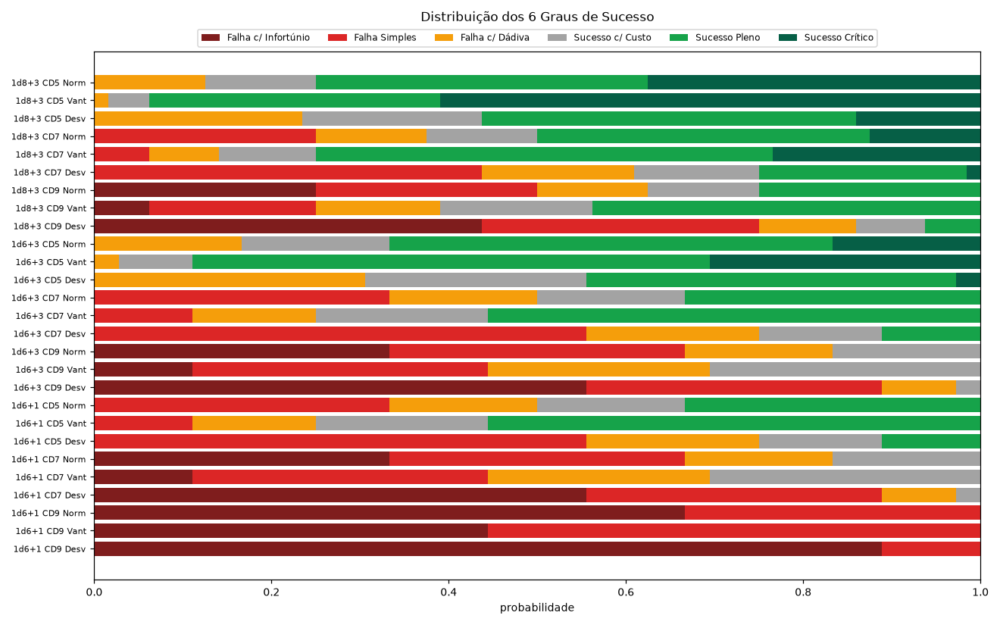
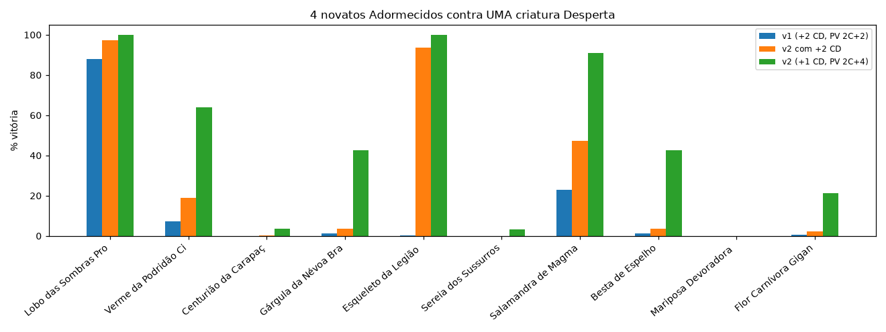
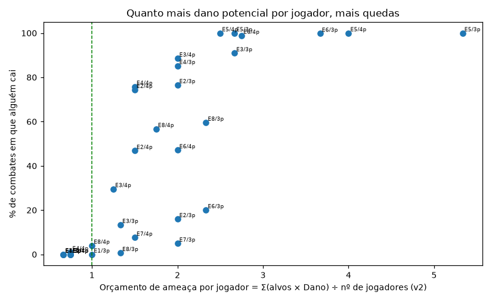
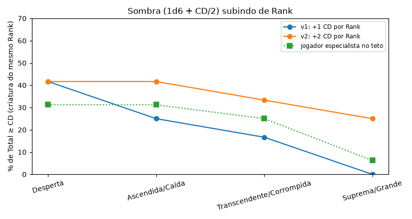

# Relatório de Rolagens e Equilíbrio — Shadow Slave RPG (regras v2)

*Simulador em `sim/ssrpg/` · probabilidades exatas por enumeração · Monte Carlo com 10.000 combates por cenário (976 cenários) · **padrão = regras v2** já aplicadas nos Livros 1–4; a coluna "v1" reproduz as regras antigas para comparação.*

## Resumo em 1 minuto

- **Testes ficaram jogáveis:** a CD Moderada agora é 7. Um novato passa em média em **31%** das 12 Subcategorias na CD 7 (antes, na Moderada 9: **8%**, e impossível em 9 de 12).
- **Combates ficaram menos letais sem ficar triviais:** 4 novatos contra os encontros escalados vencem **99%** (v1: 96%) e alguém cai em **18%** (v1: 38%). Contra os encontros como estão no livro (feitos para 7), vencem **84%** (v1: 64%); por isso o Livro 3 agora tem o **Orçamento de Ameaça**.
- **Rank acima virou rampa, não parede:** 4 novatos contra UMA criatura Desperta vencem em média **47%** (v1: 12%). Demônios e Diabos Despertos continuam quase invencíveis para novatos.
- **Teste extra do Jhonne:** 4 Adormecidos **saturados** (Marco 10, Memórias, 2 Ecos) vencem a ficha comum do Demônio Desperto em **100%**. Com o **Perfil de Chefe** agora nos livros (CD 11, 2× PV, +1 de Dano), a briga direta vence **22%**; com plano tático + Relógio de Preparação, **94%** (−1 CD) a **91%** (−1 alvo). O Derrubar revisado passou de 2% para 55% contra esse chefe (seção 7).

- **Rodada de Aspectos (só Inata + 1ª Habilidade, personagens Adormecidos):** os Aspectos mais fortes são Escravo das Sombras, Besta Lunar, Dançarino da Gravidade, Predador Silencioso, Senhor das Correntes. O Escravo das Sombras Adormecido não é um Aspecto de utilidade: o Manto (+1 em rolagens e +1 de Dano por Sombra, sem custo) leva a briga direta contra o Demônio chefe de 24% para 99%. Com "1 Sombra no Manto e sem +Dano", ele cai para 78% nos cenários duros e mantém o Batedor (seção 8).

## 1. Regras v2 aplicadas (resumo exato para repassar)

### 1.1 Escala de CDs de tarefa (Livro 1 §1.3)

| Dificuldade | CD v2 | CD v1 |
| :--- | :--- | :--- |
| Trivial | **3** | 5 |
| Fácil | **5** | 7 |
| Moderada (padrão) | **7** | 9 |
| Difícil | **9** | 11 |
| Extrema | **11** | 13 |
| Divina | **13** | 15 |

- CDs intermediárias para ajuste fino: **4, 6, 8, 10, 12**. **CD mínima: 3.**
- Toda CD **fixa de teste** dos livros (perícia, sobrevivência, ofício, ambiente) caiu **2 pontos**. Exemplos: primeiros socorros e estabilizar **CD 7** (**9** sem kit); Culinária **CD 5 + 1 por Rank** do ingrediente acima do cozinheiro; Iniciativa/CD de Reação **CD 7 ± 1 por Rank** (**9** contra inimigos muito velozes); Choque de Vontades **CD 7 ± 1 por Rank**; perseguição **CD 7 ± 1 por Rank**.
- **CDs de criatura não mudam** (CD da ficha = CD de combate contra o próprio Rank): Adormecida **6–8**, Desperta **9–10**, Caída **10–11**, Corrompida **12**, Grande **13+**. CDs de efeitos dentro das fichas do Bestiário também ficam como estão.
- **CD Estática de NPC / Percepção da presa / Fintar:** `7 + Pilar (ou Astúcia) relevante ± 1 por Rank`.

### 1.2 Diferença de Rank (Livro 1 §1.3)

- **±1 na CD por Rank de diferença** (antes ±2), sempre com mínimo 3.
| Situação | CD da ficha | CD v2 | CD v1 |
| :--- | :--- | :--- | :--- |
| Adormecido contra criatura Desperta | 9 | **10** | 11 |
| Adormecido contra criatura Caída | 10 | **12** | 14 |
| Adormecido contra criatura Corrompida | 12 | **15** | 18 |
| Desperto contra criatura Adormecida | 7 | **6** | 5 (mínimo) |
| Ascendido contra criatura Adormecida | 7 | **5** | 5 (mínimo) |

### 1.3 Orçamento de Ameaça (Livro 3, antes da Regra dos 5 Segundos)

- **Ameaça de uma criatura** = `nº de jogadores que ela ataca por rodada × Dano por alvo` (Dano normal da ficha; enxames e matilhas: 1 alvo por indivíduo; Dano de Alma conta igual; quem só prende/controla conta 0).
- **Ameaça do encontro** = soma de todas as criaturas que agem na rodada. **Regra: Ameaça ≤ 1 × nº de jogadores.**
| Jogadores | 3 | 4 | 5 | 6 | 7 |
| :--- | :--- | :--- | :--- | :--- | :--- |
| Orçamento | 3 | 4 | 5 | 6 | 7 |

- Acima do Orçamento: retire lacaios, reduza alvos do chefe, divida em ondas ou ofereça gargalo/cobertura/emboscada.
- **Criatura de Rank acima num encontro acima do Orçamento → ⚠️ Fuga/Evitar.** Criatura **2+ Ranks acima → sempre Fuga/Evitar.** Mesmo Rank acima do Orçamento → marcado **⚖️ Acima do Orçamento** (dividir em ondas).
- Matrizes do Livro 3 e as 10 tabelas `1d6` de encontros do Livro 4 foram marcadas com essas tags (Livro 4: Coorte de referência por região, mesa de 7).

### 1.4 PV (Livro 1 §2.1 e §6.1)

- **PV Máximo = (2 × Corpo) + 4** (antes +2), +1 nos Marcos 2 e 6, +1 por Núcleo Divino extra (+2 no 7º).
| Corpo | 1 | 2 | 3 | 4 | 5 |
| :--- | :--- | :--- | :--- | :--- | :--- |
| PV v2 | 6 | 8 | 10 | 12 | 14 |
| PV v1 | 4 | 6 | 8 | 10 | 12 |

### 1.5 Sombras e Ecos (Livro 1 §7.5 G; Livro 2 cap. 8)

- **Sombra Evolutiva sobe de Rank: +2 na CD e +1 de Dano Base** (antes +1 CD). A rolagem continua `1d6 + ⌊CD/2⌋`, então +2 de CD = +1 na rolagem.
- **Eco reforjado** continua **+1 CD e +4 PV** por reforja (teste de reforja `Alma [Canalizar]` **CD 9**, Relógio 4).
- As 12 fichas de Sombra do Livro 2 cap. 8 mostram a trilha como `CD X (Eco Y)`.

### 1.5b Regras da 2ª rodada (aprovadas e aplicadas)

- **Perfil de Chefe** (Livro 3 §5.2): Demônio ou Diabo **Desperto** como chefe contra Coorte **Adormecida**: **CD 11** na ficha (12 na mesa, pelo `+1` por Rank), **PV × 2** (Demônio da Matriz 28, Diabo 36), **Dano +1** por alvo, mesmos alvos e habilidades. Aplicado a 6 fichas do Bestiário do L3 e às matrizes do L4 (Centurião da Carapaça, Troll de Casca Vermelha, Salamandra Ígnea).
- **Relógio de Preparação** (Livro 1 §1.7; guia do Mestre no Livro 3 §5.1): **4 segmentos**, sempre ao lado de um **Relógio de Ameaça** de 4. Completo = **1 Vantagem de Plano**: *Fraqueza Estudada* (−1 na CD da criatura na cena), *Terreno Escolhido* (−1 alvo por rodada, mínimo 1) ou *Emboscada Garantida* (Rodada de Surpresa sem teste). Máximo **1 por criatura de Rank acima**.
- **Derrubar** (Livro 1 §5.3): CD de Defesa (+1 se quadrúpede ou Grande), **dano normal da arma** (+2 no Crítico) e *Derrubado*. A criatura derrubada **gasta a Ação Maior para se levantar** (não ataca nessa rodada) e fica **Firme** até o fim da rodada seguinte. Personagens continuam levantando com metade do Movimento.
- **CDs do L4 alinhadas ao Bestiário do L3:** Centurião da Carapaça 11 → 10; Aranhas de Ferro 10 → 9.

### 1.6 Esclarecimentos aprovados junto

- **CD Exata na Defesa:** você **não sofre dano**, mas paga **1 Infortúnio** (padrão: **I1 Guarda Aberta**: Desvantagem na sua próxima Defesa).
- **Mariposa Devoradora de Sonhos:** **1 Dano de Alma** por alvo (texto alinhado à linha de stats) e cura **1 PV por alvo drenado**.
- **Esqueleto da Legião Imortal:** remonta **uma vez** (com 3 PV no turno seguinte); **fogo, esmagamento ou Crítico** impedem a remontagem.

### 1.7 Antes × depois (números do simulador)

| Encontro | Jog. | Versão | Ameaça / Orçamento | Vitória v1 → v2 | Alguém cai v1 → v2 | Grupo todo cai v1 → v2 | Rodadas (v2, vitórias) |
| :--- | :--- | :--- | :--- | :--- | :--- | :--- | :--- |
| E1 | 4 | livro (7) | 3 / 4 (ok) | 100% → **100%** | 1% → **0%** | 0% → **0%** | 3,0 |
| E1 | 4 | escalado | 3 / 4 (ok) | 100% → **100%** | 1% → **0%** | 0% → **0%** | 3,0 |
| E1 | 3 | livro (7) | 3 / 3 (ok) | 100% → **100%** | 0% → **0%** | 0% → **0%** | 3,9 |
| E1 | 3 | escalado | 2 / 3 (ok) | 100% → **100%** | 0% → **0%** | 0% → **0%** | 3,1 |
| E2 | 4 | livro (7) | 6 / 4 (⚖️ acima) | 54% → **81%** | 94% → **74%** | 46% → **19%** | 5,3 |
| E2 | 4 | escalado | 6 / 4 (⚖️ acima) | 80% → **95%** | 79% → **47%** | 20% → **5%** | 4,3 |
| E2 | 3 | livro (7) | 6 / 3 (⚖️ acima) | 29% → **50%** | 91% → **77%** | 71% → **50%** | 5,6 |
| E2 | 3 | escalado | 6 / 3 (⚖️ acima) | 87% → **95%** | 33% → **16%** | 13% → **5%** | 3,7 |
| E3 | 4 | livro (7) | 8 / 4 (⚖️ acima) | 46% → **84%** | 98% → **89%** | 54% → **16%** | 8,2 |
| E3 | 4 | escalado | 5 / 4 (⚖️ acima) | 99% → **100%** | 62% → **30%** | 1% → **0%** | 4,7 |
| E3 | 3 | livro (7) | 8 / 3 (⚖️ acima) | 19% → **46%** | 98% → **91%** | 81% → **54%** | 9,9 |
| E3 | 3 | escalado | 4 / 3 (⚖️ acima) | 98% → **100%** | 28% → **13%** | 2% → **0%** | 5,0 |
| E4 | 4 | livro (7) | 6 / 4 (⚖️ acima) | 51% → **88%** | 96% → **76%** | 48% → **10%** | 10,5 |
| E4 | 4 | escalado | 3 / 4 (ok) | 100% → **100%** | 11% → **1%** | 0% → **0%** | 5,0 |
| E4 | 3 | livro (7) | 6 / 3 (⚖️ acima) | 15% → **42%** | 97% → **85%** | 85% → **56%** | 12,2 |
| E4 | 3 | escalado | 2 / 3 (ok) | 100% → **100%** | 0% → **0%** | 0% → **0%** | 4,6 |
| E5 | 4 | livro (7) | 16 / 4 (⚠️ Fuga/Evitar) | 0% → **0%** | 100% → **100%** | 100% → **100%** | — |
| E5 | 4 | escalado | 10 / 4 (⚠️ Fuga/Evitar) | 0% → **0%** | 100% → **100%** | 100% → **100%** | 6,4 |
| E5 | 3 | livro (7) | 16 / 3 (⚠️ Fuga/Evitar) | 0% → **0%** | 100% → **100%** | 100% → **100%** | — |
| E5 | 3 | escalado | 8 / 3 (⚠️ Fuga/Evitar) | 0% → **0%** | 100% → **100%** | 100% → **100%** | 5,2 |
| E6 | 4 | livro (7) | 11 / 4 (⚖️ acima) | 7% → **34%** | 100% → **99%** | 93% → **66%** | 9,5 |
| E6 | 4 | escalado | 8 / 4 (⚖️ acima) | 90% → **99%** | 87% → **47%** | 10% → **1%** | 5,4 |
| E6 | 3 | livro (7) | 11 / 3 (⚖️ acima) | 1% → **5%** | 100% → **100%** | 99% → **94%** | 11,2 |
| E6 | 3 | escalado | 7 / 3 (⚖️ acima) | 92% → **99%** | 51% → **20%** | 8% → **1%** | 5,6 |
| E7 | 4 | livro (7) | 6 / 4 (⚖️ acima) | 100% → **100%** | 40% → **8%** | 0% → **0%** | 5,0 |
| E7 | 4 | escalado | 3 / 4 (ok) | 100% → **100%** | 1% → **0%** | 0% → **0%** | 3,0 |
| E7 | 3 | livro (7) | 6 / 3 (⚖️ acima) | 99% → **100%** | 25% → **5%** | 1% → **0%** | 6,5 |
| E7 | 3 | escalado | 2 / 3 (ok) | 100% → **100%** | 0% → **0%** | 0% → **0%** | 3,1 |
| E8 | 4 | livro (7) | 7 / 4 (⚖️ acima) | 89% → **99%** | 86% → **57%** | 11% → **1%** | 6,4 |
| E8 | 4 | escalado | 4 / 4 (ok) | 100% → **100%** | 23% → **4%** | 0% → **0%** | 3,1 |
| E8 | 3 | livro (7) | 7 / 3 (⚖️ acima) | 59% → **87%** | 84% → **60%** | 41% → **13%** | 8,2 |
| E8 | 3 | escalado | 4 / 3 (⚖️ acima) | 100% → **100%** | 4% → **1%** | 0% → **0%** | 3,1 |

Encontros: **E1** Pântano dos Sinos — Ato 1 (L3 §3.5 A (Roteiro Pronto 1)); **E2** Pântano dos Sinos — Ato 4 (Sanguessuga-Sino) (L3 §3.5 A (Roteiro Pronto 1)); **E3** Alcateia das Ruínas (L3 §4.3 Matriz A 8–9); **E4** Emboscada Noturna da Maré (L3 §4.3 Matriz A 3–4); **E5** Patrulha da Carapaça (L3 §4.3 Matriz A 5–6); **E6** Caçadores do Céu (L3 §4.3 Matriz B 3–4); **E7** Encontro Rápido (modelo) (L3 §5.1 Modelo 1); **E8** Encontro Tático (modelo) (L3 §5.1 Modelo 2 + Matriz §5.2).

## 2. Probabilidades exatas dos graus

Tabela completa em `resultados/probabilidades_graus.csv`. O resultado depende só de **Pilar + bônus**.

### 1d6: chance de Total ≥ CD (Normal / Vantagem / Desvantagem)

| Pilar+bônus | CD 3 | CD 5 | CD 7 | CD 9 | CD 11 | CD 13 |
| :--- | :--- | :--- | :--- | :--- | :--- | :--- |
| +1 | 83 / 97 / 69 | 50 / 75 / 25 | 17 / 31 / 3 | 0 / 0 / 0 | 0 / 0 / 0 | 0 / 0 / 0 |
| +2 | 100 / 100 / 100 | 67 / 89 / 44 | 33 / 56 / 11 | 0 / 0 / 0 | 0 / 0 / 0 | 0 / 0 / 0 |
| +3 | 100 / 100 / 100 | 83 / 97 / 69 | 50 / 75 / 25 | 17 / 31 / 3 | 0 / 0 / 0 | 0 / 0 / 0 |
| +4 | 100 / 100 / 100 | 100 / 100 / 100 | 67 / 89 / 44 | 33 / 56 / 11 | 0 / 0 / 0 | 0 / 0 / 0 |
| +5 | 100 / 100 / 100 | 100 / 100 / 100 | 83 / 97 / 69 | 50 / 75 / 25 | 17 / 31 / 3 | 0 / 0 / 0 |
| +6 | 100 / 100 / 100 | 100 / 100 / 100 | 100 / 100 / 100 | 67 / 89 / 44 | 33 / 56 / 11 | 0 / 0 / 0 |

### 1d8: chance de Total ≥ CD (Normal / Vantagem / Desvantagem)

| Pilar+bônus | CD 3 | CD 5 | CD 7 | CD 9 | CD 11 | CD 13 |
| :--- | :--- | :--- | :--- | :--- | :--- | :--- |
| +1 | 88 / 98 / 77 | 62 / 86 / 39 | 38 / 61 / 14 | 12 / 23 / 2 | 0 / 0 / 0 | 0 / 0 / 0 |
| +2 | 100 / 100 / 100 | 75 / 94 / 56 | 50 / 75 / 25 | 25 / 44 / 6 | 0 / 0 / 0 | 0 / 0 / 0 |
| +3 | 100 / 100 / 100 | 88 / 98 / 77 | 62 / 86 / 39 | 38 / 61 / 14 | 12 / 23 / 2 | 0 / 0 / 0 |
| +4 | 100 / 100 / 100 | 100 / 100 / 100 | 75 / 94 / 56 | 50 / 75 / 25 | 25 / 44 / 6 | 0 / 0 / 0 |
| +5 | 100 / 100 / 100 | 100 / 100 / 100 | 88 / 98 / 77 | 62 / 86 / 39 | 38 / 61 / 14 | 12 / 23 / 2 |
| +6 | 100 / 100 / 100 | 100 / 100 / 100 | 100 / 100 / 100 | 75 / 94 / 56 | 50 / 75 / 25 | 25 / 44 / 6 |

### Distribuição dos 6 graus em casos típicos (rolagem normal)

| Caso | Falha c/ Infortúnio | Falha Simples | Falha c/ Dádiva | Sucesso c/ Custo | Sucesso Pleno | Sucesso Crítico | Máx. Natural |
| :--- | :--- | :--- | :--- | :--- | :--- | :--- | :--- |
| 1d8+3 vs CD 5 | 0,0% | 0,0% | 12,5% | 12,5% | 37,5% | 37,5% | 12,5% |
| 1d8+3 vs CD 7 | 0,0% | 25,0% | 12,5% | 12,5% | 37,5% | 12,5% | 12,5% |
| 1d8+3 vs CD 9 | 25,0% | 25,0% | 12,5% | 12,5% | 25,0% | 0,0% | 12,5% |
| 1d8+3 vs CD 10 | 37,5% | 25,0% | 12,5% | 12,5% | 12,5% | 0,0% | 12,5% |
| 1d8+2 vs CD 7 | 12,5% | 25,0% | 12,5% | 12,5% | 37,5% | 0,0% | 12,5% |
| 1d6+3 vs CD 7 | 0,0% | 33,3% | 16,7% | 16,7% | 33,3% | 0,0% | 16,7% |
| 1d6+1 vs CD 5 | 0,0% | 33,3% | 16,7% | 16,7% | 33,3% | 0,0% | 16,7% |
| 1d6+1 vs CD 7 | 33,3% | 33,3% | 16,7% | 16,7% | 0,0% | 0,0% | 16,7% |

### Chance de sucesso de cada ficha de novato nas 12 Subcategorias (escala v2)

| Ficha (Livro 2 §1.1) | CD 3 Trivial | CD 5 Fácil | CD 7 Moderada | CD 9 Difícil | CD 11 Extrema | CD 13 Divina |
| :--- | :--- | :--- | :--- | :--- | :--- | :--- |
| Baluarte (Dorian) | 92% (impossível em 0/12) | 63% (impossível em 0/12) | 31% (impossível em 0/12) | 8% (impossível em 9/12) | 2% (impossível em 10/12) | 0% (impossível em 12/12) |
| Executor | 92% (impossível em 0/12) | 63% (impossível em 0/12) | 30% (impossível em 0/12) | 6% (impossível em 9/12) | 1% (impossível em 11/12) | 0% (impossível em 12/12) |
| Olho de Falcão | 92% (impossível em 0/12) | 64% (impossível em 0/12) | 33% (impossível em 0/12) | 10% (impossível em 8/12) | 2% (impossível em 10/12) | 0% (impossível em 12/12) |
| Canalizador | 92% (impossível em 0/12) | 63% (impossível em 0/12) | 31% (impossível em 0/12) | 8% (impossível em 9/12) | 2% (impossível em 10/12) | 0% (impossível em 12/12) |

- Na v1, a Moderada era a CD 9: a coluna "CD 9" acima é o "antes" do teste padrão.
- CD 13 (Divina) continua impossível no `1d6` sem bônus e exige `1d8 + Pilar 3 + bônus 2` ou mais; é o teto planejado.

## 3. Novato sozinho contra cada criatura

| Criatura | CD contra Adormecido | Baluarte (Dorian) | Executor | Olho de Falcão | Canalizador |
| :--- | :--- | :--- | :--- | :--- | :--- |
| 1. Larva do Pesadelo | Adormecida CD 6 | 100% → **100%** | 100% → **100%** | 100% → **100%** | 100% → **100%** |
| 2. Carniçal das Ruínas | Adormecida CD 7 | 100% → **100%** | 100% → **100%** | 87% → **97%** | 92% → **99%** |
| 3. Carniçal Alfa | Adormecida CD 8 | 68% → **83%** | 57% → **74%** | 2% → **5%** | 4% → **15%** |
| 4. Saqueador da Carapaça | Adormecida CD 8 | 79% → **87%** | 81% → **90%** | 4% → **8%** | 15% → **31%** |
| 5. Escavador de Coral | Adormecida CD 8 | 96% → **99%** | 96% → **99%** | 22% → **43%** | 36% → **72%** |
| 6. Aranha de Ferro | Adormecida CD 8 | 96% → **99%** | 96% → **99%** | 23% → **43%** | 36% → **71%** |
| 7. Afogado do Mar Amaldiçoado | Adormecida CD 8 | 96% → **99%** | 96% → **99%** | 23% → **43%** | 36% → **70%** |
| 8. Vespa Carmesim | Adormecida CD 8 | 99% → **100%** | 97% → **99%** | 72% → **86%** | 77% → **93%** |
| 9. Harpia de Penas de Bronze | Adormecida CD 8 | 96% → **99%** | 96% → **99%** | 22% → **42%** | 37% → **71%** |
| 10. Boneco de Porcelana | Adormecida CD 8 | 26% → **43%** | 18% → **35%** | 0% → **0%** | 0% → **0%** |
| 11. Lobo das Sombras Profundas | Desperta CD 9 → 10 | 0% → **1%** | 1% → **3%** | 0% → **0%** | 0% → **0%** |
| 12. Verme da Podridão Cinzenta | Desperta CD 9 → 10 | 0% → **0%** | 0% → **0%** | 0% → **0%** | 0% → **0%** |
| 13. Centurião da Carapaça | Desperta CD 10 → 11 | 0% → **0%** | 0% → **0%** | 0% → **0%** | 0% → **0%** |
| 14. Gárgula da Névoa Branca | Desperta CD 10 → 11 | 0% → **0%** | 0% → **0%** | 0% → **0%** | 0% → **0%** |
| 15. Esqueleto da Legião Imortal | Desperta CD 9 → 10 | 0% → **0%** | 0% → **2%** | 0% → **0%** | 0% → **0%** |
| 16. Sereia dos Sussurros | Desperta CD 10 → 11 | 0% → **0%** | 0% → **0%** | 0% → **0%** | 0% → **0%** |
| 17. Salamandra de Magma | Desperta CD 9 → 10 | 0% → **0%** | 0% → **1%** | 0% → **0%** | 0% → **0%** |
| 18. Besta de Espelho | Desperta CD 10 → 11 | 0% → **0%** | 0% → **0%** | 0% → **0%** | 0% → **0%** |
| 19. Mariposa Devoradora de Sonhos | Desperta CD 10 → 11 | 0% → **0%** | 0% → **0%** | 0% → **0%** | 0% → **0%** |
| 20. Flor Carnívora Gigante | Desperta CD 9 → 10 | 0% → **0%** | 0% → **0%** | 0% → **0%** | 0% → **0%** |

Vitória 1 contra 1, v1 → v2. Lutar sozinho contra uma criatura Desperta continua uma péssima ideia, como na obra.

## 4. 4 novatos contra UMA criatura Desperta do Bestiário

| Criatura | v1 | v2 se o Rank ainda desse +2 | v2 | alguém cai (v2) |
| :--- | :--- | :--- | :--- | :--- |
| Lobo das Sombras Profundas | 88% | 97% | **100%** | 6% |
| Verme da Podridão Cinzenta | 7% | 19% | **64%** | 77% |
| Centurião da Carapaça | 0% | 0% | **4%** | 100% |
| Gárgula da Névoa Branca | 1% | 4% | **43%** | 85% |
| Esqueleto da Legião Imortal | 0% | 94% | **100%** | 9% |
| Sereia dos Sussurros | 0% | 0% | **3%** | 100% |
| Salamandra de Magma | 23% | 47% | **91%** | 43% |
| Besta de Espelho | 1% | 4% | **43%** | 85% |
| Mariposa Devoradora de Sonhos | 0% | 0% | **0%** | 100% |
| Flor Carnívora Gigante | 0% | 2% | **21%** | 99% |

O Esqueleto passou de 0% para quase 100% por causa da remontagem limitada; a Mariposa continua a 0% (4 alvos de Dano de Alma + cura).

## 5. Orçamento de Ameaça e Sombras

Dentro do Orçamento (Ameaça ≤ nº de jogadores), alguém cai em menos de 5% dos combates escalados. Acima de ~2× o Orçamento, alguém cai na maioria das lutas.

| Regra | Rank da Sombra | CD | Rolagem | CD das criaturas do Rank | Chance de Total ≥ CD |
| :--- | :--- | :--- | :--- | :--- | :--- |
| v1 (+1 CD) | Desperta | 10 | 1d6+5 | 9–10 | 42% |
| v1 (+1 CD) | Ascendida/Caída | 11 | 1d6+5 | 10–11 | 25% |
| v1 (+1 CD) | Transcendente/Corrompida | 12 | 1d6+6 | 12–12 | 17% |
| v1 (+1 CD) | Suprema/Grande | 13 | 1d6+6 | 13–14 | 0% |
| **v2 (+2 CD)** | Desperta | 10 | 1d6+5 | 9–10 | 42% |
| **v2 (+2 CD)** | Ascendida/Caída | 12 | 1d6+6 | 10–11 | 42% |
| **v2 (+2 CD)** | Transcendente/Corrompida | 14 | 1d6+7 | 12–12 | 33% |
| **v2 (+2 CD)** | Suprema/Grande | 16 | 1d6+8 | 13–14 | 25% |

## 6. Teste extra (A): 4 Adormecidos contra 1 Desperto de cada Classe

**Como as fichas foram montadas** (`sim/extra.py`):

- **Novatos:** as 4 fichas recomendadas do Livro 2 §1.1 (Baluarte, Executor, Olho de Falcão, Canalizador), PV v2, sem Memórias nem Ecos.
- **Adormecidos saturados (Marco 10, Aspecto comum):** Pilar principal **4** (Marco 10), PV `2×Corpo + 4 + 2` (Marcos 2 e 6), Essência +5 (Marcos ímpares), 2 Atributos (Marcos 4 e 8). **Suposições:** arma de Memória com runa `+1` e 1 Atributo de `+1` no ataque (Canalizador: só `+1`, porque ataca com o Aspecto), 1 Atributo de `+1` na Defesa (Baluarte soma o escudo), armadura de Memória Tier I (2 níveis). Ecos: o Baluarte tem um **Eco Saqueador da Carapaça** e o Olho de Falcão um **Eco Lobo das Cinzas** (Tabela 7-4: CD 8, `1d6 + 4`, 5–6 PV, Dano 1), agindo com a Ação Menor do dono.
- **Regras de Rank aplicadas:** CD +1 por Rank; Memória Adormecida contra alvo Desperto (Tabela 7-1): arma com −1 na rolagem e armadura gastando 2 níveis por ponto de dano.
- **Criaturas:** faixa Desperta da Matriz Rank × Classe (L3 §5.2): Besta CD 9, 6 PV, Dano 2, 1 alvo; Monstro CD 9, 10 PV, Dano 2, 2 alvos; Demônio CD 10, 14 PV, Dano 2, 3 alvos (foca o mais frágil); Diabo CD 10, 18 PV, Dano 2, 3 alvos (foca o mais frágil). Mais 4 fichas do Bestiário como conferência.

| Criatura Desperta | 4 novatos | 4 saturados sem Ecos | 4 saturados + 2 Ecos |
| :--- | :--- | :--- | :--- |
| Besta Desperta (Matriz) | **100%** · cai 2% | **100%** · cai 0% | **100%** · cai 0% |
| Monstro Desperto (Matriz) | **96%** · cai 35% | **100%** · cai 0% | **100%** · cai 0% |
| Demônio Desperto (Matriz) | **8%** · cai 100% | **100%** · cai 29% | **100%** · cai 0% |
| Diabo Desperto (Matriz) | **1%** · cai 100% | **99%** · cai 65% | **100%** · cai 3% |
| Lobo das Sombras Profundas (nº 11) | **100%** · cai 5% | **100%** · cai 0% | **100%** · cai 0% |
| Gárgula da Névoa Branca (nº 14) | **38%** · cai 98% | **100%** · cai 15% | **100%** · cai 0% |
| Centurião da Carapaça (nº 13) | **4%** · cai 100% | **98%** · cai 60% | **100%** · cai 1% |
| Sereia dos Sussurros (nº 16) | **55%** · cai 88% | **100%** · cai 1% | **100%** · cai 0% |

"cai" = combates em que pelo menos um jogador chegou a 0 PV.

**Leitura:** para novatos, Besta e Monstro Despertos são vencíveis; Demônio e Diabo são paredes (como pede a obra). Para Adormecidos saturados, **qualquer criatura Desperta da Matriz cai em 3–4 rodadas**, quase sem ninguém cair. O salto vem do Pilar 4 + bônus de Memória, que com flanqueamento estoura o Cap +3 e vira **Vantagem em quase todo ataque**, e dos Ecos, que dão mais ataques e mais alvos para a criatura dividir.

## 7. Teste extra (B): saturados contra um Demônio Desperto, briga direta × estratégia

**Regras v2 usadas aqui (todas já nos livros):** Perfil de Chefe (L3 §5.2), Relógio de Preparação (L1 §1.7) e Derrubar revisado (L1 §5.3: dano normal, a criatura gasta a Ação Maior para se levantar e fica Firme 1 rodada; CD `+1` se quadrúpede/Grande — o simulador aplica o `+1`).

**Estratégias modeladas:**

- **Emboscada** (L1 §3.2): Vanguarda contra `7 + Astúcia da presa + 1` (Demônio da Matriz: 10; Perfil de Chefe: 11). "Coletivo" = 3 rolam e a maioria precisa passar; "líder" = o melhor rola com `+2` de Ajuda. Sucesso = Rodada de Surpresa com Vantagem; o Olho de Falcão faz **Ataque Furtivo**.
- **Runas-armadilha** (L1 Runas 6 e 8): Mina Ígnea (2 de Dano + Derrubado) e Dardo de Relâmpago (2 de Dano + Atordoado).
- **Posição Elevada:** +1 nos ataques à distância. **Gargalo:** a criatura alcança 1 alvo a menos por rodada (decisão do Mestre).
- **Mirar em Ponto Fraco** (Executor, CD +2): no Pleno/Crítico, +1/+2 de Dano e destrói uma parte (−1 alvo e fim da carapaça).
- **Derrubar** (Baluarte, regra nova e antiga), **Proteger Aliado**, **Ajuda Tática** dos Ecos.
- **Relógio de Preparação completo:** 1 Vantagem de Plano (*Fraqueza Estudada* −1 CD, *Terreno Escolhido* −1 alvo ou *Emboscada Garantida*).

### Saturados (4 + 2 Ecos)

| Estratégia | Demônio Desperto da Matriz (CD 10 → 11, 14 PV, Dano 2, 3 alvos) | Demônio Desperto em Perfil de Chefe (CD 11 → 12, 28 PV, Dano 3, 3 alvos) | Diabo Desperto em Perfil de Chefe (CD 11 → 12, 36 PV, Dano 3, 3 alvos) |
| :--- | :--- | :--- | :--- |
| briga direta | **100%** · cai 0% · 0,0 | **22%** · cai 100% · 2,2 | **5%** · cai 100% · 2,4 |
| emboscada, teste coletivo da Vanguarda (+ Ataque Furtivo) | **100%** · cai 0% · 0,0 | **22%** · cai 100% · 2,2 | **5%** · cai 100% · 2,4 |
| emboscada, líder + 2 ajudantes (+ Ataque Furtivo) | **100%** · cai 0% · 0,0 | **35%** · cai 100% · 2,0 | **11%** · cai 100% · 2,3 |
| 1 Runa de Mina Ígnea | **100%** · cai 0% · 0,0 | **60%** · cai 99% · 1,8 | **26%** · cai 100% · 2,2 |
| Mina Ígnea + Dardo de Relâmpago | **100%** · cai 0% · 0,0 | **72%** · cai 98% · 1,7 | **37%** · cai 100% · 2,1 |
| Posição Elevada (+1 à distância) | **100%** · cai 0% · 0,0 | **26%** · cai 100% · 2,2 | **9%** · cai 100% · 2,4 |
| gargalo (−1 alvo da criatura) | **100%** · cai 0% · 0,0 | **76%** · cai 100% · 2,2 | **38%** · cai 100% · 2,4 |
| Mirar em Ponto Fraco (Executor) | **100%** · cai 1% · 0,0 | **51%** · cai 100% · 2,2 | **22%** · cai 100% · 2,4 |
| Derrubar (Baluarte), regra antiga | **100%** · cai 2% · 0,0 | **2%** · cai 100% · 2,2 | **0%** · cai 100% · 2,2 |
| Derrubar (Baluarte), regra nova | **100%** · cai 0% · 0,0 | **55%** · cai 99% · 1,6 | **30%** · cai 100% · 1,9 |
| Proteger Aliado (Baluarte) | **100%** · cai 0% · 0,0 | **29%** · cai 93% · 1,6 | **10%** · cai 99% · 2,0 |
| Ecos dão Ajuda +1 em vez de atacar | **100%** · cai 0% · 0,0 | **30%** · cai 100% · 2,2 | **9%** · cai 100% · 2,4 |
| plano tático (emboscada líder + furtivo + Posição Elevada + Proteger) | **100%** · cai 0% · 0,0 | **47%** · cai 80% · 1,1 | **31%** · cai 91% · 1,5 |
| plano tático + Derrubar | **100%** · cai 0% · 0,0 | **73%** · cai 52% · 0,6 | **62%** · cai 64% · 0,8 |
| plano tático + gargalo | **100%** · cai 0% · 0,0 | **91%** · cai 61% · 1,0 | **80%** · cai 79% · 1,4 |
| plano completo (tático + gargalo + 2 runas) | **100%** · cai 0% · 0,0 | **99%** · cai 17% · 0,2 | **97%** · cai 34% · 0,5 |
| Relógio de Preparação: Fraqueza Estudada (−1 CD) | **100%** · cai 0% · 0,0 | **79%** · cai 100% · 1,8 | **56%** · cai 100% · 2,2 |
| Relógio de Preparação: Terreno Escolhido (−1 alvo) | **100%** · cai 0% · 0,0 | **76%** · cai 100% · 2,2 | **37%** · cai 100% · 2,4 |
| Relógio de Preparação: Emboscada Garantida | **100%** · cai 0% · 0,0 | **59%** · cai 99% · 1,8 | **24%** · cai 100% · 2,2 |
| plano tático + Fraqueza Estudada (−1 CD) | **100%** · cai 0% · 0,0 | **94%** · cai 33% · 0,5 | **90%** · cai 47% · 0,7 |
| plano tático + Terreno Escolhido (−1 alvo) | **100%** · cai 0% · 0,0 | **91%** · cai 61% · 1,0 | **81%** · cai 79% · 1,4 |
| plano tático + Emboscada Garantida | **100%** · cai 0% · 0,0 | **73%** · cai 59% · 0,8 | **52%** · cai 81% · 1,3 |
| (fora da regra) −2 na CD | **100%** · cai 0% · 0,0 | **100%** · cai 96% · 1,0 | **100%** · cai 100% · 1,2 |

Cada célula: **vitória** · combates em que alguém cai · média de jogadores caídos nas vitórias.

### Novatos (para comparação; ficha comum, sem Perfil de Chefe)

| Estratégia | Demônio Desperto da Matriz | Centurião da Carapaça |
| :--- | :--- | :--- |
| briga direta | **8%** · cai 100% | **4%** · cai 100% |
| emboscada, teste coletivo da Vanguarda (+ Ataque Furtivo) | **9%** · cai 100% | **4%** · cai 100% |
| emboscada, líder + 2 ajudantes (+ Ataque Furtivo) | **14%** · cai 98% | **9%** · cai 99% |
| 1 Runa de Mina Ígnea | **32%** · cai 93% | **22%** · cai 97% |
| Mina Ígnea + Dardo de Relâmpago | **49%** · cai 84% | **39%** · cai 89% |
| Posição Elevada (+1 à distância) | **18%** · cai 98% | **6%** · cai 100% |
| gargalo (−1 alvo da criatura) | **23%** · cai 100% | **18%** · cai 100% |
| Mirar em Ponto Fraco (Executor) | **0%** · cai 100% | **0%** · cai 100% |
| Derrubar (Baluarte), regra antiga | **2%** · cai 100% | **0%** · cai 100% |
| Derrubar (Baluarte), regra nova | **6%** · cai 99% | **4%** · cai 100% |
| Proteger Aliado (Baluarte) | **11%** · cai 96% | **4%** · cai 98% |
| plano tático (emboscada líder + furtivo + Posição Elevada + Proteger) | **36%** · cai 78% | **17%** · cai 90% |
| plano tático + Derrubar | **36%** · cai 77% | **17%** · cai 89% |
| plano tático + gargalo | **62%** · cai 69% | **38%** · cai 84% |
| plano completo (tático + gargalo + 2 runas) | **92%** · cai 22% | **82%** · cai 39% |
| Relógio de Preparação: Fraqueza Estudada (−1 CD) | **45%** · cai 97% | **23%** · cai 100% |
| Relógio de Preparação: Terreno Escolhido (−1 alvo) | **23%** · cai 100% | **17%** · cai 100% |
| Relógio de Preparação: Emboscada Garantida | **26%** · cai 96% | **17%** · cai 98% |
| plano tático + Fraqueza Estudada (−1 CD) | **79%** · cai 43% | **50%** · cai 68% |
| plano tático + Terreno Escolhido (−1 alvo) | **62%** · cai 69% | **38%** · cai 84% |
| plano tático + Emboscada Garantida | **58%** · cai 60% | **35%** · cai 76% |
| (fora da regra) −2 na CD | **90%** · cai 88% | **67%** · cai 98% |

### O sistema recompensa estratégia? Sim, e quanto

- **Demônio em Perfil de Chefe:** briga direta **22%** (grupo todo cai em 78%); com o Relógio de Preparação sozinho, **79%** (−1 CD); plano tático **47%**; plano tático + Relógio **94%** (−1 CD, alguém cai em 33%) ou **91%** (−1 alvo, alguém cai em 61%); plano completo **99%**.
- **Diabo em Perfil de Chefe:** briga direta **5%**, plano tático + Relógio (−1 CD) **90%**.
- **Derrubar revisado:** 2% → **55%** contra o Demônio chefe (novatos contra o Demônio da Matriz: 2% → 6%). Deixou de atrapalhar e virou uma tática boa, sem travar o monstro, porque ele fica Firme depois de levantar.
- Novatos contra o Demônio da Matriz: **8% → 92%** com o plano completo.
- **Ainda fraca:** *Mirar em Ponto Fraco* nas mãos de novatos (0%): a CD +2 tira o dano principal do Executor por várias rodadas. Sugestão para uma próxima rodada: o `+2` só vale para partes minúsculas; para juntas e olhos, `+1`.
- **Alvo do Jhonne atingido:** o Demônio Desperto em Perfil de Chefe é bizarramente forte na briga direta e vencível por um grupo saturado e preparado, quase sempre a um custo alto.

## 8. Rodada de Aspectos: 4 Adormecidos com os Aspectos do Livro 2

**Regra desta rodada (correção do Jhonne):** os personagens são **Adormecidos** e usam só o que o Livro 2 libera nesse Rank: a **Habilidade Inata** e a **1ª Habilidade (Adormecida)** de cada Aspecto. Nada de Passo das Sombras, Manifestação, Encarnação ou outra Habilidade de Desperto para cima. Só o monstro é Desperto. Aspectos Divinos: novato no Núcleo `[1/7]`; saturado no `[2/7]`, porque o Marco 10 condensa o 2º Núcleo (L2, Parte A, Regras Compartilhadas, item 2), com +3 PE e +1 PV.

**Método:** 2.000 lutas por célula. Fichas de Papel iguais às das seções 6–7 (novatos e saturados). Cada Aspecto foi testado em cada um dos 4 lugares (Baluarte, Executor, Olho de Falcão, Canalizador), com os outros 3 sem Aspecto de combate. Depois, 247 grupos de 4 Aspectos diferentes (metade com o Escravo das Sombras obrigatório) e 7 combinações suspeitas. Condições em inimigos viram −1 na CD (L2 §2.1 item 6), sem empilhar. Demônios e Diabos focam o mais frágil por sorteio ponderado. Por isso a linha de base da briga direta contra o chefe aparece um pouco acima dos 22% da seção 7 (lá o foco é determinístico).

Cenários: novatos contra L3 E3, E4 (a criatura embosca), E6, E7, E8 e uma criatura Desperta de cada Classe; saturados contra os mesmos, mais a Patrulha da Carapaça (Centurião em Perfil de Chefe) e o Demônio em Perfil de Chefe em 3 situações: briga direta, plano + Relógio de Preparação (Fraqueza Estudada) e Ameaça encheu (a criatura ataca primeiro).

### 8.1 Escravo das Sombras enquanto Adormecido

O que o Livro 2 dá de fato nesse Rank:

- **Inata, Vínculo Sombrio:** enxerga no escuro (alcance Perto no `[1/7]`, Distante no `[2/7]`); Sombras Pessoais com +1 em furtividade se ele não tiver Mestre.
- **1ª Habilidade, Controle das Sombras** (Ação Menor para alternar): **Modo Batedor** até 100 m, invisível, com visão compartilhada. Uma Sombra em Batedor impede que ele seja **Surpreendido** e dá **Vantagem em Astúcia** para detectar emboscadas e mapear o terreno. **Modo Manto:** cada Sombra enrolada nele, na arma ou numa Sombra Evolutiva dá **+1 em todas as rolagens e +1 de Dano**.
- **Sombras:** 1 Sombra Pessoal no novato; 2 no saturado (2º Núcleo). Sombra Evolutiva: até 1 por Núcleo, com custo zero de Essência; no saturado modelei 1 Sombra Adormecida (CD 8, 5 PV, Dano 1) no lugar de um Eco.
- **Defeito, Consciência Limpa:** não pode mentir. Não pesa em combate; pesa em cenas sociais (o simulador não mede).
- **Fora do Adormecido (não usado):** Passo das Sombras (2ª, Desperta), Manifestação (3ª), Encarnação (4ª), Legião do Sol Negro (5ª). Manto em **aliados** só a partir da 2ª/3ª Habilidade pela Seção 1.3 A; a linha de custo da 1ª Habilidade fala em "1 PE para projetar Manto em aliados". Os livros se contradizem aqui; testei as duas leituras.

Escravo das Sombras no lugar do Executor, com os outros 3 sem Aspecto (vitória · alguém cai). Novatos não têm Sombra Evolutiva, então "Manto na Sombra Evolutiva" equivale a não usar o Manto:

| Política | Novatos × Demônio Desperto | Novatos × E4 (emboscada) | Saturados × chefe, briga direta | Saturados × chefe, plano | Saturados × chefe, Ameaça encheu |
| :--- | :---: | :---: | :---: | :---: | :---: |
| Grupo sem Aspectos (base) | 9% · cai 100% | 100% · cai 2% | 24% · cai 100% | 92% · cai 35% | 8% · cai 100% |
| Escravo das Sombras: manto em si + Batedor (padrão) | 39% · cai 97% | 100% · cai 0% | 99% · cai 91% | 100% · cai 1% | 99% · cai 90% |
| Escravo das Sombras: Manto na Sombra Evolutiva | 9% · cai 99% | 100% · cai 1% | 95% · cai 98% | 100% · cai 3% | 95% · cai 98% |
| Escravo das Sombras: Manto num aliado (1 PE, leitura ampla) | 42% · cai 98% | 100% · cai 0% | 99% · cai 93% | 100% · cai 0% | 99% · cai 92% |
| Escravo das Sombras: só Batedor (sem Manto) | 9% · cai 99% | 100% · cai 1% | 55% · cai 100% | 99% · cai 18% | 55% · cai 100% |
| Escravo das Sombras: só Manto (sem Batedor) | 39% · cai 97% | 100% · cai 1% | 99% · cai 91% | 100% · cai 4% | 96% · cai 100% |
| Escravo das Sombras: nem Manto nem Batedor | 9% · cai 99% | 100% · cai 3% | 55% · cai 100% | 98% · cai 25% | 30% · cai 100% |

**Utilidade medida à parte (sem o Manto):**

- **Relógio de Preparação** (tarefas CD 8, Ameaça de 4): o grupo completa a Preparação antes da Ameaça em **54%** das vezes (saturados) e 29% (novatos). Com o Escravo das Sombras (Vantagem em Astúcia para rastrear e mapear): **58%** e 37%.
- **Sombra Evolutiva** (saturado, custo zero): sozinha, sem Manto nem Batedor, leva a briga direta de 24% para 55%. Quase todo o ganho vem do 3º combatente corpo a corpo, que fecha o Cerco (+2) para o grupo.
- **Nunca ser surpreendido:** quando a Ameaça enche e o Demônio chefe ataca primeiro, o mesmo grupo vence 30% sem o Batedor e **55%** com ele: a criatura perde a rodada grátis.
- **Valor esperado da caçada ao chefe** (prepara; depois luta com plano ou alertado): grupo base 54%; com o Escravo das Sombras sem Batedor 67%; **com o Batedor 80%**. O Batedor vale cerca de +13 pontos nessa caçada, sem causar 1 ponto de dano.
- Contra a emboscada do E4, novatos sem ele: alguém cai em 2%; com o Batedor: 1%.

**Leitura:** no Adormecido, o Escravo das Sombras **não é** um Aspecto de utilidade com pouco dano. O Manto dá +1/+1 por Sombra em todas as rolagens, sem custo, e no saturado (2 Sombras) leva a briga direta contra o chefe de 13% para 98% (média dos cenários duros, melhor lugar). A utilidade (Batedor, Relógio, nunca surpreendido) existe e é medida acima, mas o ganho vem quase todo do Manto. Isso contraria a ênfase pedida (utilidade acima de poder ofensivo) e a obra (Sunny Adormecido luta sujo porque é fraco).

### 8.2 Contribuição de cada Aspecto (sozinho no grupo)

Linha de base sem Aspectos: novatos 5% de vitória (média de Demônio e Diabo Despertos); saturados 13% (média de chefe direto, Patrulha da Carapaça e Ameaça encheu); novatos nos encontros do L3: alguém cai em 13%.
Δ = pontos percentuais em relação à base. "Melhor lugar" é o Papel em que o Aspecto rende mais; "média" considera os 4 Papéis.

| Aspecto | Melhor lugar | Novatos Δ (melhor) | Novatos Δ (média) | Saturados Δ (melhor) | Saturados Δ (média) | Encontros L3: menos quedas | Relógio de Preparação Δ | Leitura |
| :--- | :--- | :---: | :---: | :---: | :---: | :---: | :---: | :--- |
| Escravo das Sombras | Executor | +22 | +15 | +85 | +71 | +9 | +3 | 🔴 forte demais |
| Besta Lunar | Olho de Falcão | +27 | +25 | +68 | +54 | +6 | 0 | 🔴 forte demais |
| Dançarino da Gravidade | Baluarte | +21 | +10 | +65 | +42 | +11 | 0 | 🔴 forte demais |
| Predador Silencioso | Baluarte | +19 | +11 | +49 | +26 | +8 | 0 | 🔴 forte demais |
| Senhor das Correntes | Baluarte | +8 | +3 | +54 | +40 | +10 | 0 | 🔴 forte demais |
| Devorador Carmesim | Olho de Falcão | +7 | +4 | +49 | +32 | +6 | 0 | 🔴 forte demais |
| Druida de Espinhos | Baluarte | +3 | -1 | +53 | +37 | +8 | 0 | 🔴 forte demais |
| Alquimista da Peste | Baluarte | +14 | +9 | +41 | +29 | +4 | 0 | 🔴 forte demais |
| Eco Ressonante | Baluarte | +3 | 0 | +40 | +23 | +4 | 0 | 🟠 forte |
| Caçadora da Aurora | Executor | +3 | +2 | +38 | +19 | +11 | 0 | 🟠 forte |
| Forjador do Crepúsculo | Executor | +1 | 0 | +38 | +20 | +2 | 0 | 🟠 forte |
| Mestre das Ilusões | Baluarte | +5 | +3 | +25 | +12 | +10 | 0 | 🟠 forte |
| Portadora da Luz | Baluarte | +8 | +5 | +16 | +11 | +10 | 0 | 🟠 forte |
| Arqueiro dos Ventos | Canalizador | +16 | +7 | +8 | -7 | +7 | 0 | 🟠 forte |
| Guarda-Sol de Aço | Baluarte | +3 | +1 | +14 | +3 | +12 | 0 | 🟢 equilibrado |
| Tecelão de Almas | Executor | 0 | 0 | +13 | +9 | 0 | +5 | 🟢 equilibrado |
| Arauto da Tempestade | Olho de Falcão | +1 | 0 | +12 | +5 | +7 | 0 | 🟢 equilibrado |
| Tecelão de Pesadelos | Olho de Falcão | 0 | 0 | +12 | +4 | +3 | 0 | 🟢 equilibrado |
| Artífice de Cristal | Baluarte | +5 | +4 | +7 | +6 | +4 | 0 | 🟢 equilibrado |
| Príncipe do Nada | Canalizador | +1 | 0 | +8 | +4 | +9 | 0 | 🟢 equilibrado |
| Caminhante do Tempo | Executor | 0 | 0 | +6 | +5 | 0 | 0 | 🟢 equilibrado |
| Oráculo Sagrado | Baluarte | 0 | 0 | +6 | +6 | +1 | 0 | 🟢 equilibrado |
| Ceifadora de Almas | Olho de Falcão | 0 | 0 | +4 | +2 | +1 | 0 | 🔵 fraco/sem efeito em combate |
| Cronista das Cinzas | Olho de Falcão | 0 | 0 | +3 | 0 | +2 | 0 | 🔵 fraco/sem efeito em combate |
| Cantor dos Mortos | Baluarte | 0 | 0 | +2 | +1 | +7 | 0 | 🔵 fraco/sem efeito em combate |
| Guardião de Gelo | Olho de Falcão | 0 | 0 | +1 | 0 | 0 | 0 | 🔵 fraco/sem efeito em combate |
| Cavaleiro Astral | Baluarte | 0 | 0 | 0 | 0 | +1 | 0 | 🔵 fraco/sem efeito em combate |
| Monarca da Areia Branca | Baluarte | 0 | 0 | 0 | 0 | +1 | 0 | 🔵 fraco/sem efeito em combate |

Como cada Aspecto foi modelado (só Inata + 1ª Habilidade):

| Aspecto | Inata usada | 1ª Habilidade usada | Ficou de fora |
| :--- | :--- | :--- | :--- |
| Escravo das Sombras | Vínculo Sombrio (visão no escuro) | Controle das Sombras: Batedor (nunca surpreendido; Vantagem em Astúcia para rastrear/mapear) e Manto (+1 em todas as rolagens e +1 de Dano por Sombra). Novato 1 Sombra, saturado 2 + 1 Sombra Evolutiva | Nome Verdadeiro; ponto fraco das Sombras contra Dano de Alma |
| Portadora da Luz | Chama Incorruptível | Chama da Alma: +1 de Dano (1 PE/cena) ou cura 2 PV (2 PE, Ação Maior, CD 5/7) | imunidades (sem alvo nos testes) |
| Príncipe do Nada | Olhos do Espelho | Reflexo Vivo: Reação, 1 PE, Abjurar contra a CD; sucesso = o golpe acerta o reflexo (2 por rodada no [2/7]) | Duelo de Possessão (só contra alvo enfraquecido; não se aplica a chefe) |
| Arauto da Tempestade | Sangue das Profundezas (−1 dano elétrico/frio) | Centelha do Maelstrom: disparo 2 de Dano por 1 PE, +1 com Carga Estática | chuva/condução; o Defeito (predadores o priorizam) foi modelado |
| Forjador do Crepúsculo | Olho da Bigorna: 1d8 com qualquer arma | Sinfonia do Aço (1 PE/cena): +1 Defesa (Reação, 1×/rodada); [2/7] +1 no ataque focado | quebra de escudos |
| Tecelão de Almas | Olhos da Tapeçaria: +1 em análise, imune a surpresa Perto | Fios de Essência: 1 de Dano por 1 PE | teia de alarme, reduzir Movimento |
| Devorador Carmesim | Fome Imortal | Presa do Predador: garras 2 de Dano sem custo; Crítico deixa Sangrando | Banco Genético (mutações não listadas no L2) |
| Oráculo Sagrado | Percepção Espiritual: nunca surpreendido | Vislumbre de 3 Segundos: 2×/cena, Vantagem na Defesa de um aliado | visões fora de combate |
| Caçadora da Aurora | Corpo de Titã: +2 PV | Arremesso Trovejante: dano da arma, empurra; CD+2 = Derrubado | empurrão de 1 Faixa |
| Arqueiro dos Ventos | Olhos do Céu: sem −1 em Longe | Ascensão Celeste: voo grátis, +1 nos disparos e imune a corpo a corpo de quem não voa | — |
| Ceifadora de Almas | Frio do Além-Túmulo | Lâmina Fantasma: ignora armadura/carapaça; Crítico +1 e −1 na CD na rodada seguinte | — |
| Cantor dos Mortos | Sussurro do Ossuário | Ergam-se: ergue 1 criatura abatida como Marionete (CD −1, ½ PV, 1 de Dano) | nada a erguer contra um chefe sozinho |
| Guarda-Sol de Aço | Raízes de Montanha | Intercepção Heroica: Reação, defende no lugar de aliado Perto com +1 | imunidade a Derrubar (monstros não usam) |
| Dançarino da Gravidade | Equilíbrio Zero | Toque da Pluma e da Bigorna: Arma Pesada (2) com 1 mão por Agilidade; CD+3 = Derrubado | — |
| Mestre das Ilusões | Presença Difusa: monstros não táticos o atacam por último | Miragem Tática: ilusão no flanco = +1 ao próximo aliado (Ação Menor) | Fintar (Vantagem a 2 aliados) |
| Artífice de Cristal | Toque do Avaliador | Cristalizar Gume: 1º acerto de 2 armas +1 de Dano | camada temporária em escudo |
| Predador Silencioso | Passos no Vazio: +1 Furtividade | Golpe na Jugular: +1 no ataque e +1 de Dano contra alvo surpreso ou já engajado por aliado | — |
| Druida de Espinhos | Sangue Botânico | Chicote de Roseira Negra: Derrubar/Agarrar até Perto (Alma ou Agilidade), 1 de Dano | puxar aliado |
| Cronista das Cinzas | Pulmões de Fornalha | Chama de Obsidiana: 1 de Dano até Distante; CD+2 = Queimando | — |
| Guardião de Gelo | Mente Glacial: +1 Vontade | Lâmina da Geada: Congelado (sem Movimento) | o efeito é só de posicionamento: o motor por Faixas não o mede |
| Eco Ressonante | Ecolocalização | Impacto de Alta Frequência: 1 de Dano interno (−1 carapaça); CD+3 = Atordoado | — |
| Caminhante do Tempo | Relógio Interno: nunca surpreendido, +1 Iniciativa | Aceleração de Instante: 2 Movimentos ou troca de arma grátis | fuga e reposicionamento |
| Senhor das Correntes | Alma Acorrentada | Correntes da Alma: Derrubar/Agarrar/Desarmar até Perto com +1 | — |
| Monarca da Areia Branca | Filho das Dunas | Lâmina de Areia de Osso: 1 de Dano até Perto; CD+2 = Cego | — |
| Tecelão de Pesadelos | Aura Inquietante | Sussurro do Pavor: 1 de Dano de Alma e Amedrontado (−1 na CD da criatura por 1 rodada) | — |
| Cavaleiro Astral | Bússola das Constelações | Lança de Luz Estelar: 1 de Dano até Distante (2 em CD+3) | âncora de teleporte (só Desperto+) |
| Alquimista da Peste | Corpo Imune | Destilar Toxina: arma revestida, Envenenado (−1 na CD da criatura até ser tratado) | ácido (−1 carapaça) |
| Besta Lunar | Sentidos de Lobo: +1 Astúcia | Garras da Fera: 1 de Dano (2 em CD+3) e Sangrando | — |

### 8.3 Grupos de 4 Aspectos e combinações que quebram o jogo

- Média dos grupos **com** o Escravo das Sombras: saturados 94%, novatos 32%. **Sem** ele: 59% e 21%.
- Grupos saturados que vencem o Demônio chefe na **briga direta** em 80% ou mais: 186 de 247; em 50% ou mais: 218. O Perfil de Chefe foi calibrado para 22% sem Aspectos; com Aspectos fortes, o chefe deixa de ser "bizarramente forte".

**10 grupos mais fortes** (saturados, média dos cenários duros):

| Grupo (Baluarte / Executor / Olho de Falcão / Canalizador) | Saturados | Novatos | Chefe direto |
| :--- | :---: | :---: | :---: |
| Escravo das Sombras / Forjador do Crepúsculo / Besta Lunar / Arauto da Tempestade | 100% | 56% | 100% |
| Escravo das Sombras / Alquimista da Peste / Forjador do Crepúsculo / Portadora da Luz | 100% | 66% | 100% |
| Senhor das Correntes / Escravo das Sombras / Dançarino da Gravidade / Artífice de Cristal | 100% | 88% | 100% |
| Escravo das Sombras / Dançarino da Gravidade / Senhor das Correntes / Tecelão de Pesadelos | 100% | 45% | 100% |
| Príncipe do Nada / Escravo das Sombras / Besta Lunar / Monarca da Areia Branca | 100% | 54% | 100% |
| Besta Lunar / Escravo das Sombras / Monarca da Areia Branca / Dançarino da Gravidade | 100% | 84% | 100% |
| Escravo das Sombras / Príncipe do Nada / Besta Lunar / Caminhante do Tempo | 100% | 55% | 100% |
| Forjador do Crepúsculo / Escravo das Sombras / Alquimista da Peste / Besta Lunar | 100% | 60% | 100% |
| Devorador Carmesim / Alquimista da Peste / Dançarino da Gravidade / Besta Lunar | 100% | 90% | 100% |
| Artífice de Cristal / Escravo das Sombras / Senhor das Correntes / Guardião de Gelo | 100% | 58% | 100% |

**Maiores sinergias** (o grupo rende mais que a soma dos Aspectos isolados; novatos, onde não há teto de 100%):

| Grupo | Novatos | Sinergia |
| :--- | :---: | :---: |
| Senhor das Correntes / Escravo das Sombras / Dançarino da Gravidade / Artífice de Cristal | 88% | +30 |
| Portadora da Luz / Senhor das Correntes / Dançarino da Gravidade / Ceifadora de Almas | 56% | +26 |
| Escravo das Sombras / Alquimista da Peste / Forjador do Crepúsculo / Portadora da Luz | 66% | +22 |
| Senhor das Correntes / Alquimista da Peste / Tecelão de Almas / Artífice de Cristal | 49% | +21 |
| Predador Silencioso / Besta Lunar / Senhor das Correntes / Forjador do Crepúsculo | 70% | +20 |
| Caminhante do Tempo / Alquimista da Peste / Dançarino da Gravidade / Besta Lunar | 84% | +20 |

**Combinações suspeitas, testadas de propósito:**

| Grupo | Saturados × chefe direto | Saturados × Patrulha | Novatos × Demônio Desperto | Novatos × Diabo Desperto |
| :--- | :---: | :---: | :---: | :---: |
| Caçadora da Aurora / Eco Ressonante / Druida de Espinhos / Senhor das Correntes | 95% | 85% | 6% | 1% |
| Guarda-Sol de Aço / Eco Ressonante / Arqueiro dos Ventos / Tecelão de Pesadelos | 50% | 32% | 8% | 2% |
| Guarda-Sol de Aço / Predador Silencioso / Oráculo Sagrado / Alquimista da Peste | 94% | 88% | 52% | 32% |
| Guarda-Sol de Aço / Escravo das Sombras / Arqueiro dos Ventos / Portadora da Luz | 98% | 94% | 53% | 26% |
| Caçadora da Aurora / Escravo das Sombras / Cronista das Cinzas / Oráculo Sagrado | 100% | 99% | 44% | 18% |
| Guarda-Sol de Aço / Eco Ressonante / Besta Lunar / Cronista das Cinzas | 95% | 84% | 30% | 11% |
| Príncipe do Nada / Tecelão de Almas / Artífice de Cristal / Cantor dos Mortos | 46% | 17% | 14% | 3% |

- **Se as condições empilharem** (Envenenado + Cego + Amedrontado = até −3 na CD): o grupo Guarda-Sol / Alquimista / Areia / Pesadelos vai de 84% para 96% contra o chefe. Hoje o texto não diz se empilham; recomendo escrever que **condições em inimigos dão no máximo −1 na CD**, como a Vantagem.

### 8.4 Sugestões para os Aspectos desequilibrados (simuladas, NÃO aplicadas nos livros)

| Aspecto | Sugestão | Saturados, livro → sugestão | Novatos, livro → sugestão |
| :--- | :--- | :---: | :---: |
| Escravo das Sombras | No Adormecido, o Manto dá só **+1 nas rolagens por Sombra**; o +1 de Dano por Sombra fica para o Desperto (2ª Habilidade). | 98% → **92%** | 27% → 11% |
| Escravo das Sombras | No Adormecido, **só 1 Sombra pode estar no Manto**; as outras ficam em Batedor. | 98% → **87%** | 27% → 27% |
| Escravo das Sombras | As duas juntas (**recomendada**): o Escravo das Sombras Adormecido vira o batedor da obra, com +1 nas rolagens e a utilidade intacta. | 98% → **78%** | 27% → 11% |
| Druida de Espinhos | Pacote de controle: **Firme por 2 rodadas**; Atordoado também deixa Firme; criatura de **Rank acima** só perde a Ação Maior na **1ª queda da cena** (depois levanta com o Movimento). | 67% → **38%** | 8% → 7% |
| Senhor das Correntes | Mesmo pacote de controle. | 68% → **37%** | 13% → 9% |
| Dançarino da Gravidade | Mesmo pacote de controle. Quase não muda: a força dele é a Arma Pesada (2 de Dano) com 1 mão e escudo. Sugestão extra, não simulada: com Arma Pesada em 1 mão, o escudo não dá bônus de Defesa. | 78% → **75%** | 26% → 26% |
| Caçadora da Aurora | Mesmo pacote de controle. | 52% → **42%** | 8% → 8% |
| Eco Ressonante | Mesmo pacote: depois de Atordoada, a criatura fica Firme e não pode ser Atordoada de novo na rodada seguinte. | 53% → **46%** | 8% → 8% |
| Besta Lunar | **Sangrando e Queimando em criaturas duram 3 turnos dela** (hoje duram até alguém tratar, e monstro não trata). | 81% → **64%** | 32% → 19% |
| Devorador Carmesim | Garras com **1 de Dano (2 em CD+3)**, como a Besta Lunar, e a regra de 3 turnos para Sangrando. Hoje são 2 de Dano de graça, o que vira qualquer atirador num Executor. | 63% → **41%** | 12% → 8% |
| Cronista das Cinzas | Mesma regra (o Cronista quase não muda: Demônios apagam o fogo com a Ação Maior). | 16% → **16%** | 5% → 5% |
| Alquimista da Peste | **Destilar Toxina reveste a arma 1 vez por cena** (2 acertos). Limitar a duração não adianta: ele reaplica a toxina com a Ação Menor a cada turno. Mesmo com 1×/cena, quase nada muda: a força dele contra chefe vem do −1 na CD que o Envenenado dá a todo o grupo, e isso só se resolve com a regra de não empilhar condições (8.3). | 54% → **52%** | 19% → 19% |
| Predador Silencioso | Golpe na Jugular só contra alvo **surpreso ou cercado por 3+** e só **+1 de Dano** (sem +1 no ataque). | 63% → **35%** | 24% → 5% |

Referência: grupo sem Aspectos 13% (saturados) e 5% (novatos), mesmos cenários duros; melhor lugar de cada Aspecto.

**Todas as sugestões juntas, nos mesmos 247 grupos aleatórios (saturados contra o Demônio em Perfil de Chefe):**

Pacote = Escravo das Sombras com 1 Sombra no Manto e sem +Dano; controle (Firme 2 rodadas, Atordoado deixa Firme, Rank acima perde a Ação Maior só na 1ª queda); Sangrando/Queimando 3 turnos; Toxina 1×/cena; garras do Devorador 1 (2 em CD+3); Golpe na Jugular estrito.

| | Livro atual | Com as sugestões |
| :--- | :---: | :---: |
| Vitória média, briga direta | 84% | **69%** |
| Grupos que vencem a briga direta em 80%+ | 186 | **108** |
| Vitória média, plano + Relógio | 100% | **100%** |
| Ganho médio do plano | +16 | **+31** |

**Mesmo com as sugestões, o Perfil de Chefe ficou fraco para grupos com Aspectos.** Ele foi calibrado (seção 7) com fichas sem Aspecto. Testei perfis mais duros em 80 desses grupos (600 lutas cada), com o livro atual e com o pacote de sugestões:

| Perfil do Demônio Desperto chefe | Sem Aspectos: direta / plano | Livro atual: direta / plano | Com as sugestões: direta / plano | Com as sugestões: grupos ≥ 80% na direta |
| :--- | :---: | :---: | :---: | :---: |
| atual (CD 11, 28 PV, Dano 3, 3 alvos) | 24% / 92% | 88% / 100% | **74% / 100%** | 40 de 80 |
| CD 11, 42 PV, Dano 3, 3 alvos | 0% / 42% | 57% / 97% | **20% / 93%** | 3 de 80 |
| CD 11, 42 PV, Dano 3, 4 alvos | 0% / 16% | 40% / 92% | **7% / 79%** | 1 de 80 |
| CD 12, 36 PV, Dano 3, 4 alvos | 0% / 3% | 9% / 72% | **1% / 41%** | 0 de 80 |
| CD 12, 42 PV, Dano 3, 4 alvos | 0% / 0% | 4% / 58% | **0% / 23%** | 0 de 80 |

Leitura: o alvo do Jhonne (briga direta perdida, plano vencido a custo alto) pede **as sugestões de Aspecto e um chefe mais duro**. Quem chega mais perto é **CD 11, 42 PV (3× o PV normal), Dano 3, 3 alvos**: com as sugestões, cerca de 20% na briga direta e 93% com plano. Com o livro atual, o mesmo perfil ainda deixa a briga direta em 57%. Por isso as duas mudanças precisam vir juntas. Com CD 12 ou 4 alvos, até o plano fica abaixo de 80%. Sem Aspectos o perfil de 42 PV fica impossível (42% com plano), mas toda ficha tem Aspecto, então o normal é calibrar com eles. Se for aprovado, o Perfil de Chefe do L3 §5.2 passa de 2× para 3× PV, com o resto igual.

Com as sugestões, menos grupos atropelam o chefe na briga direta e o plano passa a valer mais. Os Aspectos fracos (Cavaleiro Astral, Guardião de Gelo, Monarca da Areia Branca, Ceifadora de Almas, Cronista das Cinzas, Cantor dos Mortos contra chefe sozinho) não precisam de mais dano: o que eles fazem (posicionamento, cegar, erguer cadáveres, ignorar carapaça) depende de cenas que este motor não mede bem. Sugestão leve para eles: **Cego** em criatura também tira 1 alvo do Ataque Varrido naquela rodada; **Congelado** impede a criatura de alcançar quem está a Perto ou mais longe.

### 8.5 Inconsistências encontradas no Livro 2 (não corrigidas)

- **Manto em aliados:** a Seção 1.3 A diz que o Manto em aliados vem "a partir da 2ª/3ª Habilidade"; a 1ª Habilidade (Adormecida) cobra "1 PE para projetar Manto em aliados". Escolher uma das duas.
- **Evolução de Sombra Evolutiva:** L2 §1.3 B ainda diz "+1 na CD" por Rank; a regra v2 aprovada (L1 §7.5 G) é **+2 na CD por Rank**. Ficou uma linha da v1 no L2.
- **Núcleo do Adormecido saturado:** pelo L2, o Marco 10 condensa o 2º Núcleo Divino ainda no Rank Adormecido. Isso dobra o Manto (2 Sombras) e o Arsenal do Forjador antes de Despertar. Se a intenção é que o 2º Núcleo venha só no Desperto, o texto precisa dizer.
- **Condições em inimigos:** o L2 §2.1 item 6 transforma cada condição em −1 na CD, mas não diz se condições diferentes somam.

## 9. Pontos ainda em aberto

| Tema | Situação |
| :--- | :--- |
| Habilidades de Papel | Técnicas de Papel ficaram de fora. Aspectos: só Inata + 1ª Habilidade (Rank Adormecido), seção 8. |
| Condições especiais | Teias, agarrões e hipnose não modelados; veneno, frenesi, carapaças, bote, rebote, remontagem e cura da Mariposa sim. |
| Fichas saturadas | Bônus de Memória e Atributos são suposições típicas (ver seção 6); os livros não trazem uma ficha pronta de Marco 10. |
| Gargalo e Posição Elevada | Dependem do Mestre; o simulador usa −1 alvo e +1 à distância. |
| Escala para 3–4 jogadores | Agora coberta pelo Orçamento de Ameaça (Livro 3). |

## 10. Arquivos

- `sim/ssrpg/regras.py`, `sim/ssrpg/combate.py`, `sim/ssrpg/dados.py`: motor com as regras v2 como padrão (`VARIANTE_V1` reproduz as antigas).
- `sim/simular.py` (`./venv/bin/python simular.py --n 10000`, cerca de 1 min) e `sim/extra.py` (teste extra, cerca de 15 s); `sim/aspectos.py`, `sim/rodar_aspectos.py` (rodada de Aspectos, cerca de 8 min em 8 núcleos) e `sim/relatorio_aspectos.py`.
- `sim/graficos.py`, `sim/gerar_relatorio.py`, `sim/testes_regras.py` (exemplos de mesa v2: Kael CD 10, Iris CD 8, PV 6/8/10/12/14).
- `sim/resultados/resultados.json`, `sim/resultados/extra.json`, `sim/resultados/probabilidades_graus.csv`, `sim/graficos/*.png`.
- Relatório v1 arquivado em `review/v2/RELATORIO_ROLAGENS_v1.md`; mudanças nos livros em `review/BALANCO_v2.md`.

